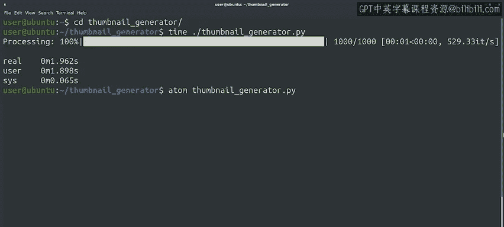
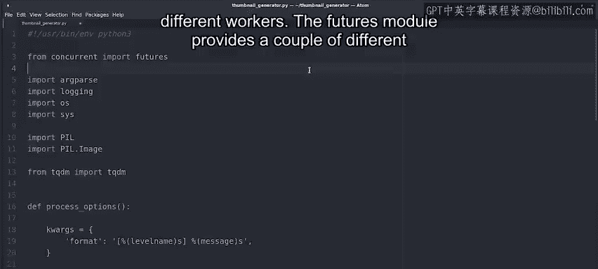
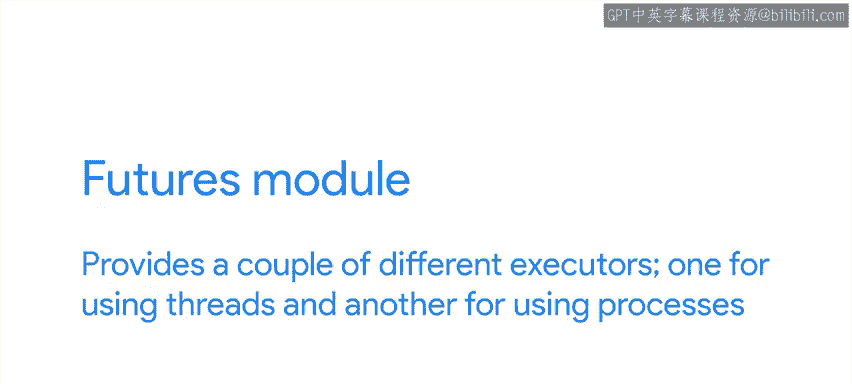
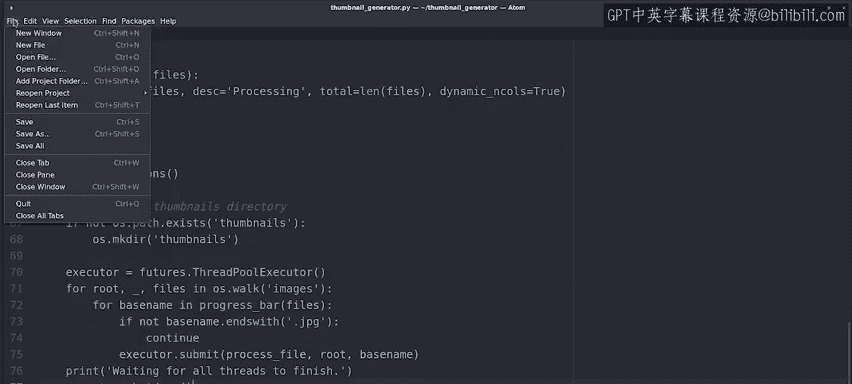
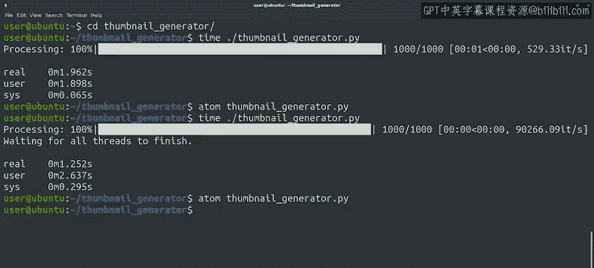
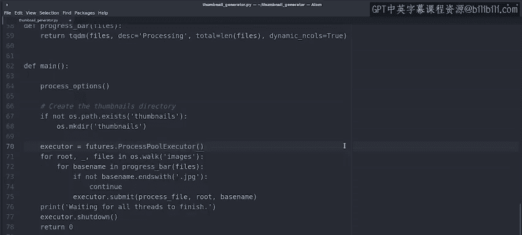
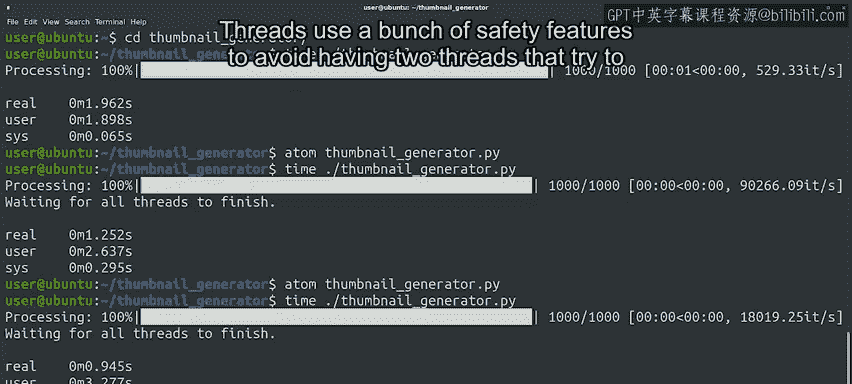

# 谷歌《用Python进行IT自动化办公3、4、5、6课（Git、debug、云端、实践）Google IT Automation with Python》中英字 - P85：27_使用线程加速.zh_en - GPT中英字幕课程资源 - BV1LW4y1F7XW

🎼Yeah。

Our company has an e-commerce website that includes a bunch of images of the products that are up for sale。

 there's a rebranding coming up， which means that all of these images will need to be replaced with new ones。

This includes both the full size images and the thumbnails We have a script that creates the thumbnails based on the full size images。

 but there's a lot of files to process and our script is taking a long time to finish。

It looks like it's time to take it up a notch and use something better to do the resizing We'll start by trying out the current script as is using a set of 1000 test images。

There's more images to convert， but it'll be easier to test the speed of our script with a smaller batch。

 We'll execute our program using the time command to see how long it takes。

It took about two seconds for 1 thousand0 images。 This doesn't seem too slow。

 but there's tens of thousands of images that need converting。

 and we want to make sure that the process is as fast as possible。

Let's try making this go faster by having it process the images in parallel we'll start by importing the future submod。

 which is part of the concurrent module， this gives us a very simple way of using Python threads。

To be able to run things in parallel， we'll need to create an executor。

This is the process that's in charge of distributing the work among the different workers。

The Fus module provides a couple of different executors， one for using threads。

 and another for using processes。

We'll go with the thread Po executor for now。Now， the function that does most of the work in this loop is process F。

Instead of calling it directly in the loop， we'll submit a new task to the executor with the name of the function and its parameters。

Our for loop now creates a bunch of tasks that are all scheduled in the executor。

The executor will run them in parallel using threats。

An interesting thing that happens when we use threads is that the loop will finish as soon as all tasks are scheduled。

 but it will still take a while until the tasks complete。

 so we'll add a message saying that we're waiting for all threads to finish and then call the shuttdown function on the executor。

This function waits until all the workers in the pool are done and only then shuts down the executor。

All right， we've made the change， let's save our script and test it out。

Our scripts now takes 1。2 seconds。 That's a nice improvement over the two seconds we saw before。

See how the user time is higher than the real time。By using multiple threads。

 our script is making use of the different processors available in the computer。

 and this value shows the time used on all processors combined。

 What do you think will happen if we try to use processes instead of threads Let's try this out by changing the executor that we're using。

By changing the executor to the process Po executor。

 we tell the futures module that we want to use processes instead of threads for the parallel operations let's save and try this one out now。

Wow， this is now taking less than a second to finish and the user time has gone up even more。

This is because by using processes， we're making even more use of the CPU。

The difference is caused， by the way， threads and processes work in Python。

 threadreads use a bunch of safety features to avoid having two threads that try to write to the same variable。

 In this means， that when using threads， they may end up waiting for their turn to write to variables for a few milliseconds。

 adding up to the small difference between the two approaches。In this video。

 we looked into how we can add threading support to a Python script to make better use of our processor power there's still more improvements that we can make to our script。

 like checking if the thumbnail exists and is up to date before doing the conversion or adding a second progress bar while waiting for tasks to finish to make it clear that our script is doing its job we won't go into those here but if you're interested。

 you can explore those possibilities on your own up next。

 another reading with pointers to more information followed by the last practice quiz of the module。

