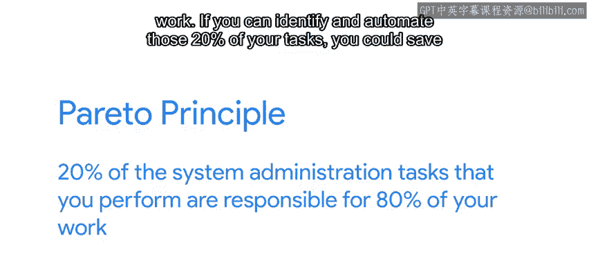
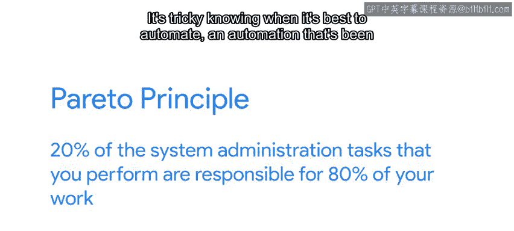
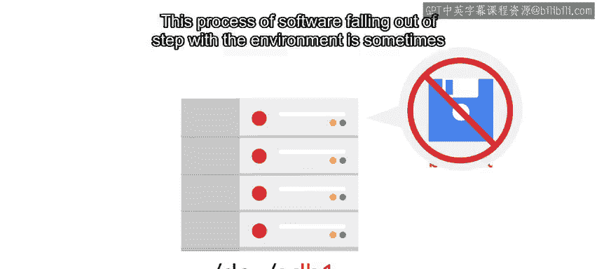
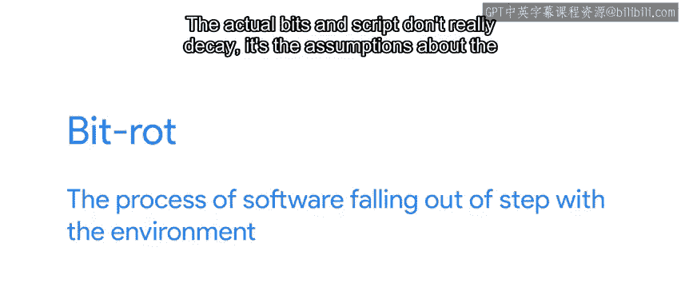
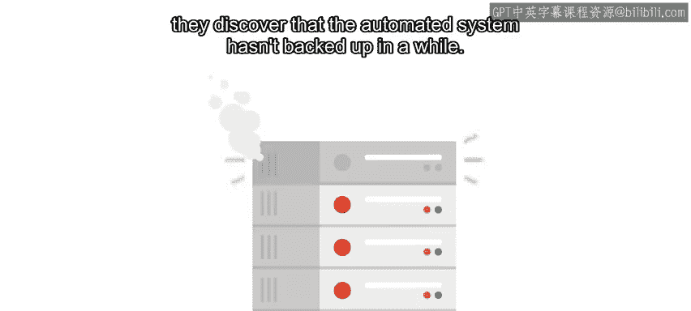
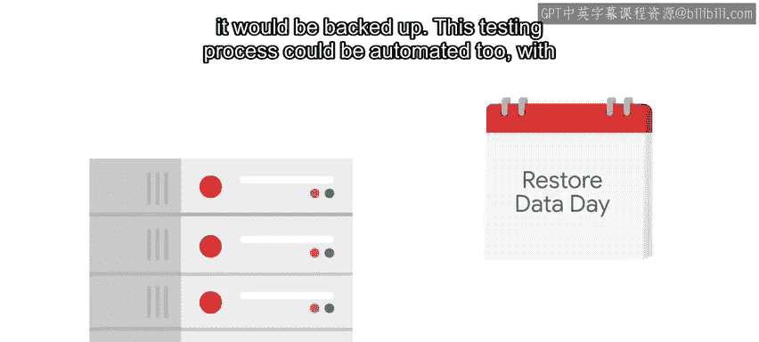
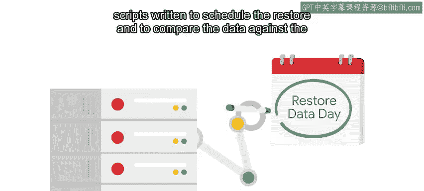

# 谷歌《用Python进行IT自动化办公1、2课（Python、控制操作系统）｜Google IT Automation with Python》中英字幕 - P86：12_自动化的缺陷.zh_en - GPT中英字幕课程资源 - BV1gw411E7E1

🎼。う。

Hands down， automation makes our lives a lot easier， but despite its many benefits。

 when automation is implemented without thoughtful design， it can cause some serious problems。

Let's take a look at some ways that automation can fail and what we can do to avoid them。

Any task or process we automate comes with a tradeoff。

Is it time and the effort it'll take to write the script worth the potential automation benefits？

A simple heuristic that can help us decide is to estimate how long it takes us to do a certain task and then multiply that by how many times we perform that task in a given time window if we estimate that it would take less time to automate the task than it would to do it manually。

 chances are it's a good candidate for automation。So if the time to write the automation is less than the time to perform the task。

 multiply by the amount of times you do it， then automate the task。

Let's check out a real world example。Say you generate a daily report on your system's usage and it takes you five minutes a day to do it。

If automating this task takes you one hour， then in 12 days。

 you've already saved the 60 minutes it took you to create the automation。

This would be a great use of your time as it would free up to those five minutes every day to do something else if instead it takes you 10 hours to create the automation。

 then it would require 120 days or 24 working weeks to start saving time on the task。

That's almost six months until you'd start reaping the benefits of your automation。

It's even possible that by then the requirements for the report will have changed。

 needing even more of your time Usually the decision of whether to automate or not isn't so straightforward。

If a task is complex and performed infrequently， it may seem like automating is more trouble than it's worth。

But keep in mind that once a task is wrapped in automation， anyone can do it。

It can be very useful to automate a complex error prone task if it's critical that the task be done correctly。

 even if it's not executed that often。There are no hard and fast rules on when to automate。

 but the cost time trade off can help guide your decisions。 A concept called the Paretto principle。

Can also be a useful guideline to help you decide which task to automate。

When applied to automation in IT， the Pareto principle states that 20% of the system administration tasks that you perform are responsible for 80% of your work。

If you can identify and automate those 20% of your tasks。

 you could save yourself a whole lot of time。It's tricky knowing when it's best to automate。

 an automation that's been implemented can be fragile。

If underlying systems change and the automation isn't updated accordingly， workflows can break。

Imagine an automated backup system that periodically saves the contents of a sales database。

Let's say the automatic backup program uses a disk identifier like Dev SDDA1 to know where the data to be saved is stored。

What happens if a new disk is added to the server and this identifier changes to dev SDB1？

The automation will no longer be able to access the disk。

 it thinks it should be backing up and it will fail。

This process of software falling out of step of the environment is sometimes called bit rot。

The actual bits in the script don't really decay， it's the assumptions about the implicit signals the script relies on that rot。

It's important to think about how your automation will handle errors。

Automated systems perform actions about human intervention， so it's easy to set and forget them。

If an automated system fails and it goes unnoticed， the consequences can be really bad。

Let's revisit our backup example。Imagine that the backups fail because the diskidentifier has changed。

 and no one notices。 some time later， the sales database server crashes and the data needs to be restored。

The IT specialist will be an in for a nasty surprise when they discover that the automated system hasn't backed up in a while。

False confidence in an automated system may also factor into decision making。For example。

 if the database needs to be upgraded， system administrators may be more willing to proceed with a potentially risky operation since they believe they can recover the data from backups。

 so how can we avoid these silent failures？You can build a method of notification into your automated systems This way。

 the automation fails， a human is notified and can investigate。

This notification method could be an email， a new entry in the internal issue tracker。

 an update to a dashboard， or even a page to the person who is on call for the service。

 whichever the method it's important that the notification services the error so that a person can fix automation。

Borsset in automation failure though， is when automation succeeds but performs the wrong action。

To build on our earlier example， what if the backup system was correctly performing its task but was configured to back up the wrong data？

A restore of the incorrect sales data could lead to data loss or even data corruption。

 where customers might get charged the incorrect amount or billed for products they haven't even purchased。

Oops。Sometimes a task completes， but it completes incorrectly。For this more subtle class of failures。

 we can use periodic tests to check in on the behavior of your automated systems。

In our backup system example， we could schedule a regular restore of data from the sales database and then check that the restored data is what you expected would be backed up。

This testing process could be automated too， with scripts written to schedule the restore and to compare the data against some master data set。

Again， if any part of the resource process fails， the automated system could halt to prevent further data corruption and send a notification to a human who could investigate the problem。

Along with flagging problems， good automation will make debugging easier by logging the actions it takes。

The system law can be an extremely useful source of information when you're investigating an issue。

We say that it's of forensic value。Our scripts can also be configured to write to the system log。

Doing this creates an audit trail of useful troubleshooting information。

 which can help with the debugging process。Automation is an incredibly powerful tool that saves time。

 reduces mistakes， and facilitates growth and scalability。

 but we need to apply it thoughtfully to avoid some of the pitfalls that can arise from its use。

Keep these things in mind， and automation can be a valuable asset in your toolbox。

