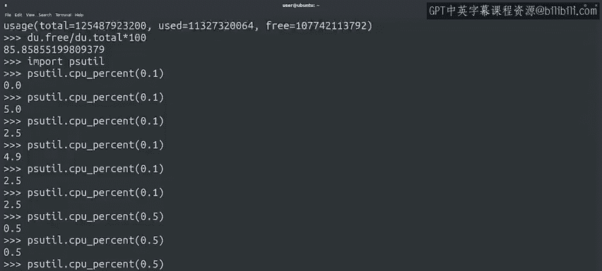
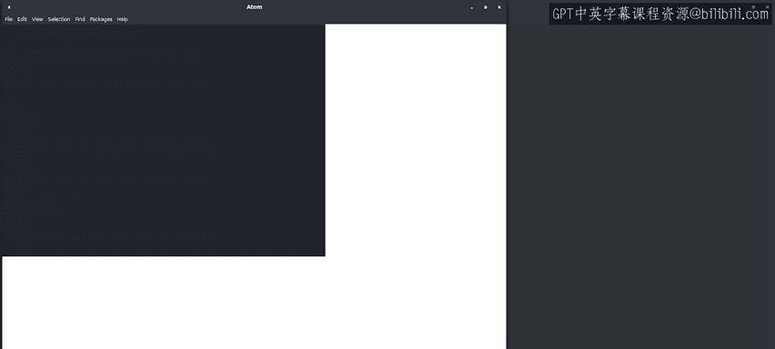
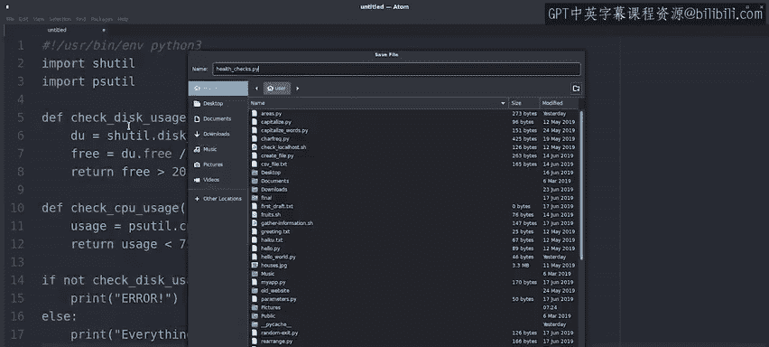
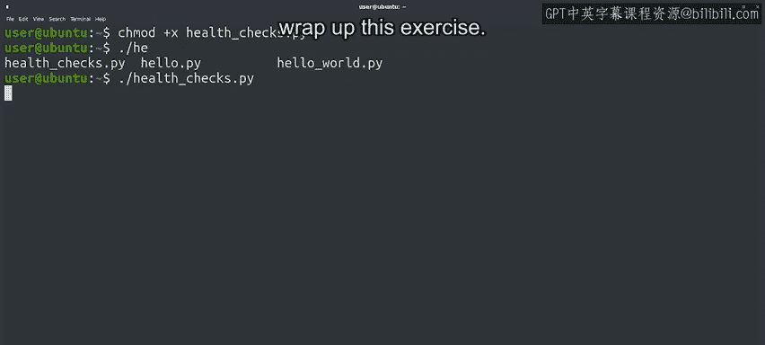

# 谷歌《用Python进行IT自动化办公1、2课（Python、控制操作系统）｜Google IT Automation with Python》中英字幕 - P87：13_实际自动化示例.zh_en - GPT中英字幕课程资源 - BV1gw411E7E1

🎼。う。

So we've talked about the benefits of automation and the things we need to be prepared for。

Let's now look at an example of something we can automate using Python。

 Sa for example that you wanted to check the health of your computer。

This can call for a lot of different checks。Verifying that there's enough disk space。

 that the processor isn't overloaded， that it has the latest security updates。

 and that it's running the services it's supposed to to verify all of this。

 we need to know how to check each of these values。And of course。

 we'll do it by using some of the handy modules available to us。For example。

 we can use the SH U module and the disk usage function to check the current available disk space。

 Let's try it out in the interpreter。We'll start by importing the SX UT module。

Then get the disk usage。Let's print the variable and see what's in it。Cool。

 so we get the total number of bytes on disk， the amount that's used and the amount that's free。

 We can calculate the percentage of free disk space by dividing the number of bytes free by the total and multiplying that by 100。

😊，Allright， but what about CPU usage for this， we can use another module called PSU till。

 This includes a CPU percent function that returns a number showing how much of the CPU is being used。

The amount of CPU used at each instant can change a lot since processes are starting and finishing all the time。

 so this function receives an interval of seconds and returns an average percentage of usage in that interval。

 Let's try it out。We'll start by importing the PSU till module。

Then call the CPU percent function with 0。1 seconds。When we are using interactive interpreter。

 we can use the arrows in our keyboard to get back the lines that we brought before。

 so using the up arrow let's execute the same line a few times。As you can see， this can vary a lot。

 Let's try it with 0。5 seconds。

H see how it's taking longer to finish than previous calls。

 but the numbers are more similar to each other。 that's because the function needs to wait for the given time to calculate the average Okay。

 so we've done a bunch of research Now we can write our health checking script。

We'll kick off with a script that'll do two health checks。

First， we'll set our script to use the pipeline interpreter with the Shaang。

We know that we'll use SHUT and PSUT so let's import those two modules。

Let's first define a check disc usage function that will receive a disk to check and return true if it is more than 20% free or false if it's less。

And now let's write another function called check CPUU usage In this case。

 we'll check the usage for a whole second。We'll say the machine is healthy if the CPU usage is less than 75%。

Great， we have our two functions。Let's now add the main body of our script where we'll check if either of those two functions returns false。

So here we're just printing a message that the usable see。

 We'll improve on the script later on once we've learned better ways of notifying our system administrators。

We're almost done， let's save our script， make it executable and run it。

So there you have it， everything's okay。Which seems like a great point to wrap up this exercise。

All along this course， we'll explore practical automation examples which you'll be able to apply in your job。

And as we talk about the additional functionality available。

 we'll be able to extend our automation knowledge to more and more areas。So how are you feeling。

 Some of this stuff is a little tricky and learning about automation calls for a little bit of manual work。

 The irony isn't lost on us。 So roll up your sleeves and practice these scripts on your computer。

 Also， feel free to rewind and rewatch if you feel a little loss anywhere。😊。

Whether you need to do a little review or you're about to jump straight into the next practice quiz。

 you're doing great， keep at it。