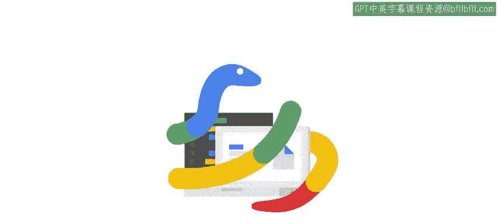

# 谷歌《用Python进行IT自动化办公1、2课（Python、控制操作系统）｜Google IT Automation with Python》中英字幕 - P88：14_模块 1 总结 - 开始使用 Python.zh_en - GPT中英字幕课程资源 - BV1gw411E7E1

🎼。う。

Congrats， you finished the first module of the course and you made it through the first created assessment just like I knew you would。

We've covered a lot of ground in the past videos， so take a moment to congratulate yourself。

Seriously， you should feel really good about this。 Not everyone sticks with it like you have。

Let's quickly recap what you've learned。We've talked about some new concepts and some you were probably already a bit familiar with。

We talked about what operating systems are and why they' relevant to the world of IT。

 We went through how to install Python on your machine， how to run Python scripts。

 how to create our own modules and how to set up your developer environment by choosing a code editor。

 We also learned more about automation， including its benefits and its potential downsides and check out some examples of when it's a good idea to use automation。

We look through the practical automation example that will keep expanding as we get further into the course。

 and last but not least， you did your first Quicklase exercise of course。

 where you put all this new knowledge of practice。You fixed the problem in a Python script。

 making it run correctly， and you also wrote and used your own Python module。 That's amazing。

 Great job。 Take a moment and give yourself a pat on the back。😊。

Your hard work is seriously paying off。Time to take a little break if you need it and come back refresh for the next topic。

In the next module， we'll be talking about managing files with Python。 I'll see you there。

