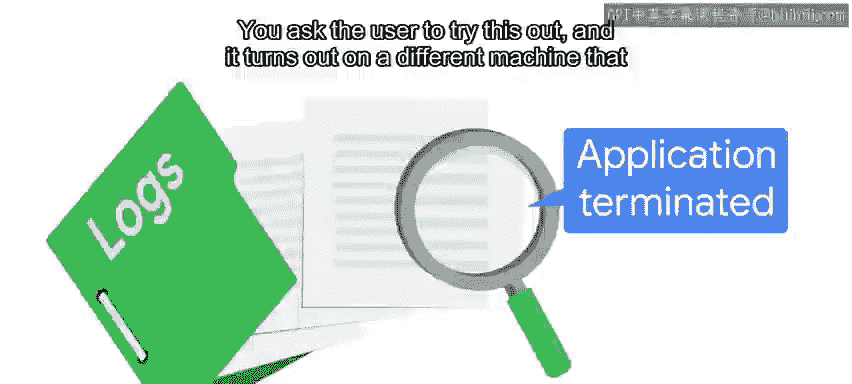
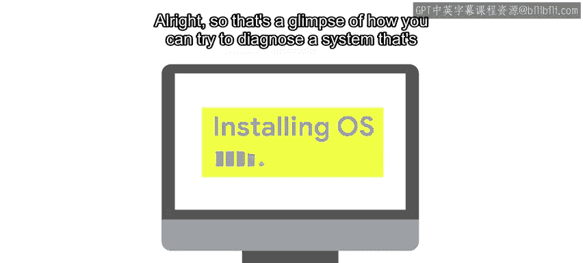

# 谷歌《用Python进行IT自动化办公3、4、5、6课（Git、debug、云端、实践）Google IT Automation with Python》中英字 - P88：30_崩溃的系统.zh_en - GPT中英字幕课程资源 - BV1LW4y1F7XW

。In this video， we're going to talk about system crashes。Gotcha。

 you should have seen the look on your face。But seriously。

 there are a ton of different reasons why applications crash When we come across a program that terminates unexpectedly。

 we go through a usual cycle of gathering information about the crash。

 digging in until we find the root cause and then applying the right fix say for example that a user asks for your help with a problem on their computer when you ask for details the user tells you that the internal billing application crashed while they were trying to generate an invoice for a customer Now this could be caused by lots of different things。

 So what you need to do is reduce the scope of the problem and remember you'll want to start with the actions that are easier and faster to check。

As a first step， you try looking at the logs to see if there's any error that may point to what's happening。

But you only find an error saying application terminated and no useful information。

So you check if the user can reproduce the problem by doing the same action on a different computer。

You ask the user to try this out， and it turns out on a different machine they can generate the invoice just fine。

 so that means that the problem just has to do with the installation or configuration on that specific computer。

Great news。 You've already reduced the scope to something machine specific。

 Another thing that you might want to check is if this happens reliably。😊。

Do all invoice generations fail， I it confined to one specific product or customer for this example。

 let's say that when you ask the user to try generating other invoices， it works just fine。

 even for the same customer。Okay， you think maybe this problem was with the specific order for that specific customer on that specific computer？

That's rather suspicious。But not so fast， the user tells you that after creating all the invoices for the day。

 they tried to generate a report and the application crashed again。But then it worked the next time。

 you double check with other users and find out the application isn't crashing when they use it。

So what does this mean？The application seems to be crashing randomly。

 but only on that computer to further reduce the scope。

 you want to know if it's just that application or the whole system。To check this out。

 you can try moving away the local configuration for the program and using the default configuration instead。

 or maybe even reinstalling the application， you might also ask the user if they've seen crashes on any other application For this example。

 let's say that reinstalling the application and running it with the default configuration still leads to random crashes。

And when pressed to remember， the user tells you that their web browser also crashed last week when they were using the internal webmail。

At this point， the information points to a problem in the overall system。

 either the hardware or the OS installation。If you have a spare computer available。

 it might make sense to give one to the user at this point so that they can go back to work while you try to figure out the root cause of the problem what can you do to further reduce the scope by now there's a high likelihood of the problem being hardware related so one thing you could do is try taking the hard drive out of the computer and putting it into a different computer。

This works best when you already have a spare case that you know works well so that you can use it for tests like these。

That way， you can quickly check if it's a problem with the data in the drive or the rest of the computer。

 let's say that after putting the hard drive in the other computer。

 the applications run without unexpected crashes。This means that some hardware component is at fault。

The next step is to find out which one。Given the random crashes， one thing to check would be the RA。

Memory chips deteriorate over time， and when they do。

 the computer might write data to some part of the memory and then get a totally different value when trying to read it back to check the health of our RAM。

 we can use the MEM Test 86 tool to look for errors。

We run this tool on boot instead of the normal operating system so that it can access all of the available memory and verify if the data written to memory is the same when it tries to read it back。

 if the RA is fine you can check if the computer is overheating by looking at the sensor data provided by the OS and if that's not the case。

 check if there's a problem with external devices like a graphics card or sound card you can do this by disconnecting or replacing the device is present in the computer and checking if the crashes still occur So what can you do if when putting the hard drive in a separate computer。

 you still get the strange crashes。 This means the problem is in the drive itself or the OS installation。

As with RAM， our hard drives age， and at some point the data that the computer reads stops matching what was originally stored。

 each OS ships its own battery of hard drive checking tools。

 and you should familiarize yourself with ones in the OS you're working with。

You'll want to look at the output of the tools that check the disk for bad sectors。

 and you'll also want to use these smart tools， which can help detect errors and even try to anticipate problems before they affect the computer's performance and what can you do if the hard drive turns out to be fine？

You'd need to look into the possible OSs issues， but before doing that， ask yourself， is it worth it？

Looking to what's wrong with the installation can take a lot of valuable time if the installation is easy to replicate。

 then just reinstalling the OS might be faster and simpler than looking into why it broke。

All right， so that's a glimpse of how you can try to diagnose a system that's unstable and behaving in weird ways。

But often you'll be dealing with a specific application that's misbehaving In this case。

 it's almost certainly a bug in the application's code that's not taking into account a situation that though and expect can sometimes occur Up next。

 we'll check out what you can do when that happens。

