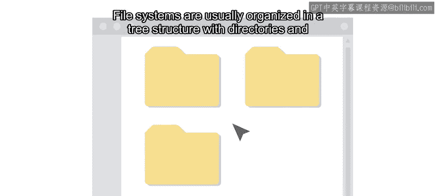

# 谷歌《用Python进行IT自动化办公1、2课（Python、控制操作系统）｜Google IT Automation with Python》中英字幕 - P89：15_使用 Python 编程文件.zh_en - GPT中英字幕课程资源 - BV1gw411E7E1

🎼。う。

Welcome back。 Let's take a quick moment to think back on what you've already accomplished in this course。

😊，In the previous module， you discovered how to install Python and set up your own programming environment。

 Then you learn how to write and execute Python scripts locally。

We then discuss when to consider automating and what problems we might encounter when doing that and to finish up。

 you are introduced to Quick Labs， the platform that will help you keep growing your skills throughout this course。

 Wow， you should be impressed yourself and I hope you're as excited as I am for what's coming up next over the next few videos we'll check out some ways you can use Python and interact with file systems。

As an IT specialist， it's likely that you'll need to manipulate files and directories on a computer a lot。

And when you need to work on a large number of files and directories。

 that's when automation can be a huge help。As a ciss admin in my job。

 I interact with files and directories all the time。

 sometimes even if I have no intention of modifying them。For example。

 I use Python to check if a certain file exists on the file system before doing any other operations。

As you might remember， operating systems like My OS， Windows。

 and Linux use file systems to organize and control how data is stored in access。

Data is usually stored on the disk and saved in files。

 which are held in containers called directories or folders。

File systems are usually organized in a tree structure with directories and files nested under their parents。

We know where a resource， like a directory or a file。

 is located within that tree structure by its path。

An absolute path is a full path to the resource in the file system。For example。

 on a Windows computer， the absolute path to the folder for the user Jordan would be C/ users/ Jordan On a Linux computer。

 the absolute path to the equivalent directory would be/ home/ Jordan。

We call it absolute path because it doesn't matter where in the file system our script is running。

 the absolute path will always lead us to the resource。On the flip side。

 relative paths use only a portion of the path to show where the resource is located in relation to the current working directory。

Relative paths are kind of a shortcut that you can use so you don't have to write out the full file path。

 but keep in mind they only make sense relative to the current location。So for example。

 if we list the contents of the directory examples。

 we'll get different outputs depending on what the current directory is。

If our current directory is/lashho/ Jordan， we'll get the contents of/ho/jordan/ examples。

 but if the current directory is/us/share/ doc/ python 3。

 we'll get the content of/ user/ sharere/ doc/ python 3/ examples。In the upcoming videos。

 we'll do a rundown of the many things that we can do with Python to manipulate files and directories。

We'll also look at specific file format called CSV that we'll use to read and write data。

 So we've got lots of good stuff ahead。 Let's get to it。

