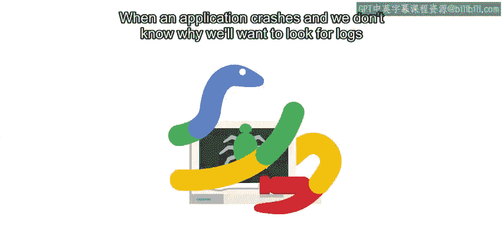
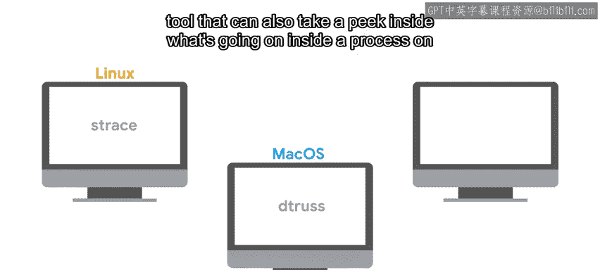
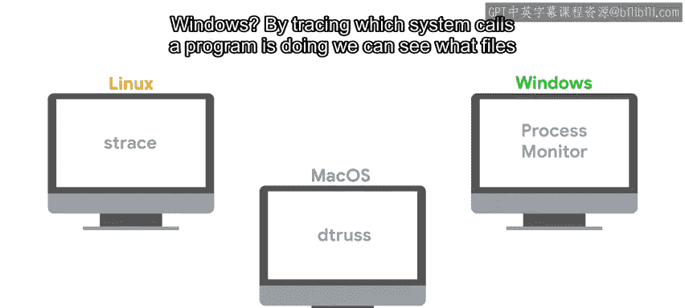
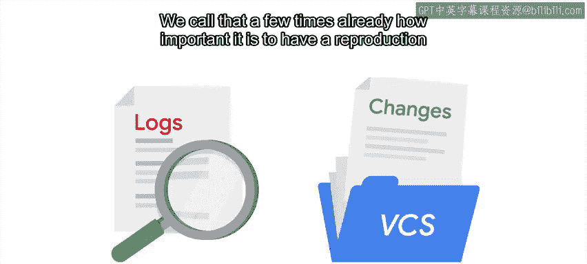

# 谷歌《用Python进行IT自动化办公3、4、5、6课（Git、debug、云端、实践）Google IT Automation with Python》中英字 - P89：31_理解崩溃应用程序.zh_en - GPT中英字幕课程资源 - BV1LW4y1F7XW

🎼Yeah。

When an application crashes and we don't know why， we'll want to look for logs that might relate to the failure to look at logs on Linux。

 we'll open the system log files in Var log。Or the user log files in do accession errors file on Mac OSOS。

 we generally use the console app to look at logs and the event viewer on Windows。

So what kind of data should you look for in these logs。

 most logs have a date and time for each line logged。Knowing when the application crashed。

 you can look for a logline around that time and try to find an error message related to the application that crashed。

 Sometimes the errors will be self explanatory， like permission denied。No such file or directory。

 connection refused。Sometimes it will be a cryptic message。

 and you have no idea what it means whenever we have an error message， no matter how weird it seems。

 we can search that online to try to figure out its meaning。If we're lucky。

 we might find the official documentation of what that error means and what we can do about it。

 but even if that's not available， we'll usually come across posts by others who've tackled a similar error and this additional information can help us understand what's going on if there are no errors or the errors aren't useful。

 we can try to find out more info by enabling debug logging。

Many applications generate a lot more output when debugging logging is enabled。

 we might need to enable it from a setting in the applications configuration file or a command line parameter to pass when running the application manually。

By enabling this extra logging information， we can get a better idea of what's actually causing the problem。

 and what do we need to do if there are no logs or error messages at all？In that case。

 we need to use tools that let us see what's going on inside the program we called that a few already on Linux。

 we use Strace to see what system calls a program is doing。

The equivalent tool is called Dtrus on Mac OS OS Process Monitor is a Windows tool that can also take a peek inside what's going on inside a process on Windows。

By tracing which system calls a program is doing， we can see what files and directories it's trying to open。

 what network connections it's trying to make， and what information it's trying to read or write this can give us a better idea of what caused the actual problem we could find that the problem is caused by a resource not being present that the program expects to be present like we saw with the missing directory example in the earlier module or we could find that the program tries to interact with the graphics interface and there isn't any because it's a service running on a server。

Or the program tries to open a file， but the user running the software doesn't have the necessary permissions If the application used to work fine and recently started crashing。

 it's useful to look into what changed in between The first thing is to check if the issue is caused by a new version of the application itself。

Maybe there's a bug in the new version that causes the crash or maybe the way that we're using the application is no longer supported。

 but that's not the only possible change that could trigger crashes。

 it could also be that a library or service used by our application changed and they no longer work well together。

Or it could be that there was a configuration change in the overall environment。

 like if the user isn't in a specific group anymore。

 or if the files that the application used are in a different location。

 when trying to figure out what changed， logs can also be a useful source of information。

In the system log， we can check which programs and libraries were recently updated。

 checking for configuration changes might be harder depending on how you manage that configuration。

 if the settings are managed through a configuration management system and the values are stored in a version control system。

 then you might be able to look at the history of changes and figure out which one triggered the failure。

We called out a few times already how important it is to have a reproduction case for a problem that we're trying to solve when we're trying to debug an application that crashes。

 finding a reproduction case can help us both understand what's causing the crash and figure out what we can do to fix it。

 so it's valuable to spend some time figuring out the state that triggers the crash This includes the overall system environment。

 the specific application configuration， the inputs to the application。

 the outputs generated by the application， the resources it uses and the services it communicates with when trying to create the reproduction case it might be useful to start from a clean slate and slowly put the pieces in place until the crash triggers。

This might include trying out the application with the default configuration instead of the local one or on a freshly installed computer instead of the computer where it's crashing。

 and remember we want to make the reproduction case as small as possible this lets us better understand the problem and also quickly check if it's present or not when we attempt to fix it。

And even if we end up unable to fix the issue， having a small and simple reproduction case is extremely helpful in reporting a bug to the program's developers。

So to sum this up， to find the root cause of a crashing application。

 we'll want to look at all available logs， figure out what changed。

 trace the system or library calls the program makes。

 and create the smallest possible reproduction case。After doing all of this。

 we should have some idea of what the root cause of the issue is and maybe even how to fix it。

The strategy for fixing problems will depend on whether we can fix the code or not in our next video。

 we'll check out what you can do when you can't fix the program and need to work around the issue。

And in later videos， we'll deep dive into strategies for fixing faulty code。

