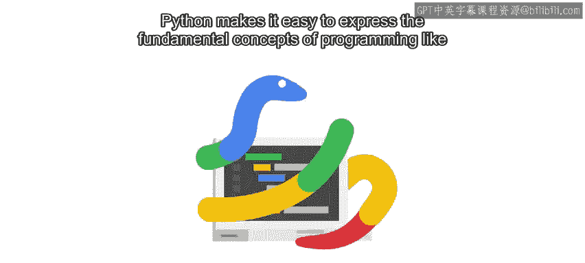

# 谷歌《用Python进行IT自动化办公1、2课（Python、控制操作系统）｜Google IT Automation with Python》中英字幕 - P8：7_Python 与 IT 的相关性.zh_en - GPT中英字幕课程资源 - BV1gw411E7E1

🎼Yeah。

Remember how we mentioned that Python is simple and easy to use。

 Python makes it easy to express the fundamental concepts of programming like data structures and algorithms with easy to read syntax。

 This makes Python a great language to use to learn programming。

 And there are other reasons to pick Python too。 Python is super popular in the I T industry。

 making it one of the most common programming languages used today。 Python isn't new。

 Its first version was released by Gido Van Rossom back in 1991。 Since then。

 the community that develops it has grown， and the language has advanced a lot。😊。

Whenever there's a significant change to the semantics or syntax of the language。

 a new major version is released。 In 2000， Python 2 was released In 2008， we got Python 3。

 In this course will use Python 3。7， which came out in 2018。 For many years。

 Python was considered a beginner's language。 and was mostly used for teaching concepts or writing very small。

 simple scripts， like in this course。 But in recent years。

 the adoption of Python has grown dramatically。 One reason for this is that the language has become more powerful。

 It's also because there's more tools available in Python for a growing range of applications。

 You can use Python to calculate statistics。 Run your ecommerce-commerce site。

 process images interact with Web services and do a whole host of other tasks。

 Python is perfect for automation。 It lets you automate everyday tasks by writing simple scripts that are easy to understand and easy to maintain。

 That's why Python is the language of choice for lots of people working in I T support system administration。

😊，And web development。Not only that， but it's also used in fast growing areas of I。

 like machine learning or data analytics。 Last but not least。

 Python is available for download on a wide variety of operating systems like Windows。

 Linux and Macs。 And what's more Python is so popular in the workplace that if you are currently working in I。

 you've most likely encountered it already。 And if you're planning her career in it chances are。

 you'll interact with Python quite a bit。 So there's a whole lot of reasons for why Python is relevant to today's I industry。

 A large part of programming is learning through trial and error and asking questions。

 So if at any point you get stuck， don't get discouraged， making mistakes helps you improve。

 The more you see failure or broken code as an opportunity to learn the quicker you'll master programming。

 I remember the first Python script I ever wrote， it took a lot of refactoring。

 debugging and testing to get it to work。 I relied on a lot of my teammates for help and mentorship and wound up spending。

😊，More time on stack overflow than actually writing the code。Thankfully。

 you don't have to reinvent the wheel。 There's almost always someone on the internet who's tried to do what you're doing and can help point you in the right direction when you're stuck。

Sometimes it takes a village。 It's really important to keep in mind that even experienced programmers may need to ask a colleague a question from time to time or look something up on the Internet。

 whether you're a programming novice or have some experience in software development。 Remember。

 the best programmers overcome challenges by seeking help or using other resources。

 Once you've completed this program， you'll be well on your way to confidently programming in basic Python。

 There's lots of information online that will help you continue to develop your programming skills。😊。

For example， there are lots of online courses for specific programming languages。

 You'll find answers to your Python coding questions in the official Python documentation。

 You can use sites like stack Overflow to discuss and share with other developers。

 and you can ask questions in our discussion forums。

 You can even subscribe to some of the Python mailing lists to keep in the know on the latest updates to the language。

 You're opening the door to the whole world of programming。

 And it's super exciting to be joining the development community。

 The most important thing to remember， is that you're never alone。

 Any questions you may have any time in your career。

 There are resources out there to help you find the answers you need。 Wow。

 that was a lot of information。 Feel free to take a quick break。

 Gr something a drink and then head on over to the supplemental reading to learn more about Python and the resources out there to help you learn。

😊。