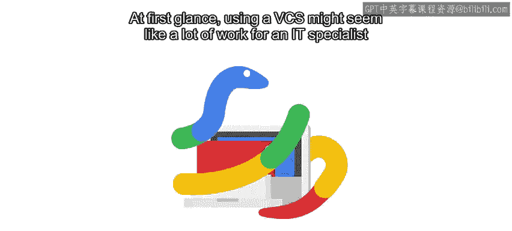
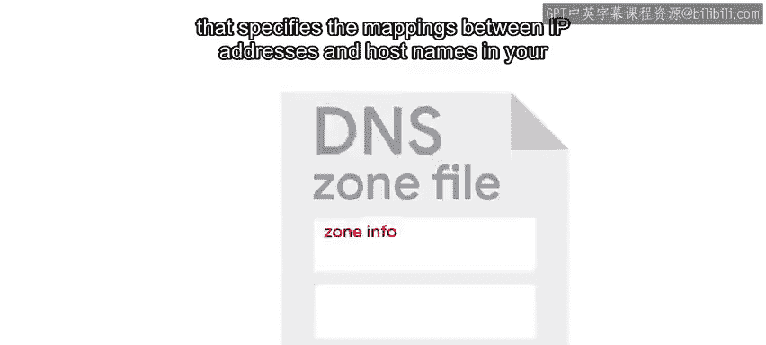
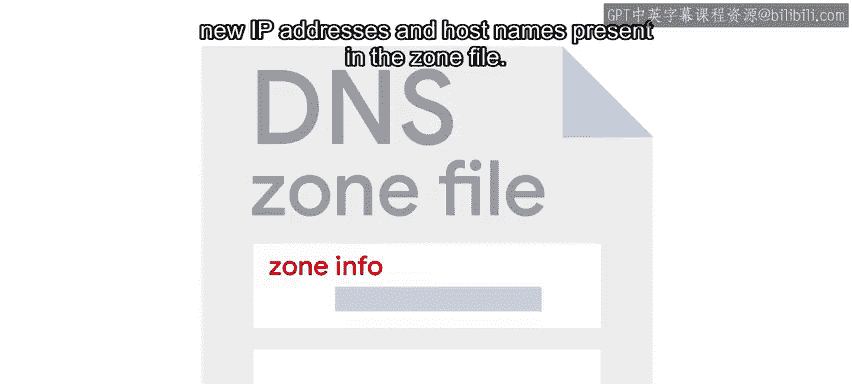
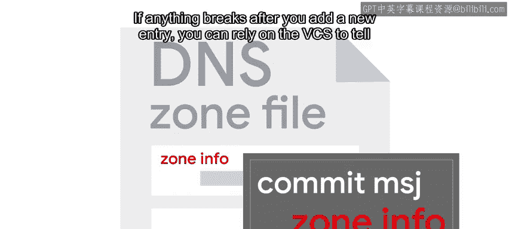
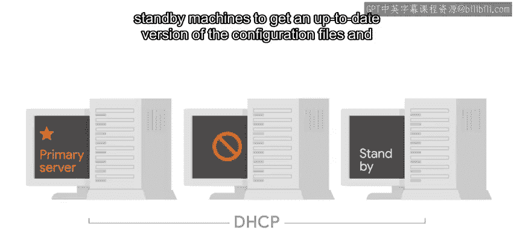
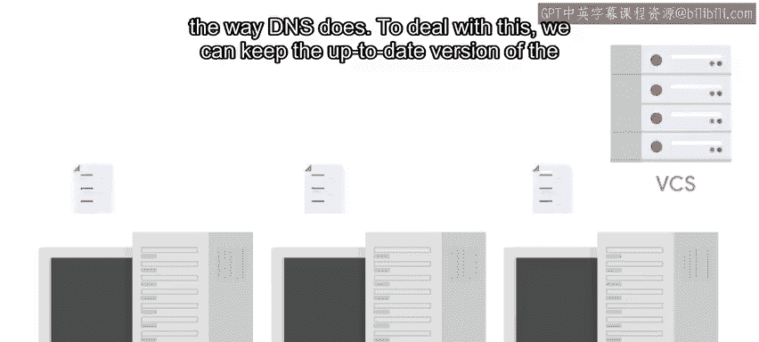

# 谷歌《用Python进行IT自动化办公3、4、5、6课（Git、debug、云端、实践）Google IT Automation with Python》中英字 - P8：7_版本控制与自动化.zh_en - GPT中英字幕课程资源 - BV1LW4y1F7XW

🎼。う。

At first glance， using a VCS might seem like a lot of work for an IT specialist to set up and learn。

It might especially seem like overkill if you're the only member of your IT team that writes code。

 or maybe even the only member period。So can a VCS help even if you don't need to share your scripts or collaborate on them with others？

The short answer is yes。A VCS can be invaluable even in a one person IT department。

A VCS stores your code and configuration， and it also stores the history of that code and configuration。

A version control system can function a lot like a time machine。

 giving you insights into decisions of the past。Whenever you write a commit message after making a change。

 it's as if the current version of yourself is explaining your decisions to a future you， or。

 you know， others who might work on the same scripts and configurations in the future。

This can help you avoid finding yourself staring at a piece of code that you or someone else wrote three months ago and puzzling over how it works or even why it exists。

With a VCS， you can view， track， and select snapshots from the history of your project。

 so nothing you do is lost。And since we can use a VCS to store both code and configuration files。

 we can make the overall IT systems more scalable and reliable。 For example。

 let's say you've stored the DNS zone file for your company and a VCS。

And in case you don't remember， a DNS Zone file is a configuration file that specifies the mappings between IP addresses and host names in your network。

When you update the zone information。

Always use good explanatory commit messages。That way。

 you'll have access to meta information about your new IP addresses and host names present in the zone file。

 like when they were added and for what purpose。

If anything breaks after you add a new entry， you can rely on the VCS to tell you what the file looked like before the change。

You can then revert to the old version quickly so you can fix the problem fast and figure out what went wrong later This functionality enhances the reliability of systems you operate because of the audit trail provided by the VCS。

 you know exactly what version of the zone file to row back to。

 which reduces the time it takes to fix the problem。

It's generally better to quickly roll back first and stop errors before spending time figuring out what and wrong。

You can curb the fix after the bleeding is stopped。

Figuring out the bug might take up valuable time or worse。

 your first attempt at a solution could have its own bugs。 Let's look at a different example。

The configuration for a DHCP Damon can be replicated in two or more machines。

 where one acts as a primary server and the other one acts as a standby machine。

The standby machines won't do much while the primary is up。

But if the primary goes down for any reason， a standby machine can become primary and start responding to DHCP queries for this to work。

 the configuration files on all machines need to be identical。

This is because the DHCP protocol doesn't provide a way for standby machines to get an up to date version of the configuration files and the way DNS does To deal with this。

 we can keep the up to date version of the DHCP configuration in a version control system。

And have the machines download the configuration from the VCS。

This means all the machines will have the exact same files。 That's already handy enough。

 but after using it for a while， you're bound to see other benefits。

Say you get an urgent alert over the weekend， telling you that your DHCP server isn't responding to any queries。

You look at the history of the changes and you find that one of the changes added on Friday evening included a duplicated entry causing the server to misbehave。

By using a VCS， you can easily roll back the change and have the servers back to health in no time。

 you might come across a second unexpected benefit when it's time to replace the server with a new one。

By having all the server configuration and a version control system。

 it's much easier to automate the task of deploying a new server。

 Are you starting to see how useful version control systems can be。

You might even be thinking of some situations when。

Having your files in a VS would have saved you a few headaches。 As we said in the beginning。

 in this course， we'll use Git， which is one of the most popular versionrgin control systems in use today。

Up next， we'll learn a bit about the history of Git and what makes it so special。

