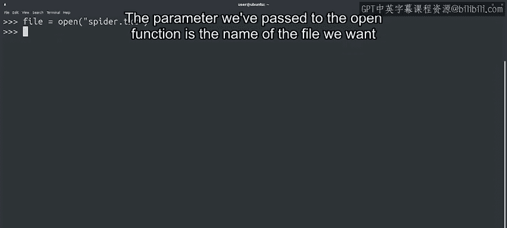
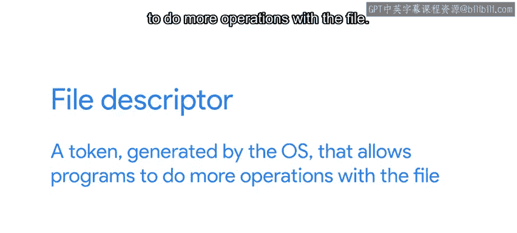
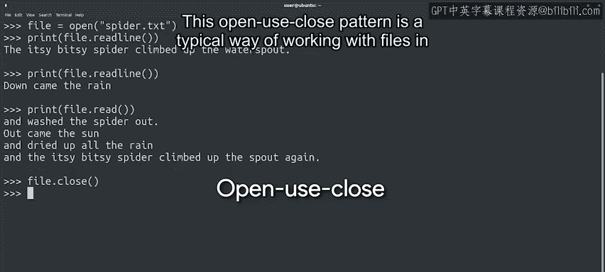
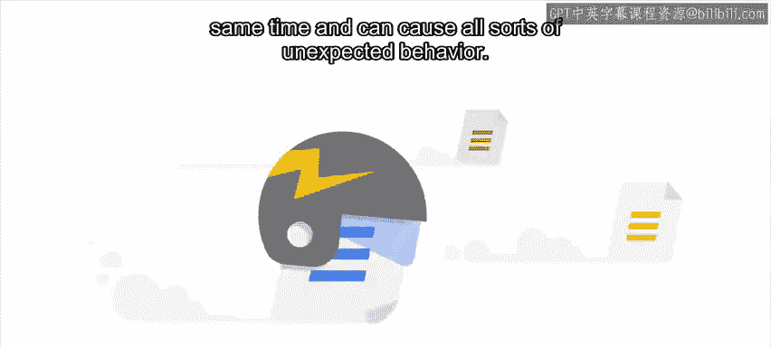
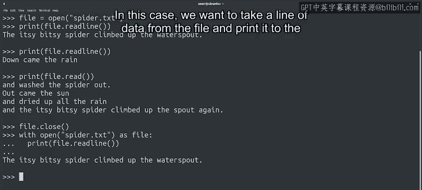

# 谷歌《用Python进行IT自动化办公1、2课（Python、控制操作系统）｜Google IT Automation with Python》中英字幕 - P90：16_读取文件.zh_en - GPT中英字幕课程资源 - BV1gw411E7E1

In the introductory course of Python， we provided information to our scripts by creating variables and passing parameters to our functions with the values that we wanted。

This works fine for small scripts， but it's usually not ideal for larger jobs。

When processing large chunks of data， it's a good idea to read that data from files。In programming。

 we work with files all the time。It's such a useful task that most programming languages have the ability to work with files baked into their core set of features。

Python is no exception。 It gives us file objects， which we can use to read and write to files。

To open a file on our computer called Spidder。txt， we can write this code。

What we're doing here is creating a new file object and assigning it to a variable called file。

The parameter we've passed to the open function is the name of the file we want to open。

In this case， we're assuming the file we want to read is in the same directory as a script we're running。

 but we can just as easily pass an absolute path to open a file in a different directory。

When we open a file， like we're doing in this example。

 the operating system checks that we have permission to access that file and then gives our code a file descriptor。

This is a token generated by the OS that allows programs to do more operations with the file。

In Python， this file descriptor is stored as an attribute of the files object。

The file object gives us a bunch of methods that we can use to operate with the file。Now。

 with this file object， we can read the contents of the file and print them to the screen。

Here we've used the Read line method。It lets us read a single line of the file。 Let's call it again。

 see what happens。Nice， this time， we got the second line of the file。So how does this work？Well。

 each time we call the read line method， the file object updates the current position in the file。

 so it keeps moving forward， we can also call the read method。

 which reads from the current position until the end of the file instead of just one line。

And washed the spider out， out came the sun and wait， wait， wait， don't go。

 you don't like my singing。That's okay。 Let's check out the other example。

The file here has six lines in total。 We read the first two with our calls to read line and then the other four altogether together with the call to read。

Just like Read line， the Read method starts reading from wherever we currently are in the file。

But instead of this one line， it reads all the way through to the file end。Finally。

 we'll close the file using the Close method。This open use closed pattern is a typical way of working with files in most programming languages。

It's a good idea to close files after you've opened them for a few reasons。First。

 when a file is open in your script， your file system usually locks it down。

 and so no other programs or scripts can use it until you're finished。Second。

 there's a limited number of file descriptors that you can create before your file system runs out of them。

 although this number might be high， it's possible to open a lot of files and deplete your file system resources。

This could happen if we're opening files in a loop， for example。Third。

 leaving open files hanging around can lead to race conditions。

 which occur when multiple processes try to modify and read from one resource at the same time and can cause all sorts of unexpected behavior no one wins in a race condition。

Now I'm going to let you in on a little secret。I'm the worst at remembering to close my files。

 and you might agree with me。 it could get pretty hard to keep track of what files you've opened and then to remember to close them。

Fortunately， the creators of Python agree。 So to help us remember to close a file after we're done using it。

 Python lets us create a block of code by using the keyword with。😊，Let's see what that looks like。

As you can see， the width keyword lets us create a block of code with the work we want to do with the file inside of it。

In this case， we want to take a line of data from the file and print it to the screen。

 which is what print file Readline does。

When we use a width block， Python will automatically close the file。

 so we don't need to remember to do that ourselves。Few。One less thing to think about。 Thanks， Python。

 both the open use close approach and the width approach have their advantages。

Using a width block is a good way to open and work on a single file。

 then have the file automatically closed at the end of the block。On the flip side。

 using open outside of a block means we can use the file object in other places in our code。

 so we're not restricted to just one single block。But when taking this approach。

 we need to remember to close it when we're finished。Okay。

 I hope this helps you feel pretty comfortable with how to open， read and display a file。

 In the next video， we're going to check out some ways of iterating through the contents of the file。

😊。