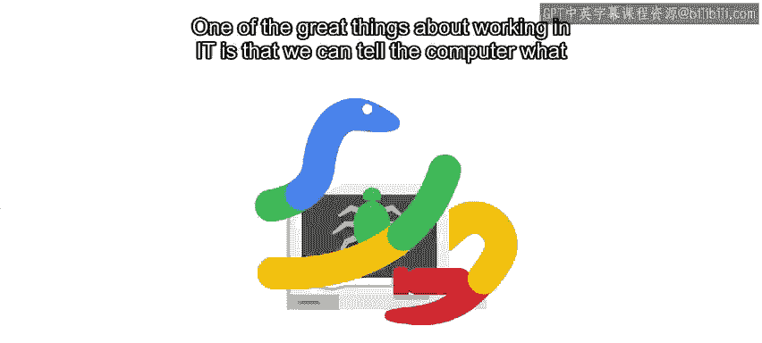
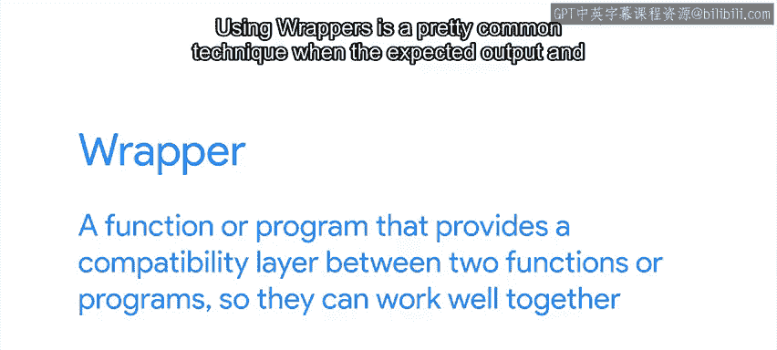
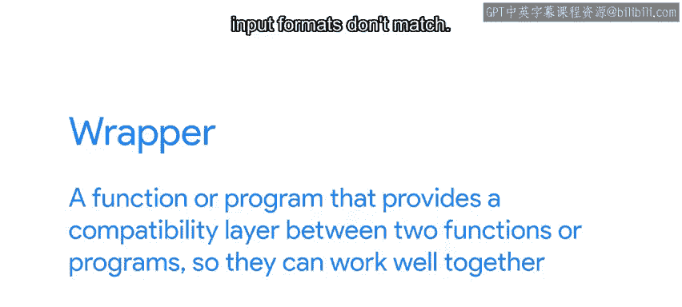
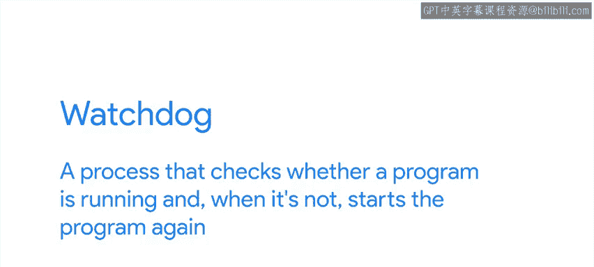
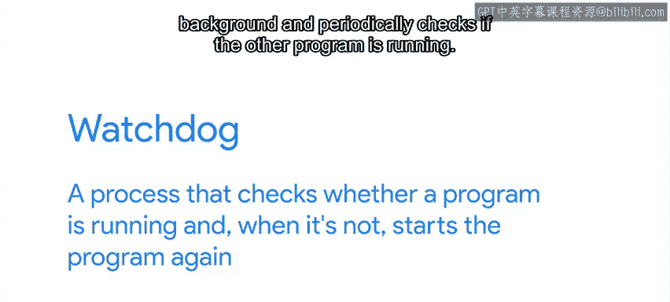
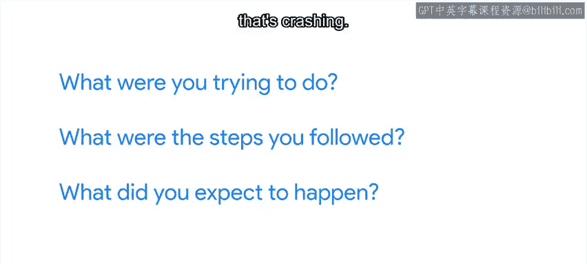

# 谷歌《用Python进行IT自动化办公3、4、5、6课（Git、debug、云端、实践）Google IT Automation with Python》中英字 - P90：32_无法修复程序时该怎么办.zh_en - GPT中英字幕课程资源 - BV1LW4y1F7XW

🎼Yeah。

One of the great things about working in IT is that we can tell the computer what to do and it will follow our orders。

When dealing with unexpected behavior in the software written by other people， though。

 we might not always be so lucky， it could be that we're dealing with proprietary software and the source code isn't available at all。

 or we might have access to the source code， but it's written in a language that we don't understand and so we can't change it。

 no matter the reason， what can you do if you need to fix an application that crashes and you can't change the code。

You'll need to figure out a way of working around the problem and avoiding the crash the actual workaround will depend on what the issue is that you're trying to solve let's do a rundown of some of the available options say you figured out that the issue is caused by a specific data input that makes the application crash the crashes only happen when the input isn't in the format the code expects。

Some of your systems generate data in XML format， which used to work fine with the previous version of the software。

But the new version now requires all data to be in a YaAML format。In this case。

 you could write a script that preprocesses the data and make sure that it's in the format that the program expects。

 Similarlyly， if the problem is caused by an external service that the application uses and that's no longer compatible。

 we could write a service to act as a proxy， and make sure that both sides see the requests and responses they expect。

This type of compatibility layer is called a wrappper。

 a wrappper is a function or program that provides a compatibility layer between two functions or programs so they can work well together。

Using wrappers is a pretty common technique when the expected output and input formats don't match。

So if you're faced with some sort of compatibility problem。

 don't be afraid to write a rapper a work around it Another possibility you might need to look at is if the overall system environment isn't working well with the application in this case。

 you might want to check what environment the applications developers recommend。

And then modify your systems to match that this could mean running the same version of the operating system using the same version of the dynamic libraries or interacting with the same backend services。

 say the application was developed and tested on Windows 7。

If you run into problems while trying to run it under Windows 10。

 you might want to use Windows 7 instead。Or if the application was developed and tested for Ubutu and you're having trouble running it under Fiora。

 you might want to try running it on Ubutu instead。

 and what can you do if you can't make the environment match？This could happen， for example。

 if there's another application that requires a different version of the same library。

 or you can't change a certain configuration setting because it's required to access a different service in this case。

 you might want to consider running the application inside a virtual machine or maybe a container。

These are two different things， but we won't go into details of how they're different here。

All you need to know right now is they both let you run the affected application in its own environment without interfering with the rest of the system。

 This is what we need if we want the environment to be different than the one other applications are using on the same computer sometimes we can't find a way to stop an application from crashing。

 but we can make sure that if it crashes， it starts back again to do this。

 we could deploy a watchdog this is a process that checks whether a program is running and when it's not starts the program again。

To implement this， we need to write a script that stays running in the background and periodically checks if the other program is running。

Whenever the check fails， the watchdog will trigger the program to restart。

Doing this won't avoid the crash itself。But it will at least ensure that the service is available。

 This works well for services where availability matters more than running continuously。

And no matter how you work around the issue， remember to always report the bug to the application developers。

As we called out， if you have a good reproduction case for your issue。

 it makes it easier for the developers to figure out what's wrong and how to fix it。

So when you report a bug， make sure you include as much information as possible。

 share a good reproduction case and answer the questions that we mentioned earlier on。

 what were you trying to do？What were the steps you followed？What did you expect to happen？

What was the actual outcome Up next， we'll see how to apply these skills to troubleshoot an application that's crashing。

