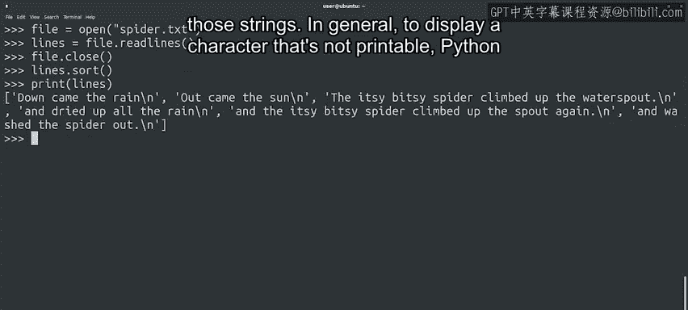

# 谷歌《用Python进行IT自动化办公1、2课（Python、控制操作系统）｜Google IT Automation with Python》中英字幕 - P91：17_遍历文件.zh_en - GPT中英字幕课程资源 - BV1gw411E7E1

We just took a look at the read line and read methods。

 which allow us to read a single line of the file or the whole contents of the file right to the end。

 along with this， file objects can be iterated in the same way as other Python sequences like list or strings。

This is really useful when you want to process a file line by line。Say for example。

 you want to make a whole line uppercase before printing it。You can do that with something like this。

Cool， it looks like that worked。But what are these weird， empty lines between the contents。

Any idea what's going on？What's happening is that the file has a new line character at the end of each line。

So when Python reads the file line by line， the line variable will always have a new line character at the end。

In other words， the new line character is not removed when calling Read line。

And when we ask Python to print the line， the print function adds another new line character。

 creating an empty line。H what can we do to avoid getting the empty lines？

We can use a string method strip to remove all surrounding white space。

 including tabs and new lines like this。Awesome， now that we use strip to remove the new line character。

 we get the output without empty lines， just like we wanted。

 Another way we can work with the contents of a file is to read the file lines into a list。😊。

Then we can do something with the list like sort contents。 To do that。

 we open the file and use the read lines method。 Let's see how that looks。😊，First， we open the file。

Then read all the lines。And now we close the file。Even though the file object is now closed。

 the lines variable has the list of lines in the file so we can operate on it。For example。

 let's sort it and print it。There are two things to check out in this code。First。

 the lines have been sorted alphabetically， so they're no longer in the order that they were in the file。

And second， we can see that Python displays a new line character using backslash and symbol when printing the list of strings。

This is a way of explicitly showing that there's a new line character in those strings。

In general， to display a character thats not printable。

 Python uses escape sequences with backslash like backslash N。

 Another common escape sequence is back slash T for tap。

And we can also use it for escaping quotes if we have a string that contains either a single or double quote。

A quick word of caution， methods like read or read lines that read the whole file at once are useful。

 but we should be careful when reading the entire contents of a file into a variable of our programs。

If the file is super large， it can take a lot of our computer's memory to hold it。

 which can lead to poor performance。If a file' is just a few kilobytes， like in our example here。

 it's fine to read it and process it completely in memory。

 but for large files like a big log file of hundreds and hundreds of megabytes of data。

 it's more efficient to process it line by line。How's this all sounding？Let's do a quick recap。

We've just learned how to open files using the open function and how to read those files using methods like read and read lines。

We also learned how to iterate through a file line by line using the read line function and four loops。

Up next， we're going to learn how to write content to files。

