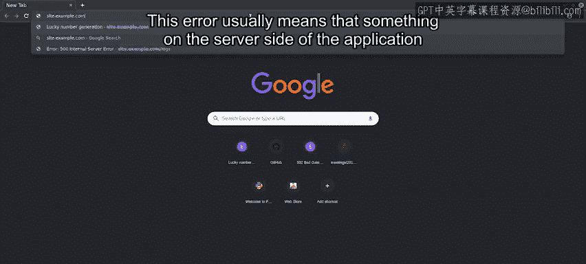
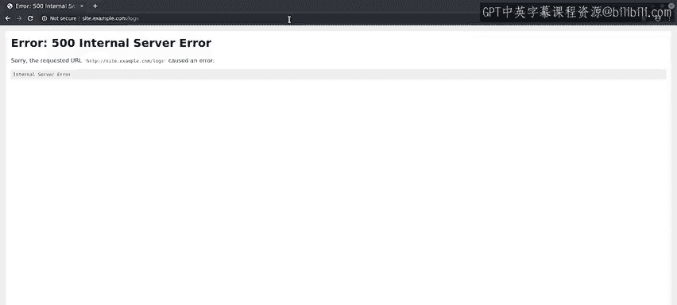
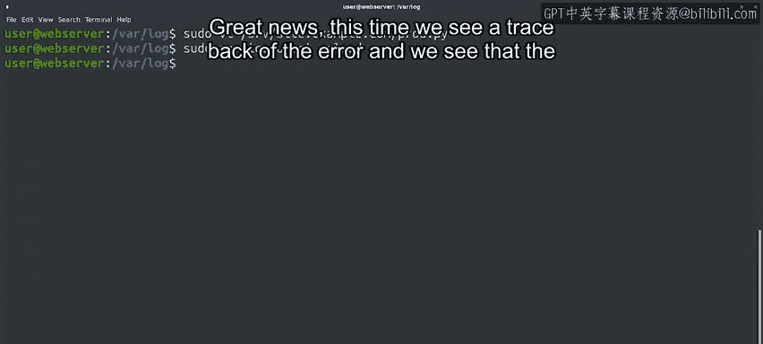
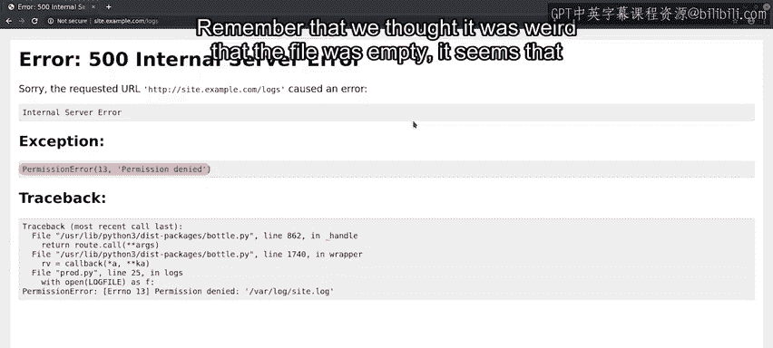
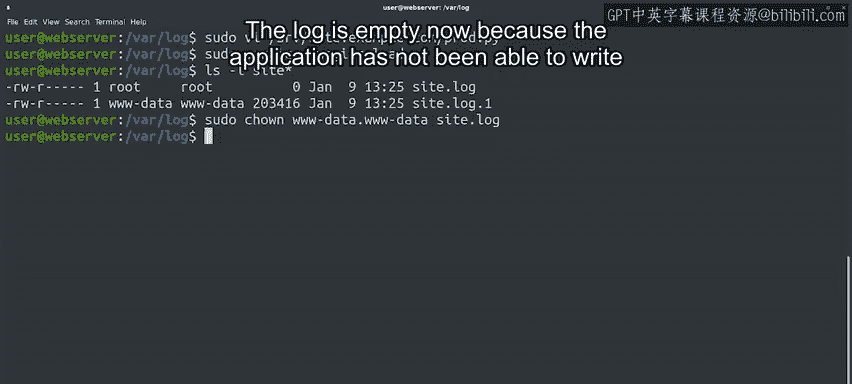
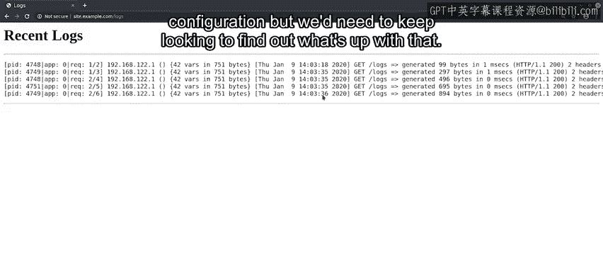

# 谷歌《用Python进行IT自动化办公3、4、5、6课（Git、debug、云端、实践）Google IT Automation with Python》中英字 - P91：33_内部服务器错误.zh_en - GPT中英字幕课程资源 - BV1LW4y1F7XW

。

A colleague has alerted us that a webage on our web server isn't working。As we've done before。

 we need to figure out what this means exactly。We asked our colleague for more details。

 and they told us that the failing webpage is at site。example。com/loglogs。

 Let's check out if this is failing for us as well。😊。

There it is， the server responded with a 500 error。

This error usually means that something on the server side of the application crashed。

But we have no idea what。We'll need to investigate to find out more information。

Let's connect to the web server and try to figure out what's up。The first step is looking at logs。

 as we called out， on Linux systems， logs are located in Var log。To do that。

 we'll use the date command to check the current date。

 Let's change into that directory and check out if there are any recent logs about our error。

And then the LS LT command， which sorts the files by the last modified date。

 connecting it to the head command to keep the top 10 lines。H， we just triggered the error。

 but there doesn't seem to be anything recent in the logs。Just in case。

 let's check out the last lines in cislog using Ta。Nope， nothing interesting here。

We need to figure out how we can get more information。

 but we don't even know which web serving software is being used on this computer。

But we do know that the web server is running on port 80， the default web serving port。

How can we find which software is listening on port 80？We can use the NetStack command。

 which can give us a bunch of information about our network connections depending on the flags we pass this command accesses a bunch of sockets that are restricted to Root。

 the administrator user on Linux， so we'll need to call it with pseudo。

 which lets us run commands as root。And then we'll pass a bunch of flags to NetSSt we'll use dash N to print numerical addresses instead of resolving host names。

L， to only check out the sockets that are listening for a connection and P to print the process ID and name to which each socket belongs。

 and since we only care about Po 80， we'll connect that output to a Grub command。

 checking for colon 80。Great， we got new information we see that the process listening on port 80 is called Engine X。

 one of the popular web serving applications out there we now want to check out the configuration for our site。

😊，Configuration files on Linux are stored in the Etsy directory， so let's look at Etsy EnGX。

There's a bunch of files here， lots of different configuration options that you can set in the web server we're looking for the configuration related to a specific site。

 so let's look in Etsy and GenX sites enabled。😊，There are two files here， one for the default site。

 and one for the site。example。com site。That's the one we want。 Let's open it with the VI editor。哈。

There's not a lot here， but at the bottom we see that it says UWSGI Pass and then the local host address followed by a different port number It seems that this website isn't being served directly from EngineX Instead the software is passing the control of the connections to UWSGI。

 which is a common solution used to connect a web server to programs that generate dynamic pages so let's see if we can find the configuration for that one will exit ViI with the colon Q and then see if there's anything interesting in Etsy UWSGI。

Here we only see two directories， apps available and apps enabled， let's see what's in apps enabled。

Cool， we found the UWSGI configuration for our site， let's check it out。Nice。

 this file has a lot more information， we see that the main directory for the application is srvsite。

example。com that the applications run as the www data user and group that it's running a Python3 script called Prad。

 Pi that the log is stored in var log site。logg and a bunch of other things。All right。

 let's use this extra information and see if we can find out what's up。

Let's exit with Colon Q once more and then check out that log file。Weird。

 the log file has a size of zero。That doesn't seem right。

 Let's see if we can find out anything else by looking at the Python script that's executed by UWSGI。

SRV site。example。com Pradapi。There's a few different web pages configured in this file it uses Bo。

 which is a Python module to generate dynamic web pages At the bottom。

 we see the configuration for the logs page that's currently failing。Holpefully。

 a colleague left a comment saying that we can get debugging information by uncommenting the line that calls bottle dottybug。

 that's exactly what we need to uncom this line， we need to have right access to the file though。

 and VI is open in read only mode currently。Let's exit and open again with Su to be able to modify it。

Okay， we've made the change， let's save it and reload UWSGI as the instructions say。

We'll do this by running pseudo Service， UWSGI reload。Okay， we've added debugging information。

 hopefully that will tell us why the page is failing。 let's reload the website and see what happens。

Great news This time we see a traceback of the error and we see that the issue is that the application is getting a permission denied error when trying to open varlo site。

logg。

Remember that we thought it was weird that the file was empty？It seems that it's somehow broken。

Let's look at it again。 This time， let's check if there are any other files that start with S。

So there's a site log file and a site loggged。1 file that's pretty common when using log rotate to rotate the logs and avoid them getting too big。

 but there's something else afoot here。 See how one file belongs to the root user and the other belongs to the Dwub du data user if you look at the permissions of the file you might notice that they are set to allow the owner to write them and the owner and the group to read them。

 but the rest of the users can't access them。And we saw earlier that the application is running with the Ww data user。

 so if site。 log belongs to the root user， the application won't be able to either read or write to this log file ding ding ding seems like we found the root cause of our issue。

 Let's change the owner of the site。 log file to fix the immediate problem。

Let's try reloading our page now。

Yes， it works。 the log is empty now because the application had not been able to write to it。

 but if we keep reloading， we'll see how it populates with our entries。All right。

 we've fixed the immediate problem， our webage is working once again。

 but we still need to take care of the long term remediation。Why was the ownership of the file wrong？

We suspect that there might be something wrong with the log rotate configuration。

 but we need to keep looking to find out what's up with that。In this video。

 we looked into how we can figure out what's up with an application that's failing。

We checked out a bunch of different tools and ideas that can help us understand what's going on and get more information until we can find the root cause。

 I hope you're starting to see how these lessons provide valuable tools for diagnosing and solving issues that will for sure occur at your job Up next。

 we have a reading with some links to learn more about different things that can make your computer crash Then a quick practice quiz。

😊。