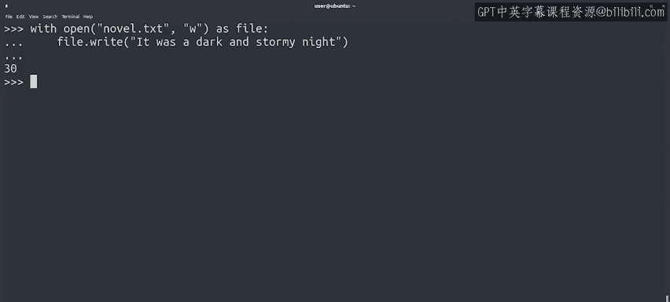
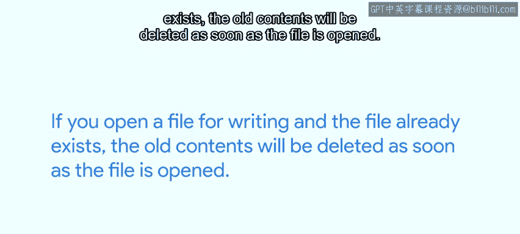
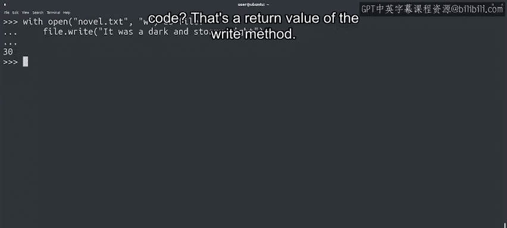

# 谷歌《用Python进行IT自动化办公1、2课（Python、控制操作系统）｜Google IT Automation with Python》中英字幕 - P92：18_写入文件.zh_en - GPT中英字幕课程资源 - BV1gw411E7E1

Now that we know how to read files in Python， the syntax for writing to them probably won't seem too strange。

 Check this out。So what do we have here， You can see that we're using the width block pattern we discussed in the previous video to open a file called novel。

 TXT。You might also guess that using the right method on a file object writes contents to it instead of reading from it。

The second argument to the open method is new， though。 So what does the W mean。

 File objects can be open in several different modes。

A mode is similar to a file permission。 It governs what you can do with a file you've just opened。

 By default， the open function uses the R mode， which stands for read only。

You get an error if you try to write to a file open and read only mode。

Since Read only is the default， we don't have to pass the R as a second argument when we just want to read the file。

Writing， however， is a whole different story。 The W character tells the open function that we want to open the file for writing only。

 If the file doesn't exist， then Python will create it。If the file does exist。

 then its current content will be overwritten by whatever we decide to write using our script。

 It's important to remember that when opening a file in write only mode， you can't read its contents。

 If you try to， the interpreter raises an error。 If you want to add content to a file that already exists。

 you can do that by using other modes like a for app content at the end of an existing file or R plus for read write mode where you can both read contents and overwrite it。

 This has tripped up a lot of us more than once。 So I'll say this again。

 if you open a file for writing in the file already exist。

 the old content will be deleted as soon as the file is open。 Yikes。

 imagine accidentally deleting important content in a file。

So remember， double check that you're opening the right file using the right mode， for example。

 if you're generating a log file of events that your program came across。

 you probably want to open the file using append a mode。

 opening it in right W mode would mean you'd write over any previous entries in that file。

 and that's not a good idea for a log file， or if you're generating a report and want to write it out to a new file using the right W mode。

 you probably want to check if the file exists to avoid losing any previous contents。

We'll learn how to check if a file exists in an upcoming video。 And finally。

 what's that lonely looking 30 doing hanging out at the end of our code。😊。

That's the return value of the right method。 When successful。

 this method returns the number of characters that it wrote， so in this case， 30。

Along with read only， write， append， and read， write。

 the open function supports a bunch of other modes。

 You'll find all the documentation on this in the official reference。

 which we'll link to in the next reading。Okay， and。Breathe， nice job。

 You just learned some complex things。It might not make sense right away。

 So have a look at the cheat sheet coming up， which puts all the information in one place for you。

 And remember， if you feel stuck at any point， you can always rewatch the videos or ask for help in the discussion forums。

 Over the last few videos， you learn how to open and read a file how to iterate through a file and finally。

 how to write a file。 We use these operations a lot when working with files So they're super important to know how to use。

😊，So head on over to check out that cheat sheet now， and after that。

 we can get some hands on practice with all this in the Jupiter notebook。

