# 谷歌《用Python进行IT自动化办公3、4、5、6课（Git、debug、云端、实践）Google IT Automation with Python》中英字 - P92：34_访问无效内存.zh_en - GPT中英字幕课程资源 - BV1LW4y1F7XW

🎼Yeah。

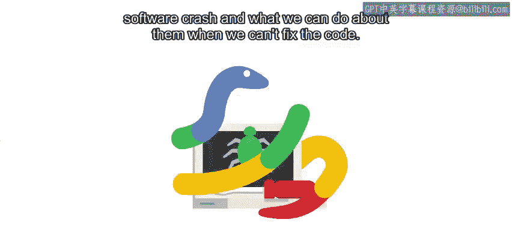

In our earlier videos， we looked into a bunch of different things that can make software crash and what we can do about them when we can't fix the code if we're able to make the application behave correctly。

 though， we'll have a lot more options for dealing with the crash。Of course。

 to apply these fixes we'll need to understand why the crash is even happening。

 One common reason a program crashes is it's trying to access invalid memory。

 to understand what this means。 Let's quickly explain how using the memory works on modern operating systems。

 Each process running on our computer asks the operating system for a chunk of memory。

 This is the memory used to store values and do operations on them during the program's execution。

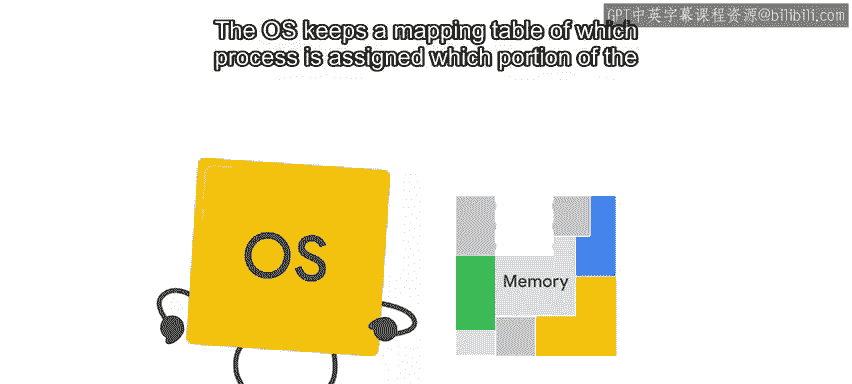

The OS keeps a mapping table of which process is assigned which portion of the memory。

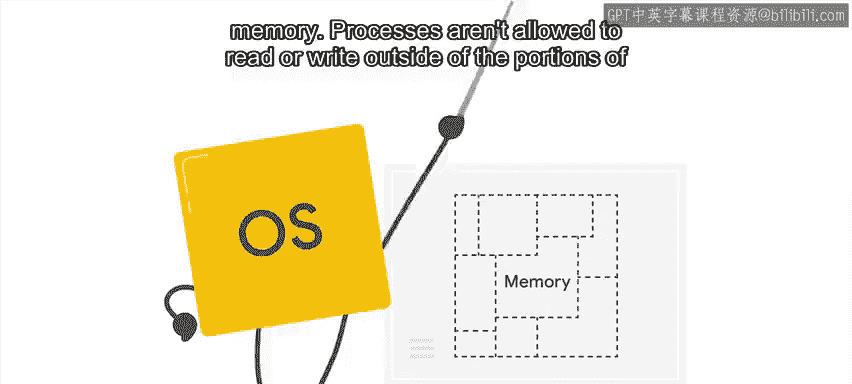

And processes aren't allowed to read or write outside of the portions of memory they were assigned。

So accessing invalid memory means that the process tried to access a portion of the system's memory that wasn't assigned to it。

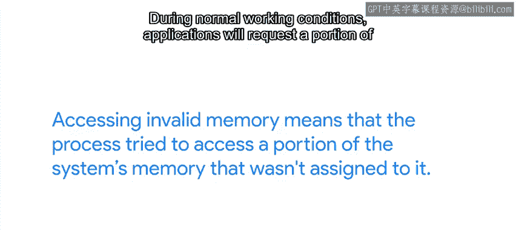

Now， how does this even happen during normal working conditions。

 applications will request a portion of the memory and then use the space at the OS assigned to them。

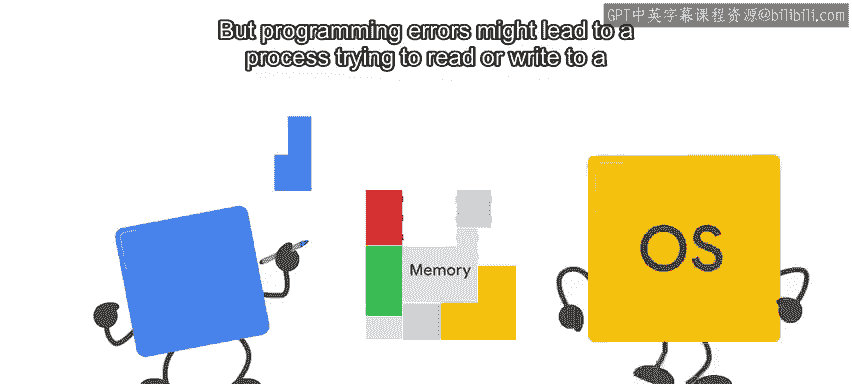

But programming errors might lead to a process trying to read or write to a memory address outside of the valid range。

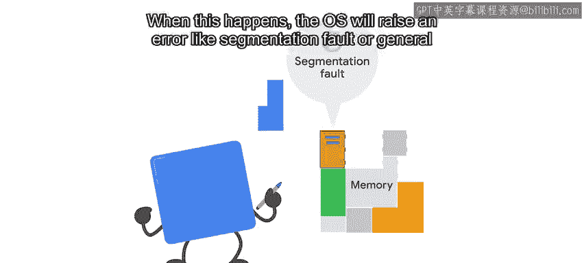

When this happens， the OS will raise an error like segmentation faultult or general Pro faultult。

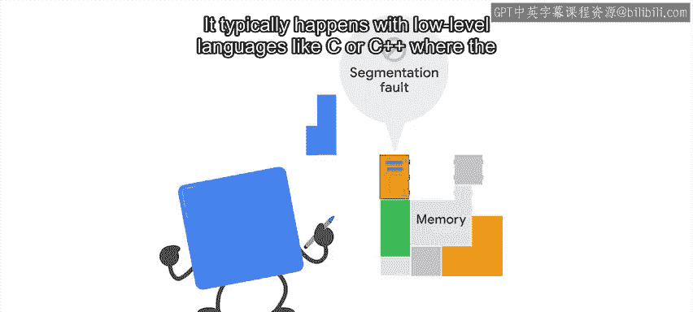

What kind of programming error is this it typically happens with low levelvel languages like C or C++。

 where the programmer needs to take care of requesting the memory that the program is going to use and then giving that memory back once it's not needed anymore。

In these languages， the variables that store memory addresses are called pointers。

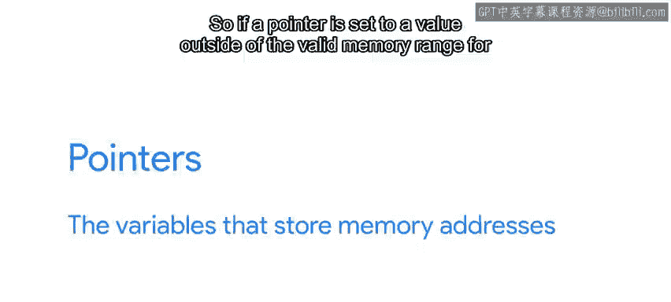

They're just like any other variable in code that can be modified as needed。

So if a pointer is set to a value outside of the valid memory range for that process。

 it will point to invalid memory， and if the code then tries to access the memory the pointer points to。

 the application will crash。

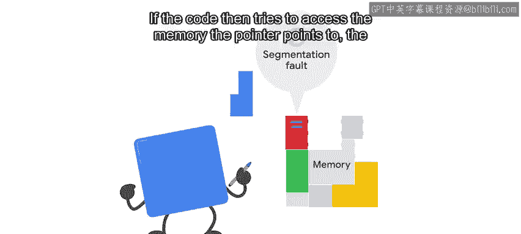

Common programming errors that lead to segmentation faults or Seg faults include forgetting to initialize a variable。

 trying to access a list element outside of the valid range。

 trying to use a portion of memory after having given it back and trying to write more data than the requested portion of memory can hold。

 So what can you do if you have a program that's Segvaulting。

 the best way to understand what's going on is to attach a debugger to the faulty program。 this way。

 when the program crashes， you'll get information about the function where the fault happened。

 You'll know the parameters that the function received and find out the address that wasn't valid。

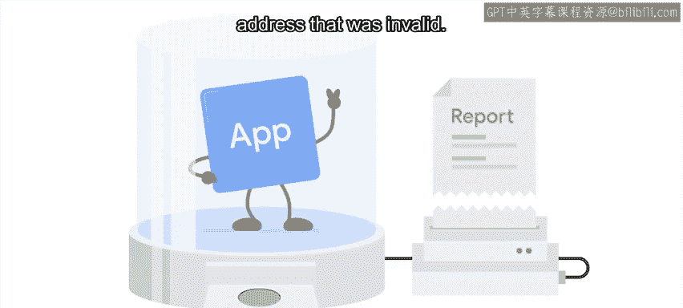

And that might already be enough to understand the problem。

 Maybe a certain variable is being initialized too late。

 or the code is trying to read too many items on a list。 If that's not enough。

 the debugger can give you a lot more detail on what the application is doing and why the memory is invalid for this to be possible will need our program to be compiled with debugging symbols。

 This means that on top of the information that the computer uses to execute the program。

 the executable binary needs to include extra information needed for debugging。

 like the names of the variables and functions being used。

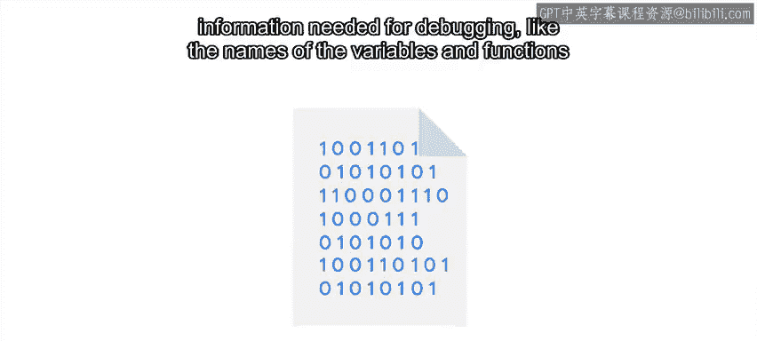

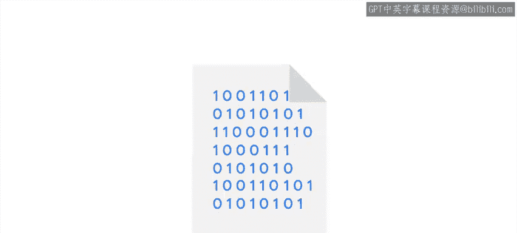

These symbols are usually stripped away from the binaries that we run to make them smaller。

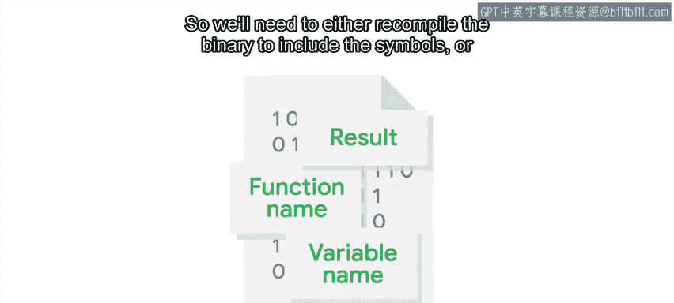

So we'll need to either recompile the binary to include the symbols or download the debugging symbols from the provider of the software if they're available Linux distributions like Deian or Uuntu ship separate packages with the debugging symbols for all the packages in the distribution。

 so to debug an application that's sefaing， we download the debugging symbols for that application attach a debugger to it and see where the fault occurs when doing this we might find that the crash happens inside a call to a library function This is separate from the application itself and so wed need to install the debugging symbols for that library。

And we might need to repeat the cycle a few times before we can identify the portion of the code that's buggy Microsoft compilers can also generate debugging symbols in a separate PDB file Some Windows software providers let users download the PDP files that correspond to their binaries to let them properly debug failures。

 One of the trickiest things about this invalid memory business is that we're usually dealing with undefined behavior。

 This meanss that the code is doing something that's not valid in the programming language。

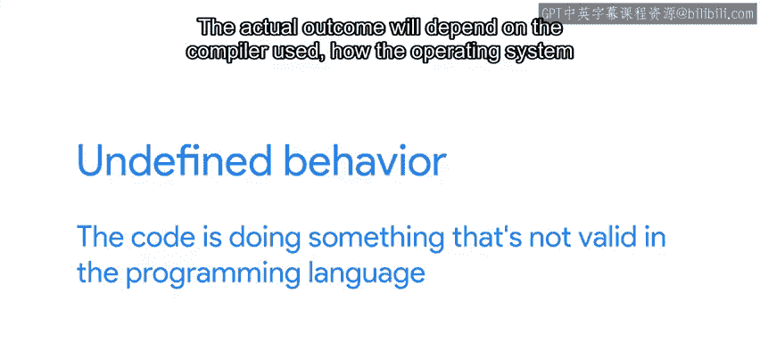

The actual outcome will depend on the compiler used。

 how the operating system assigns memory to processes， and even the version of the libraries in use。

A program that runs fine on a computer running Windows may trigger a Seg fault on a computer running Linux and vice versa when trying to understand problems related to handling invalid memory。

 Valgrind can help us a lot。 Valgrind is a very powerful tool that can tell us if the code is doing any invalid operations。

 no matter if it crashes or not。

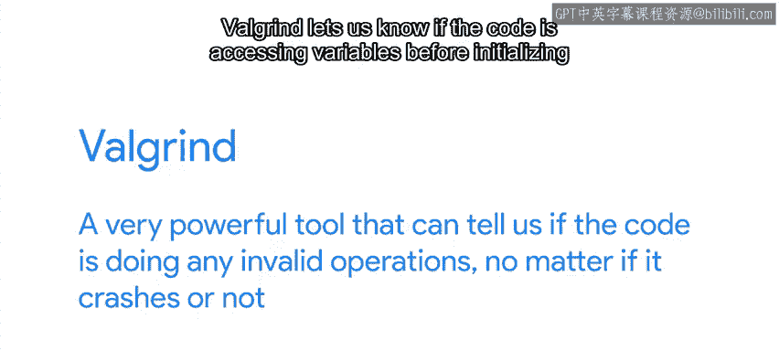

Falgr lets us know if the code's accessing variables before initializing them。

 if the code's failing to free some of the memory requested。

 if the pointers are pointing to an invalid memory address and a ton more things。

Falgrind is available on Linux and MacOS and Doctor Mem is a similar tool that can be used on both Windows and Linux Okay。

 so all of that said， what do we do when we finally discover the cause of the Sefa？

You'll want to either change the code yourself。Or get the developers to fix the problem in the next version。

 This might sound scary if you've never programmed in the language used by the application。

But when you know what's wrong with the code， it's usually not that hard to figure out how to fix it。

 If a variable is initialized too late， fixing the problem can be as easy as moving the initialization to the right part of the code。

 Or if a loop is accessing an item outside of the length of the list。

 you might solve the issue by checking that there aren't more iterations than needed。

Throughout this program， we've been teaching you these concepts so you can apply them to any piece of code no matter which language the program is using。

 so don't be afraid to put this into practice you've got the skills for it if the program is part of an open source project。

 you might find that someone else has already done the work and so you can apply a patch available online。

If there's no patch and you can't figure the bug out yourself。

 you can always get in touch with the developers and ask if they can fix the issue and create the necessary patch。

In high level languages like Python， the interpreter will almost certainly catch these kinds of problems itself。

It will then throw an exception instead of letting the invalid memory access reach the operating system。

 but still。Those exceptions can be pretty annoying。 We'll talk about those in our next video。

