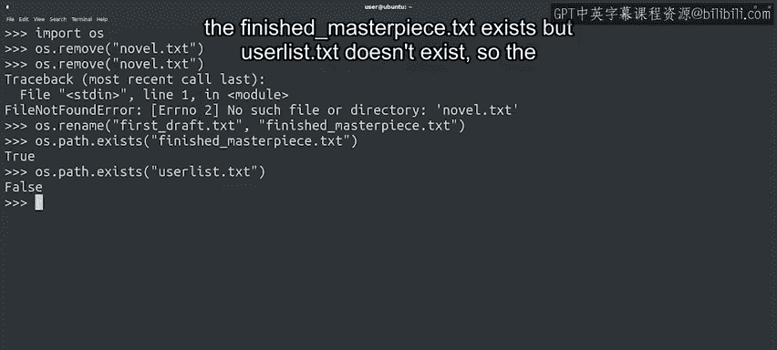

# 谷歌《用Python进行IT自动化办公1、2课（Python、控制操作系统）｜Google IT Automation with Python》中英字幕 - P93：19_文件操作.zh_en - GPT中英字幕课程资源 - BV1gw411E7E1

In earlier videos， we saw how we can read files， iterate through the contents of files。

 and also write contents of files。Those are the most common operations we'll do with files。

 but there's plenty of other things we might need to do when working with files in our scripts。

We may need to delete， rename or move files， or we might need information about a file like the time it was less modified or its current size。

Let's explore some of the many things that we can do with files in Python。For these operations。

 we'll be using functions provided by the OS module。

This module provides a layer of abstraction between Python and the operating system。

It allows us to interact with the underlying system without us knowing whether we're working on a Windows。

 Mac， Linux， or any other operating system supported by Python。

This means that you can write and test a script on one operating system like Windows and then run it on a different operating system like Linux。

 but one thing to watch out for， paths can be different across different operating systems。

 So whenever we're using an absolute path in our code。

 we need to make sure we can provide alternatives for the platforms we want to support。

The OS module lets us do pretty much all the same tasks that we can normally do when working with files from the command line。

We can change the filess permissions and delete or rename files through our code。

This means you can write scripts to do these operations for you automatically。

I bet you're already thinking about how useful the OS S module is going to be in your I T role to delete the file。

 we can use the remove function from the OS module。 Let's see this in action。😊。

So we first import the OS module， then we call the remove function。

 the OS module gives us and pass the string novel do TxT， which is the file we created earlier。

The file has now been deleted。 Let's see what happens if we try to remove it again。

Fail if we try to remove the file that doesn't exist， the function will raise an error。

We've got a file not found error。 The error typess pretty explanatory。

And the message also tells us the name of the file you couldn't find novel。 TXT。

We can easily rename a file with the rename function。

 The first parameter to the rename function is the old name of the file， and the second is new name。

😊，Let's check it out。Yep， in Python， it's that easy to write a masterpiece。

If we try to do this for a file that didn't exist， we'd get a file not found error again。

So how do we check if the file exists or not。There's a submodule inside the OS module for dealing with things related to file information。

 like whether they exist or not。This is called the OS Pa submodule。

And we can use the exist function in this module to check whether a file exists。

Let's try this out with a couple of examples。In this example。

 the exist function returned a value of true， telling us that the finished masterpiece do TXT exists。

But userless。 Txc doesn't exist， so' the function and return the value of false。

The exists function is super useful。We can use it to check that a file exists before trying to read it or verify that it does exist before trying to write it。

 which helps us avoid losing any data。Python gives us some basic ways to interact with files stored on a computer。

We're gonna take a look at them in our next video。We'll cover how to get other information files like their size。

 the last time they were modified and a bunch more info， See you there。

