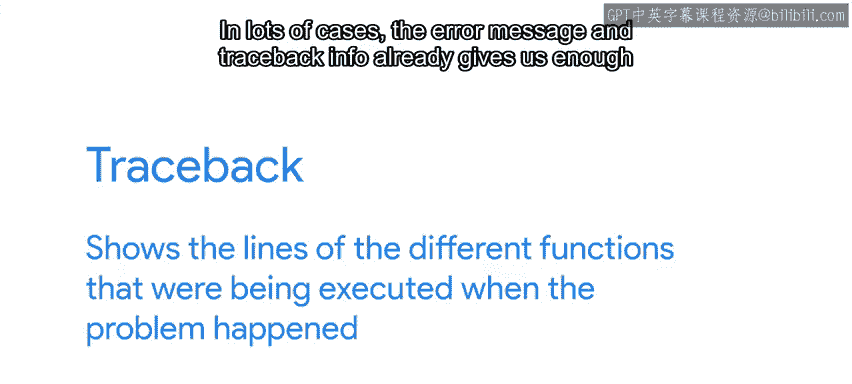
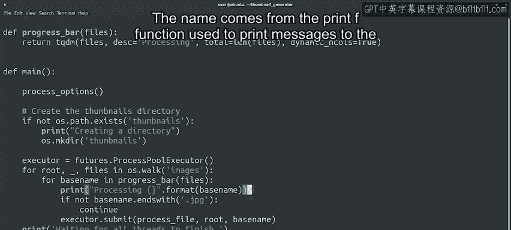

# 谷歌《用Python进行IT自动化办公3、4、5、6课（Git、debug、云端、实践）Google IT Automation with Python》中英字 - P93：35_未处理的错误和异常.zh_en - GPT中英字幕课程资源 - BV1LW4y1F7XW

🎼Yeah。In our last video， we talked a lot about what happens when a program tries to access invalid memory。

 correctly handling memory is a hard problem， and that's why there's a bunch of different programming languages like Python。

 Java or Ruby that do it for us。But that doesn't mean programs written in these languages can't trigger weird problems In these languages。

 when a program comes across an unexpected condition that isn't correctly handled in the code。

 it will trigger errors or exceptions。In Python， for example。

 we could get an index error if we try to access an element after the end of a list。

 we might get a type error or an attribute error if we try to take an action on a variable that wasn't properly initialized or division by zero error if we try to well divide by zero。

When the code generates one of these errors without handling it properly。

 the program will finish unexpectedly in general， unhandled errors happen because the code's making wrong assumptions。

Maybe the program's trying to access a resource that's not present。

Or the code assumes that the user will enter a value， but the user entered an empty string instead。

 or maybe the application is trying to convert a value from one format to another。

 and the value doesn't match the initial expectations。When these failures happen。

 the interpreter that's running the program will print the type of error。

 the line that caused the failure and the traceback。

 the traceback shows the lines of the different functions that were being executed when the problem happened。

In lots of cases， the error message and traceback info already gives us enough to understand what's going on。

 and we can move on to solving the problem， but sadly， that's not always the case。

 The fact that a piece of code crashes on one function doesn't mean that the error is necessarily in that function。

It's possible， for example， that the problem was caused by a function called earlier。

 which set a variable to a bad value， so the function where the code crashes is just accessing that variable。

 so when the error message isn't enough， we'll need to debug the code to find out where things are going wrong。

For that we can use the debugging tools available for the applications language for a Python program。

 we can use the PDB interactiveactive debugger， which lets us do all the typical debugging actions like executing lines of code one by one or looking at how the variables change values when we're trying to understand what's up with a misbehaving function on top of using debuggs it's common practice to add statements that print data related to the code's execution。

Statements like these could show the contents of variables， the return values of functions。

 or metadata， like the length of a list or size of a file。

This technique is called Pri F debugging。 The name comes from the print F function used to print messages to the screen in the C programming language。

But we can use this technique in all languages， no matter if we use print。

 puts or echo to display the text on the screen， let's take this one step further when changing code to print messages to the screen。

 The best approach is to add the messages in a way that can be easily enabled or disabled。

 depending on whether we want the debug info or not， in Python。

 we can do this using the logging module。 This module lets us set how comprehensive we want our code to be。

We can say whether we want to include all debug messages。or only info， warning or error messages。

 and then when printing the message， we specify what type of message we're printing。That way。

 we can change the debug level with a flag or a configuration setting。Okay。

 say you figured out why the unexpected exception was thrown。What do you do next？

The solution might be fixing the programming error。

 like making sure variables are initialized before they're used。

 or that the code doesn't try to access elements after the end of a list。

 or it could be that certain use cases that hadn't been considered needs to be added to the code in general。

 youll want to make the program more resilient to failures instead of crashing unexpectedly。

 you want the program to inform the user of the problem and tell them what they need to do for example say you have an application that crashes with a permission denied error。

Rather than the program finishing unexpectedly， you'll want to modify the code to catch that error and tell the user what the permission problem is so they can fix it。

 for example， unable to write new files in T， make sure your user has bright permissions on T。

In some cases， it doesn't make sense for our program to even run if certain conditions aren't met。

In that case， it's okay for the program to finish when the error is triggered。But again。

 it should do so in a way that tells the user what to do to fix the problem For example。

 if it's critical for an application to connect to a database。

 but the database server isn't responding， it makes sense for the application to finish with an error saying unable to connect to the database server。

It also makes sense to include all details of the attempted connection like the hosta， the port。

 or the username used to connect， so to recap， if your program is crashing with an unhandled error。

 you'll want to first do some debugging to figure out what's causing the issue。

Once you figured it out， you want to make sure that you fix any programming errors and that you catch any conditions that may trigger an error。

This way， you can make sure the program doesn't crash and leave your users frustrated。Up next。

 we'll talk a bit about what you can do when you're trying to fix someone else's code。

