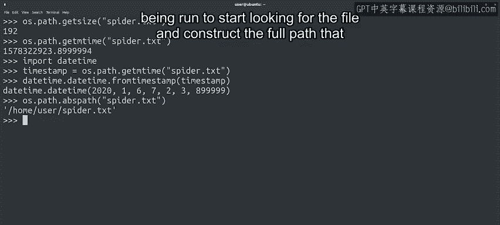

# 谷歌《用Python进行IT自动化办公1、2课（Python、控制操作系统）｜Google IT Automation with Python》中英字幕 - P94：20_更多文件信息.zh_en - GPT中英字幕课程资源 - BV1gw411E7E1

We saw earlier how to manipulate files with functions like OS Rename and OS remove and how to check whether the file exists using OS path exists。

We can get a lot more info about our files using functions in OS Pa module。For example。

 to check how big a file is， we can use the get sizeize function。

 which returns the file size in bytes。To check when a file was last modified。

 the get M time function comes in really handy。 Let's check out how this works。

what's that long number。 It doesn't look like time does it， That's because it's a times stampamp。

In this case， specifically， it's a Unix times stampamp。

 It represents the number of seconds since January 1，1970。 It seems a bit random， right。

 but there's actually a really good reason behind this date。

 This was adopted years ago to store the times associated to files and computers。

Since that's when they started publishing UniX operatinging System。

 UniX uses that date because there couldn't be any file created before that time。

While UniX TimeSamps have a 50 year history， they're still very much present today。

They're used by file systems to show when a file was created， accessed， or modified。

They are also used in other systems， like databases。As an IT specialist。

 you're bound to run into them in your day to day。But despite all of that。

 the number is pretty hard to make sense of， we can use the date time module to make it easier for us humans to read like this。

Here， we're using the from timetamp method of the date time class inside the date time module。

 It makes the date far easier for us to understand。Remember。

 the functions in the OS Pa module take the info provided by the operating system so that we can use it in our scripts no matter what OS we're running。

We can check a files size or last modification date without having to know the operating system the machine's running or the type of file system that the file stored in。

 Nice， right？Another cool feature of the functions is that we can work with both relative and absolute paths。

😊，In our examples， we've been using the relative file names without having to specify their full paths。

In some cases， we may need to specify exactly where the file is to work with it in our script。

 This is where the A B S path function can help。The ABS path function takes a file name and turns it into an absolute path。

Python uses the current working directory， which is where the script is being run to start looking for the file and construct the full path that identifies it。

This is useful if we want to store the file's full path or access a file。

 no matter what the current directory is。Visit a ton more functions in the OS and OS Pa modules that let us work with files。

But don't worry， you don't have to learn them all by heart。

Whenever you need to do something with files， it's a good idea to check the documentation and research what functions are available to find the ones that you need。

 You'll find a link to the documentation in our next reading。Wow， we're steaming right along。 now。

 we've seen how to read， iterate through and write files。

 We then learned how to manage files using lots of useful methods。

Now is a good time to try our examples on your computer or maybe even come up with your own to really get a grasp of it all。

 So no rush。 you'll find me in the next video whenever you're ready。😊。

There we'll dive into how to work with directories in our scripts。

