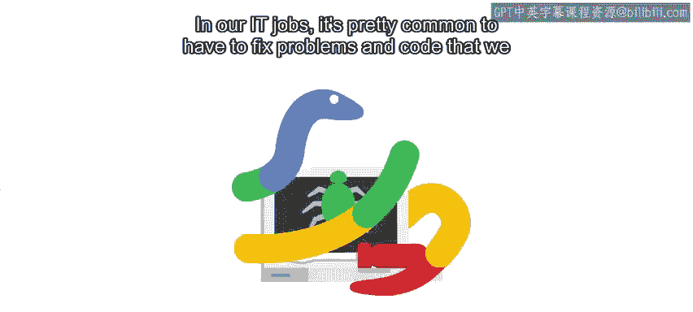
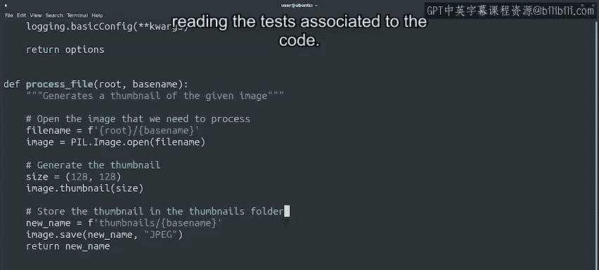

# 谷歌《用Python进行IT自动化办公3、4、5、6课（Git、debug、云端、实践）Google IT Automation with Python》中英字 - P94：36_修复他人的代码.zh_en - GPT中英字幕课程资源 - BV1LW4y1F7XW

🎼Yeah。

In RIT jobs， it's pretty common to have to fix problems in code that we didn't write ourselves。

It might be because we're working with a program that's open source or with a program that was developed by someone else inside the company When this happens。

 we'll need to spend some time getting acquainted with the code so that we can understand what's going on。

Let's do a rundown of some things that can help us with that If the code has comments and the functions are well documented。

 reading these is a great place to start when trying to figure out what's going on remember way back in the course when we first introduced Python。

 we talked about the importance of developing good habits when we're writing code。😊。

Writing good comments is one of those good habits that pays off when trying to understand code written by others and also your past self。

 unfortunately， a lot of code doesn't include enough comments。

 leaving us to try to understand it without enough context。 if that's the case。

 you can improve things by adding comments as you read the code and figure out what it's doing。

 writing these comments help you solidify your understanding。

And if you contribute those comments back to the original developers。

 you can help anybody else trying to understand the code。

Another thing that can help to understand someone else's code is reading the tests associated to the code。

 Well written tests can tell us what each function is expected to do。

And looking at the existing tests can show us which use cases weren't taken into account。

But what if there aren't enough tests， just like with writing extra comments。

 writing some tests of your own can help you better see what the code is supposed to do and improve overall quality of the code？

This can also be really useful when modifying the original code to ensure that changes you make don't break the rest of the functionality。

In my job， I need to make changes to code written by other people a lot。

I definitely read the comments and sometimes reference the tests too。But in the end。

 to really understand what's going on， I just have to read through the code。Okay。

 but how do you even start reading through someone else's code？

This depends a bit on personal preference and the size of the project。

 If there are only a couple hundred lines of code， it's feasible to read all of them。

 But when the project has thousands or tens of thousands of lines of code。

 You can't really read the whole thing。 You'll need to focus on the functions or modules that are part of the problem that you're trying to fix。

 one possible approach in this case would be to start with the function where the error happened。

Then the function or functions that call it and so on。

 until you can grasp the context that led to the problem， and while this is of course。

 much easier if it's in a programming language that you're familiar with。

 you don't need to be an expert in the language to fix a bug in the program。

If you've come across an error and debug the issue well enough to understand what's going on。

 you might be able to fix the problem， even if you've never seen that language before。

This is one of those skills that gets better with practice。

So it might make sense to you to start practicing before you need to fix a problem in the code。

Take a program that you both use and have access to its code and figure out how it does a specific action。

Follow the code until you really understand what's going on for example。

 you could take the web server software you're using and check out how it pars its configuration files。

Or take a look at one Python module youd like， like Python requests， for example。

 and figure out how it processes the data it receives。Doing this。

 you can get used to reading code written by others and understanding what it's doing。

 Another option is to pick an open source project that you use。

 Look at the list of open issues and to have go at fixing an easy one。To do that。

 you'll need to find your way around the code， understand what it's doing， and what to change。

By practicing doing this， you'll improve your ability to quickly figure out what the code does and what needs to be changed while helping improve the project's overall quality。

Up next， we'll get some practice fixing issues and a couple of different programs that crash。

