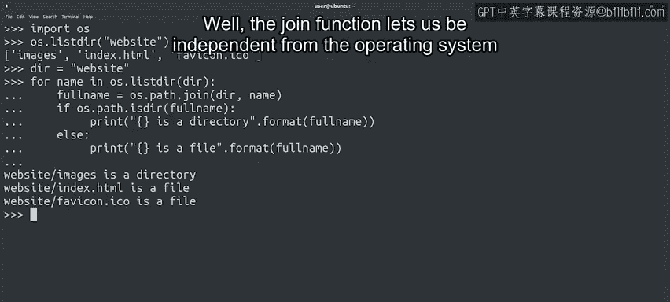
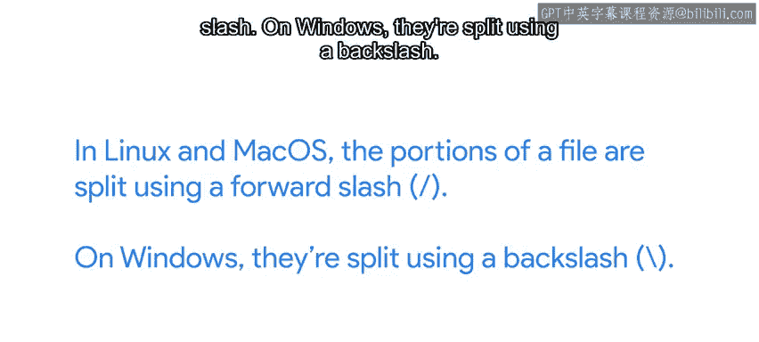
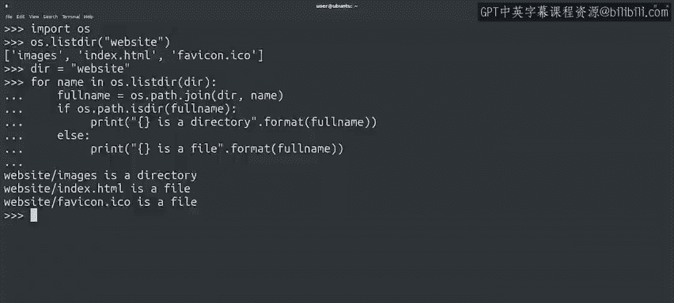

# 谷歌《用Python进行IT自动化办公1、2课（Python、控制操作系统）｜Google IT Automation with Python》中英字幕 - P95：21_目录.zh_en - GPT中英字幕课程资源 - BV1gw411E7E1

If you need to work with files in your scripts， odds are， you'll have to handle directories too。

For example， you might need to process all the files that are in a specific directory or generate a directory with the results of your data analysis。

As with files， Python provides a bunch of different functions that let us create。

 delete and browse the contents of directories。 you might remember when we talked about the current working directory and how important it is to know this when using a relative path to determine the location of a file。

To check which current directory your Python program is executing in， you can use the get CWD method。

If you use a UniX like system， you might remember that the name of the command that prints the working directory is called PWD。

In this case， the current directory is our users's home directory， which is a default directory。

 we start on when opening a terminal and Linux To create a directory， we use the makeD function。

This function has the same name as both the Windows and Linux commands that do the same exact thing。

So we've just created a directory called NewDR， and it's located in the current working directory。

You can also change directories in your program by using the CHDR function and passing the directory you'd like to change to as a parameter。

Just like the other functions we've seen， we can use relative or absolute paths to do that。

As you can see， we've changed the current working directory to the new directory that we created inside the user's home directory。

We use MKDR to create directories， and we can use our MD to remove them like this。

But the RM D function will only work if the directory is empty。

If we try to remove the directory that has files in it， we'd get an error。

We need to first delete all the files and subdirecties in that directory before we can actually remove it。

But how can we find out what contents are in that directory？Well。

 there are a few techniques that we can use to do this。

The OS list DuR function returns a list of all the files and subdirecties in a given directory。

Let's see how this looks for our website directory。So we got a list of strings。

Since there's just strings， we don't know if they're directories or files to find out what they are。

 we can use functions like OS Pa Ister， but before we look at how that works。

 see how the list contains just file names。If we want to know whether one of these files is a directory。

 we need to use OS path join to create the full path。 Let's see all this in action now。

This code is doing a bunch of interesting stuff， But let's go through it step by step。 First。

 we're defining a de variable with the name of the directory that we want to check。

This makes our code more readable and more reusable。

Then we're iterating through the file names returned by the OS Ler。

We know from our previous execution of this function that these are just the names of the files without directory。

So using OS Path join， we join the directory to each of those file names and create a string with a valid full name。

Finally， we use that full name to call OS Path ID to check if it's a directory or a file。

Maybe you're wondering what's up with that join function。

It seems to just add a slash between two strings， right。Well。

 the join function lets us be independent from the operating system again。

In Linux and Mac OS， the portions of a file are split using a forward slash。On Windows。

 they're split using a backslash。

By using the OS path join function， instead of explicitly adding a slash。

 we can make sure that our scripts work with all operating systems。

It's another one of those handy little tools that help us avoid errors when working on different platforms As we called out earlier。

 there's a lot of functions to manage directories in Python and we only cover a handful here。

We'll learn some others throughout the course as we need them。Wow， this stuff sure is a bit complex。

 great job sticking with it。 Perence and determination are key qualities for both IT jobs and learning the program。

😊，And you're showing me that you've got both by the bucket load。

 The more comfortable you are with what you've learned so far。

 the easier it'll be to learn new stuff coming up。So take the time now to review and practice everything before moving on。

You'll find a cheat sheet in the next reading to help you do just that。

So be sure to check that out and then head on over to the quiz and check in on how much you've learned。

