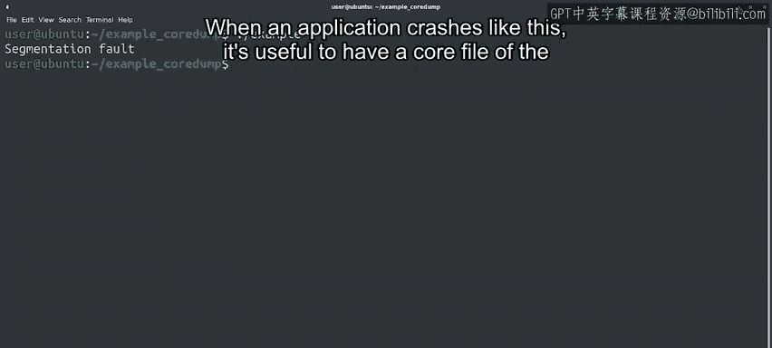
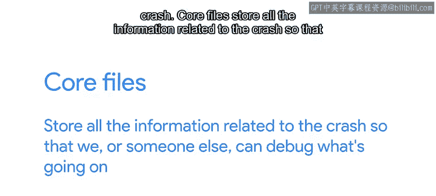
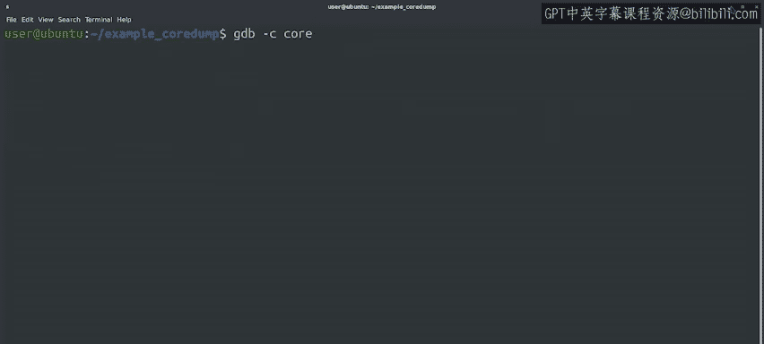

# 谷歌《用Python进行IT自动化办公3、4、5、6课（Git、debug、云端、实践）Google IT Automation with Python》中英字 - P95：37_调试段错误.zh_en - GPT中英字幕课程资源 - BV1LW4y1F7XW

Over the past videos， we've discussed a bunch of different types of crashes。

 Let's now check out what a segmentation fault looks like in action。

 We have a simple example program that crashes with a sec fault。😊。

When an application crashes like this， it's useful to have a core file of the crash。

 Co fileses store all the information related to the crash so that we or someone else can debug what's going on。

It's like taking a snapshot of the crash when it happens to analyze it later。

 We need to tell the OS that we want to generate those core fileses。

 We do that by running the U limit command， then using the dash C flag for core fileses。

 and then saying unlimited to state that we want core files of any size。 once we've done that。

 we can try executing our example again。All right， our crashing program has generated a core file。

 Let's check it out using LS L。This file contains all the information of what was going on with the program when it crashed。

We can use it to understand why the program crashed by passing it to the GDPB debugger。

We'll call GB C Core to give it our core file and then example to tell it where the executable that crash is located。

When it starts， G shows a bunch of messages， including its version， license， and how to get help。

It then tells us that the program finished with a segmentation fault。

 it shows that the crash happened inside the STR lens function。

In a file that's part of the system libraries。The no such file or directory error that we're seeing here means that we don't have the debugging symbols for that system library。

 but that's okay。 We trust the SR L function to work correctly。 It's our code that's buggy。

Let's look at the full back trace of the crash by using the back tracece command。

The first element in the list is the function where the crash occurred。

The second element is the function that called the function and so on。In this case。

 we see that the STR lens function that failed was called by the copy parameters function in our code。

 which was called by the main function。We can use the up command to move to the calling function in the backt and check out the line and copy parameters that cause the crash。

We see that the faulty line is calling the STR lens function， but it's not clear why that would fail。

 We can get more context for the code that failed by calling the list command that shows the lines around the current one。

Here we see a chunk of C code。 If this is the first time you look at C code。

 it might seem a bit confusing。That's okay。 There are some similarities with Python。

 but also some things that are pretty different。We see that the faulty line line 10 is in the body of a for loop。

The variable that the for loop uses to iterate is called I。

 Let's check out the value of I using the print command。

GDB uses the dollar sign followed by a number to give separate identifiers to each result it prints In this case。

 the result is one。In other words， when the crash happened， I have the value of one。

Since this variable is being used to access an array called RV。

 let's print the contents of the first element。Arg V 0。And then the second element， AGV1。

What are those weird numbers starting with 0 x？Those are hexadecimal numbers。

 and they are used to show addresses in memory where some data is stored。Here。

 GB is telling us that the first element in the AGV array is a pointer。

 pointing to the dot slash example string。The second element is a pointer to zero。

 also known as a null pointer。0 is never a valid pointer。

 It usually signals the end of data structures in C。

SoR code is trying to access the second element in the array。

 but the array only has one valid element。In other words。

 the for loop is doing one iteration too many。This is known as an off by one error。

 and it's a super common error。In this case， the fix is really simple。

 we need to change the less than or equal sign to be a strictly less than sign so that the iteration stops one element before。

In this video， we got a sneak peek at what it's like debugging C applications that crash with a segmentation fault Up next。

 we'll talk about how we can debug Python applications that crash with an exception。

