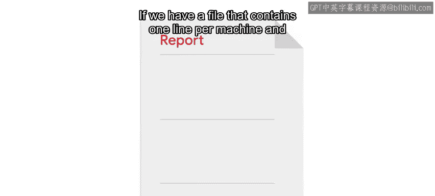
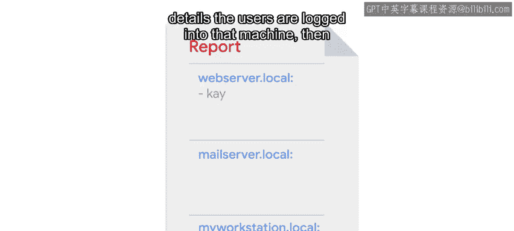
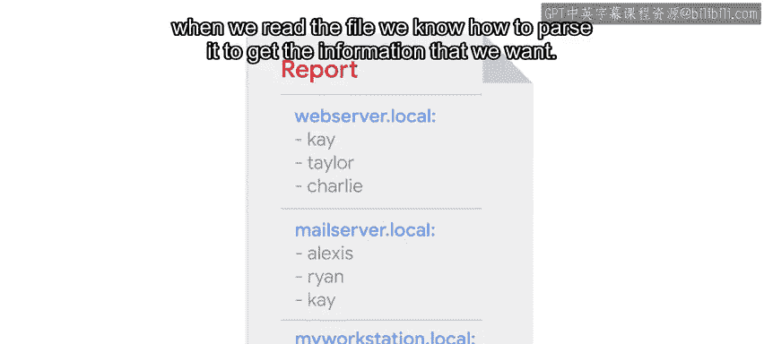
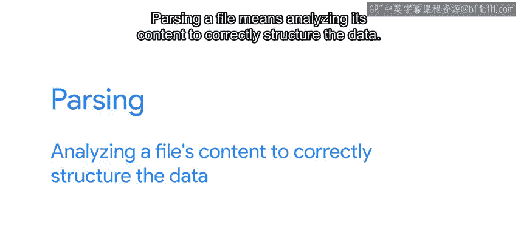
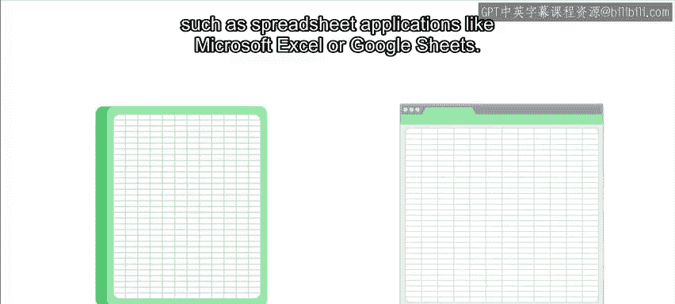

# 谷歌《用Python进行IT自动化办公1、2课（Python、控制操作系统）｜Google IT Automation with Python》中英字幕 - P96：22_什么是 CSV 文件.zh_en - GPT中英字幕课程资源 - BV1gw411E7E1

🎼。う。

When we first talked about how to read files， we looked at files with lines of text。

 one after the other。This is useful in a bunch of different situations。

 since lots of programs store their state and text files。

And we can also handle configuration files and log files as text。

But data comes in a bunch of different formats besides text。

 and you may need to deal with some of these in your scripts。

Formats give data structure and remember that computers love structure and precision。

To be able to process a data， it helps to know ahead of time how that data will be arranged。

If you can expect data to be represented in a certain way， it's easier to extract meaning from it。

Let's look at a very simple example。If we have a file that contains one line per machine and details of the users that are logged into that machine。

 then when we read the file， we know how to parse it to get the information that we want。

Psing a file means analyzing its content to correctly structure the data。

We use a bunch of different file formats to structure， store and transport data。

 You might be familiar with some already。For example。

 HTML is a markup format which defines the content of a web page。

JSON is a data interchange format commonly used to pass data between computers on networks。

 especially the internet。CSV or comma separated values is a very common data format used to store data as segments of text separated by commas。

In the Python Standard Library， you'll find classes and modules for working with many of these data formats。

 including CSV and HTML。For less common file formats or more advanced manipulation techniques。

 you'll find more libraries available as additional Python modules。In the next few videos。

 we'll check out how we can use a CSV module to process CSV files。

This not only shows how we can use Python to work with a specific data format。

 knowing how to work with CSV files is a pretty useful skill to know。

This format lets us easily store and retrieve information that we might need for our scripts。

 like employees in our company or computers in our network。In my job as a system administrator。

 I create CSV files when I want to convert the output of a command into a format that will be easier to parse later on。

For example， the DF command prints the currently used disk space in a format that's easy to read by human eyes。

 but turning the info into a CSV makes it much easier to work for the data in my scripts。

A lot of programs are capable of exporting data at CSV files such as spreadsheet applications like Microsoft Excel or Google Sheets。

 It can actually be helpful to think of a CSV file like it's a spreadsheet where each line corresponds to a row and each comma separated field corresponds to a column。

 So now that we know what CSV files are， let's learn how to read them。

