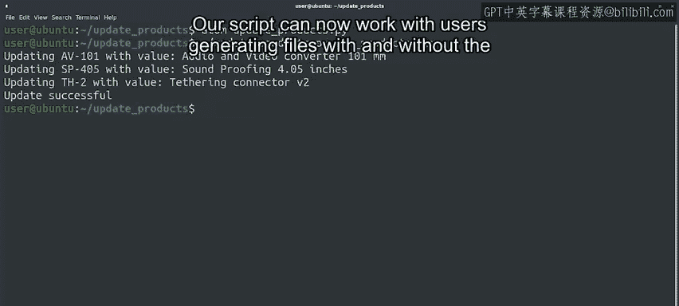

# 谷歌《用Python进行IT自动化办公3、4、5、6课（Git、debug、云端、实践）Google IT Automation with Python》中英字 - P96：38_调试Python崩溃.zh_en - GPT中英字幕课程资源 - BV1LW4y1F7XW

In our last video， we looked into an application that was crashing with a segmentation fault。

 That kind of problem is common when dealing with applications written in languages like C or C plus plus On the flip side。

 when using languages like Python。 We usually need to deal with unexpected exceptions。

 making our program crash。 Let's look at one example of that。

 We have a script that updates the descriptions of some products in our company's database。

 It's a pretty simple script that takes a CV file as a parameter。

 which includes the data that needs to be imported using the product code and description。

 Our script simply reads through a file and then updates the database。 Most of the time。

 it works just fine。😊，But when the file with the new descriptions is generated by one specific user。

 the program fails with an exception。The user has sent us a file that's failing so that we can try to figure out what's going on。

Let's first check out the contents of the file。Okay， this seems harmless enough。

 let's try executing the program。HThe program failed with an exception Let's have a look at this traceback to understand it a bit better At the bottom。

 we see the name of the exception in this case， key error and the message in this case， product code。

 which is the name of the key that's failing。Above that。

 we see a list of function calls with two lines per function。

 the first line tells us the Python file that contains the function， the line number。

 and the name of the function， the second line shows us the contents of that line。

This information is similar to the back trace that we saw in our last video。

 but the order of the functions is reversed， the function at the bottom update data is the one where the exception occurred。

Above it， we see that update data was called by Main， and on top of that。

 we see that main was called by the line at the module level。So what's going on here？

The update data function is trying to access the product code fields in a variable named row。

 but for some reason， this is failing with a key error。Frequently。

 knowing the exception message and the line where the exception happened is already enough to understand what's going on。

But in some cases， like this one， that's not enough。

It's time to try our hand at using a Python debugger。

We'll start the debugger by running PDB3 and then passing the script that we want to run and any parameters that our script needs。

In our case， we'll call PDV3 Updateproducts。pi， newproducts。csv。When we start the debugger。

 it gets positioned at the first line of our script and waits for us to tell it what to do。

We could run each of the instructions in the file one by one using the next command。

 but there's a lot going on here， so we need to go through a lot of lines until we reach the failure。

Alternatively， we can tell the debugger to continue the execution until it either finishes or crashes。

 Let's do that now。So the program failed in the same way we'd seen before。

 but now we can use the debugger to get a better idea of why we're getting this pesky key error。

Let's print the contents of R。哈。That's really weird。

 What are those characters appearing before product code。

If we search online for the sequence of characters。

 we'll find that they represent the Bte order mark or bomb。

 which is used in UTF 16 to tell the difference between a file stored using little Indian and Big Indian。

Our file is in UTF8， so it doesn't need the bomb， but some programs still include it。

 and this is tripping up our script， so what can we do？Fortunately。

 others have already faced the same issue and figured out a solution。

 there's a special value called UTF8 SG that we can set as the encoding parameter of the open function。

😊，Setting this encoding means that Python will get rid of the bomb when files include it and behave as usual when they don't。

 let's change the code of our script to use that encoding instead of the default。

We'll look for the place where it's opening the file。

 then add the encoding parameter with UTF8 SIG as the value。clean 이거。E。Sig。😔，All right。

 we've made the change。Will it work now， let's check it out。Yay， we've fixed the problem。

 our scripts can now work with users generating files with and without the by order mark。

In the last two videos， we looked briefly at GDPB and PDB。

 We've barely scratched the surface of the many operations that we can do with debuggs。

 There are a ton more advanced debugging features like setting breakpoints that let our code run until a certain line of code is executed or watchpoints that let our code run until a variable or expression changes。

 we can also step through the code instruction by instruction to check when a problem happens and much more。

We won't look into any of these advanced techniques here， but as usual。

 we'll put more information about this in the next reading in case you want to learn more。

And after that， there's another practice quiz to check out to make sure all of this has made sense。

