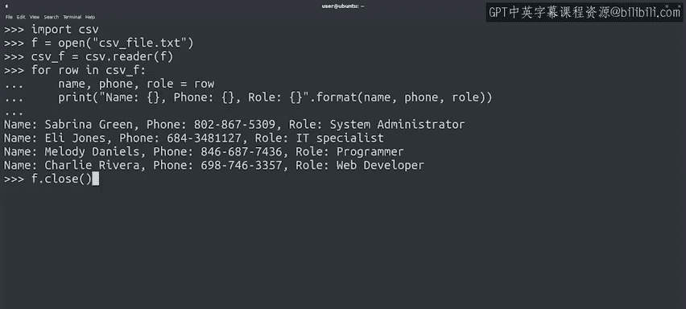

# 谷歌《用Python进行IT自动化办公1、2课（Python、控制操作系统）｜Google IT Automation with Python》中英字幕 - P97：23_读取CSV 文件.zh_en - GPT中英字幕课程资源 - BV1gw411E7E1

🎼。う。

Like we said， CSV Sansburg comma separated values CSV is a pretty simple format。

 These files are stored in plain text and each line in the CSV file generally represents a single data record。

Each field in that record is separated by a comma。With the contents of the field stored between the commas。

For example， if we're storing information about employees at our company。

 we might store the data like this。Looking at this example。

 the line that starts with Sabrina is a data record。

 and the name Sabrina Green represents a name field。

 followed by a phone number field and a role field。

Python's standard library includes a module which lets us read， create and manipulate CSV files。

Do you want to guess what that module is called？If you get CSV， you're right。

All these self explanatory names makes life a lot easier， right？

So we'll be using the CSV module and to do that， we'll need to import it like we've been doing with the other modules。

Now， before we can parse the CSV file， we need to open the file the same way as before。

And now we can parse this file using the CSV module。Okay。

 that's given us an instance of the CSV Read class。

 we can now iterate through its content and access information that it pared。Now。

 the row variable will hold each row in the CSV file。

This variable is a list with each field in the CSV corresponding to one element in the list。

 we know from before that the first field is the name， the second one， the phone number。

 and the third， the role。So we can unpack the values so that we can use variables to refer to them。

Remember that for this to work， we need to have the exact same amount of variables on the left side of the equal sign as the length of the sequence on the right side。

Now that we've unpacked these values， let's print them to the screen。As we mentioned。

 we unpack the row so that we don't have to use indexes to access each element in that list。

For example， we could have used row 0 to access the name of the employee。 This is valid。

 but it can be hard to follow when reading a lot of code。

Unpacking the list to name variables makes the code easier to understand later on。

And before we forget， let's close this file now that we're done with it。

Pretty useful， right？With that， we've now learned how to read and iterate through CSV files Up next。

 we'll talk about how you can generate your own CSV files。

