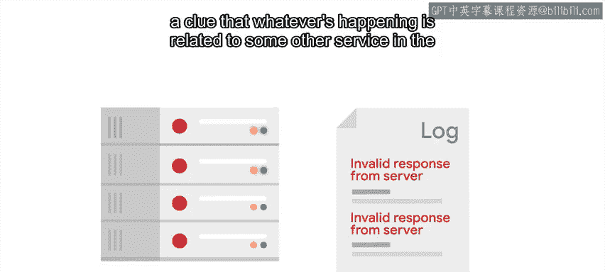
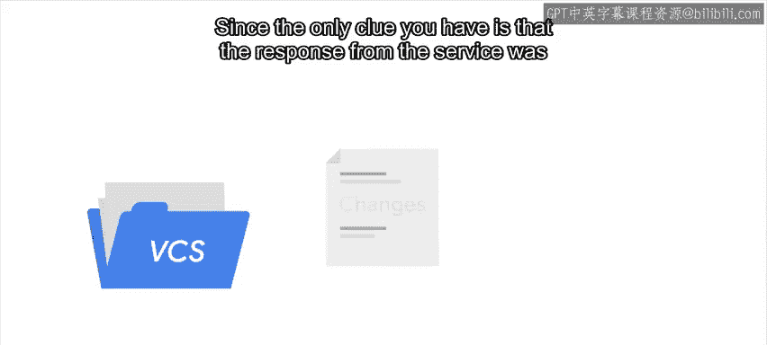
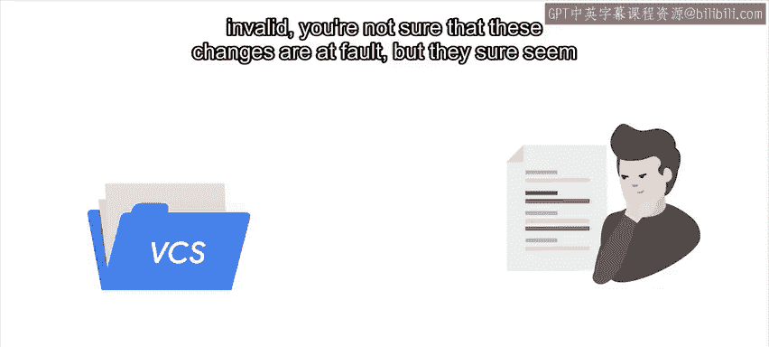
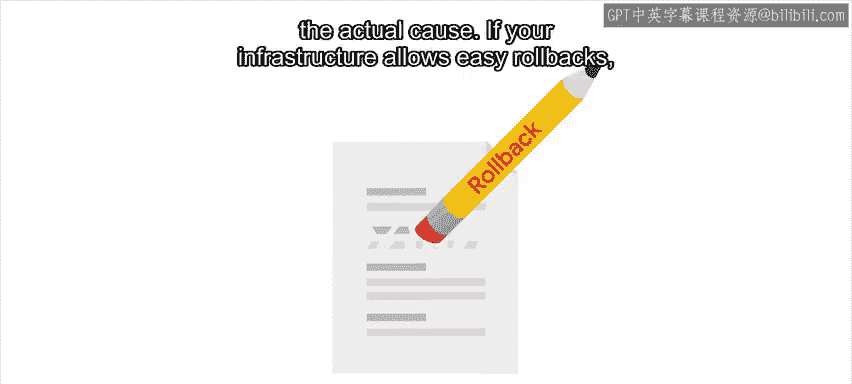
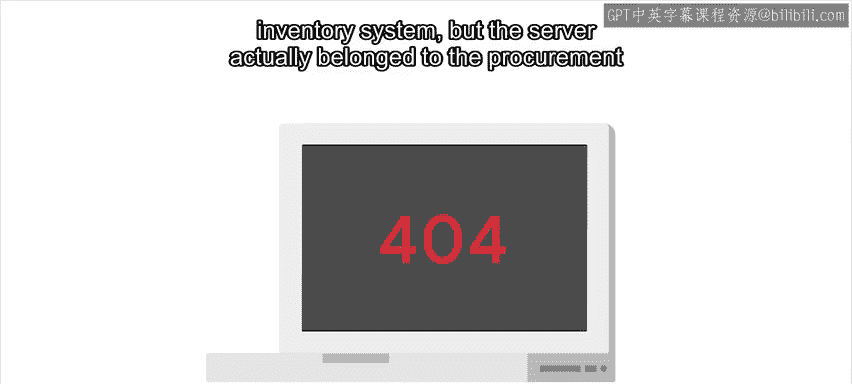
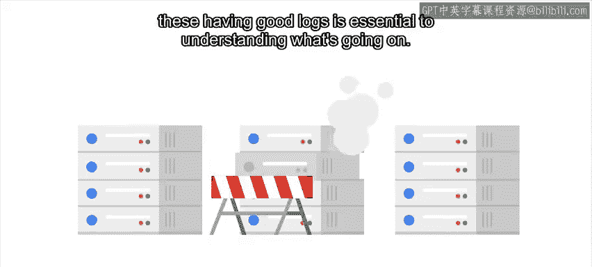
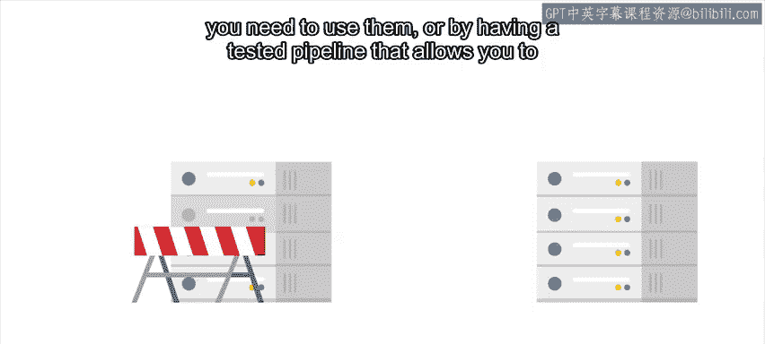
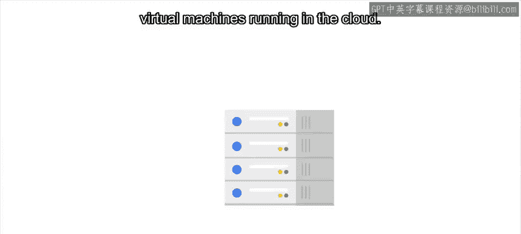

# 谷歌《用Python进行IT自动化办公3、4、5、6课（Git、debug、云端、实践）Google IT Automation with Python》中英字 - P97：39_复杂系统中的崩溃.zh_en - GPT中英字幕课程资源 - BV1LW4y1F7XW

🎼Yeah。

Up to now we've talked about how to diagnose and fix errors that are confined to one computer。

 that's a common case for computers that are used by a single user。

 but once we start going into complex systems that involve many different services will'll need to take a look at the bigger picture and how different computers interact with each other。

 say you're in charge of the ecommerce-commerce site for your company。

 the pages seen by the users recently started responding with internal server error to about 20% of all requests。

How do you figure out what's going on？You'll want to apply the same principles that we saw for troubleshooting a problem on one computer。

 but this time at a larger scale， so you'll want to check the log messages in the servers providing the server and see if you find any additional information pointing to what's causing the issue。

 You'll want to find any log specific to the service that's failing and also look at the general system logs to see if there's a problem affecting the server in general For this example。

 let's say you find a bunch of entries in the logs that say invalid response from server that's not a great error message。

You don't know what the request was or what the response was。

 but it's at least a clue that whatever is happening is related to some other service in the overall system。

 We said that this started failing recently。 So it might make sense to figure out what changed between when it was working correctly and when it started to fail。

 Was there a new version of the system deployed。 Were there any relevant changes regarding the requests。

 Let's say this is happening on a Tuesday morning。 and the latest release of this service was the previous week。

 Things were working fine until today。 And the requests seemed normal。 Nothing out of the ordinary。

 So the service itself is probably okay。 But what about the other services involved in the system。

Was there a new version of one of the underlying systems like the database。

 the authentication service， or some other backend server， like the inventory。

 billing or procurement systems， looking at recent changes。

 you see that there were a bunch of changes made earlier in the day to the load balancer used between the front end and the backend services。

Since the only clue you have is that the response from the service was invalid。

 you're not sure that these changes are at fault。 but they sure seem suspicious whenever possible。

 the best strategy is to roll back the changes that you suspect are causing the issue。

 even if you weren't 100% sure if this is the actual cause。

 if your infrastructure allows easy rollbacks， try that before doing any further investigation。

 why because that way you'll restore the service back to health if it was the cause or you'll eliminate this change as a possible cause if doing the rollback doesn't help。

 whether you do the rollback or not， when coming across unhelpful error messages。

 it's a good idea to improve them。 instead of the error just saying that the response is invalid。

 change it to include what the request and the response were。

 and why the response wasn invalid that way， the next time you're trying to debug a similar issue。

 you already have more information to work with For this example， if the error。

E had included this information。 you'd have seen that the invalid response was a 404 error。

This was caused by having a server added to the pool as part of the inventory system。

 but the server actually belonged to the procurement system Now， say a couple of weeks later。

 you see that again there are a bunch of internal server errors in the same service。

It might be tempting to assume that it's the load balancer's fault once again。But by now。

 you know that you should always look at the logs first and see what you find。

There's no reason why the error should be the same this time when looking at the logs。

 you may notice， for example， that only one of the front end servers is actually affected by the problem。

All the other machines are serving their content successfully in a case like this。

 you'd start by first removing the machine from the pool of servers that can provide this service that way you avoid users getting any more errors while you can investigate what's going on with the broken machine。

As you've probably realized by now， when dealing with complex systems like these having good logs is essential to understanding what's going on On top of that。

 you'll want to have good monitoring of what the service is doing and use version control for all changes so that you can quickly check what's changed and roll back when needed it's also important that you can very quickly deploy new machines when necessary。

 this could be achieved by either keeping standby servers in case you need to use them。

Or by having a tested pipeline that allows you to deploy new servers on demand。

A lot of companies today have automated processes for deploying services to virtual machines running in the cloud this can take a bit of time to set up。

 but once you've done that， you can very easily increase or reduce the amount of servers you're using。

This can help a lot when investigating and solving problems。

 but one thing to take into account when the servers are running as virtual machines。

 especially if they're running in the cloud， is that there might be external limits applied to these services。

 resources like the available CPU time。Ram or network bandwidth might be artificially capped。

 and not only that， the use of certain external services can also be limited。

 like how many database connections you can have at the same time。

 or how much data you can store if these limits are causing problems with your application。

 you might need to rethink how you use your resources。

We've covered a bunch of techniques that you can use when facing a problem in a complex system。

Looking at the available logs， figuring out what changed since the system was last working。

 rolling back to a previous state。Removing faulty servers from the pool or deploying new servers on demand up next。

 we'll explore a different part of dealing with bigger incidents， communication and documentation。

