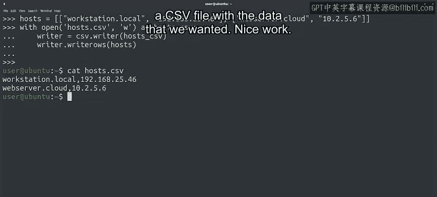

# 谷歌《用Python进行IT自动化办公1、2课（Python、控制操作系统）｜Google IT Automation with Python》中英字幕 - P98：24_生成 CSV.zh_en - GPT中英字幕课程资源 - BV1gw411E7E1

🎼。う。

In the last video， we used the reader function from the CSV module to read the contents of a CSV file。

Similarly， we can use the writer function to generate contents to a file。

This can be really helpful if you process some data in your script and you want to store it in a file。

Maybe you want to import it into a spreadsheet or use it later on in your script。

 We'll start by storing the data that we want to write into a list。We created a list of lists。

This is the data that we want to store in the CSV file。

 representing the names of the machines in our network and their IP addresses。 All right。

 with that data ready to be written， let's open the file in right mode。

We'll use the width block that we saw before， so we don't forget to close the file。Okay。

 now that we have the file open for writing， let's call the writer function of the CSV module with this file as a parameter。

The writer variable is now an instance of the CSV writer class。

 There are two functions that we can use。 Write row。

 which will write one row at a time and write rows， which will write all of them together。

In this case， we already have all the data that we want to write， so we'll call W rows。Nice。

 with that， we've written our data to the CSV file Before we move on。

 let's see how this looks when we use a tool outside of Python like the Cat command。All right。

 our code worked， and we generated a CSV file with the data that we wanted。 Nice work。😊。

We're on a roll， so let's keep going In the next video。

 we'll learn how to read and write CSV files with dictionaries。 I'll see you there。

