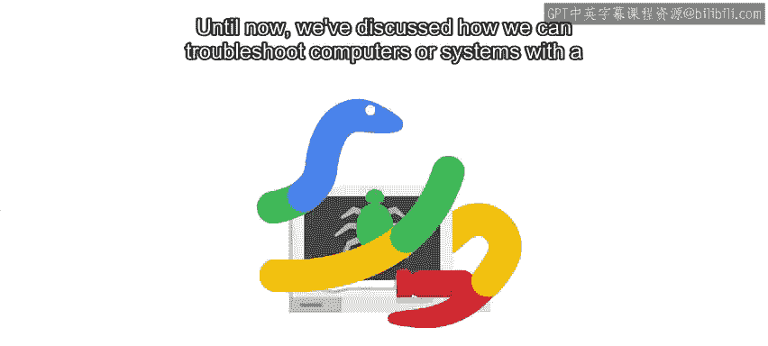
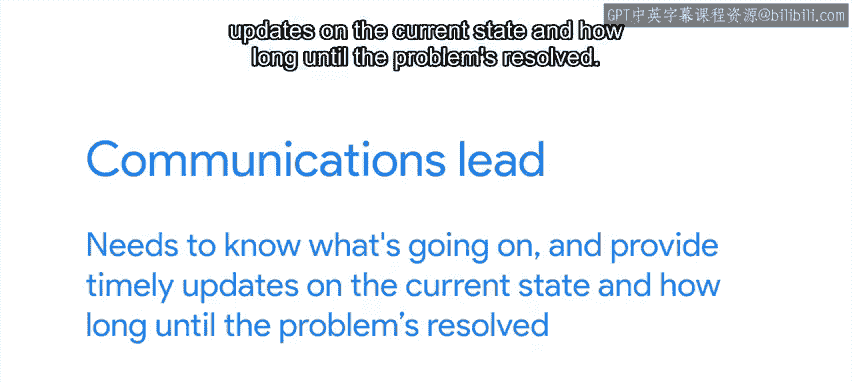
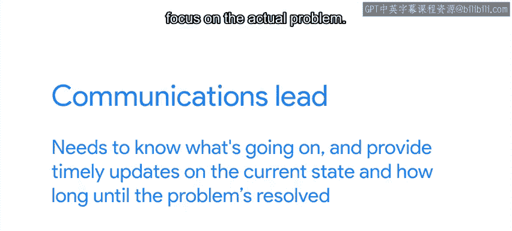
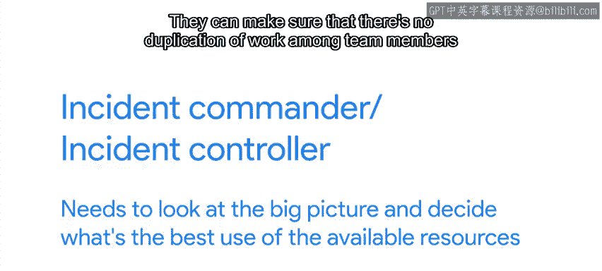
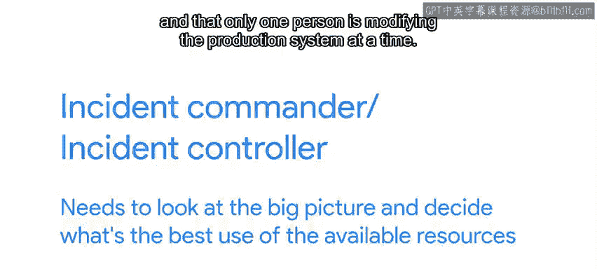
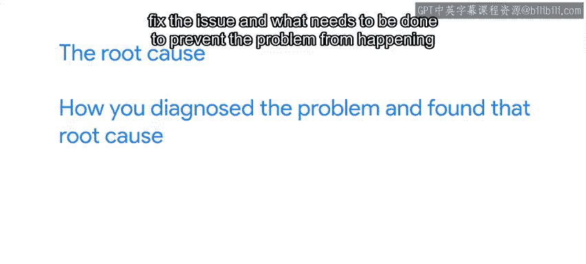
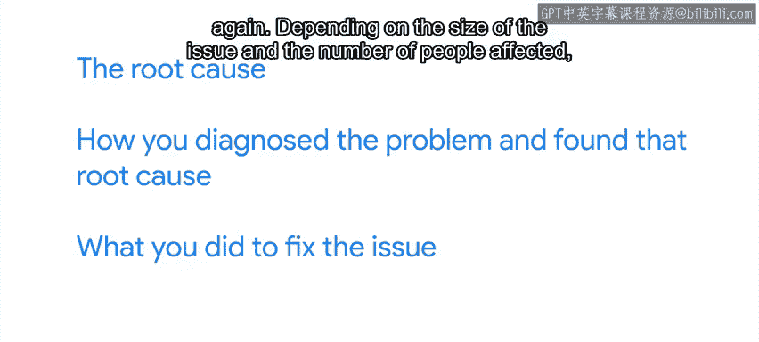

# 谷歌《用Python进行IT自动化办公3、4、5、6课（Git、debug、云端、实践）Google IT Automation with Python》中英字 - P98：40_事件期间的沟通和文档记录.zh_en - GPT中英字幕课程资源 - BV1LW4y1F7XW

🎼Yeah。

Until now， we've discussed how we can troubleshoot computers or systems with a specific issue。

We've covered how we can get enough information so we can identify the root cause and then apply the necessary remediation。

 There's another aspect to all of this， which is related to how we handle the communication with those affected by the issue and how we distribute tasks when addressing large issues as a team armed with what you've learned so far and you past experience you might do a great job troubleshooting a problem but if you drop the ball when it comes to communicating what you're doing。

 you could end up with a bunch of frustrated users calling you to find out what's going on。

And if you don't write down what you've tried or how you fixed a problem。

 you risk for getting some important details and wasting a lot of valuable time when you need to revisit an issue when working on a problem。

 it's always a good idea to document what you're doing in a bug or ticket。

If there's no such system at your company， then use a Doc， a text file， a wiki。

 or whatever you have access to， documenting what you do lets you keep track of what you've tried and what the results were。

This might seem unnecessary， but after a whole day of troubleshooting a problem。

 it's pretty common for us to forget what we've tried。

Or what was the outcome of a specific action on top of that。

 having all this info available in some electronic form lets you easily share all the data you've collected with other team members and if for example。

 you rolled something back which turned out to be unrelated。

 having the whole process documented helps you remember to roll it forward again while you're working on a problem it's important to communicate clearly with those affected by the issue they'll want to know what you figured out about the problem。

 what the available workarounds are and when they can expect the next update。

If you don't know what the problem is， it's hard to give an estimation of when you'll have it fixed。

 but you can still provide timely updates about the work you're doing。

 This kind of regular communication is helpful， no matter the size of the incident。

But the more people affected， the more you'll want to provide regular updates with clear instructions of what users can do and what they can expect as a solution that way。

 they can better plan and organize their time。If access to the internet is down。

 you'll want to let people know if they can expect a fix in one or two hours or if it's going to take the whole day。

 this info can make a difference between people choosing to discuss issues in person for a couple of hours or deciding to work from home。

If the issue was big enough that you're involving more people in finding a solution。

 you should agree on who's going to work on which tasks， for example。

 you could have someone working on finding out a temporary workaround while someone else is in charge of understanding the root cause of the problem and finding the long-term remediation。

Or if there are lots of possible causes for the issue。

 you could divide the causes among the team members and have them work on those in parallel on top of people looking for the root cause and a solution。

 you'll want to have a person in charge of communicating with the people affected。

This lets the team avoid forgetting to update the tracking issue or even worse。

 providing contradictory information， this communications lead needs to know what's going on and provide timely updates on the current state and how long until the problems resolved。

They can act as a shield for questions from users， letting the rest of the team focus on the actual problem。

 Similarlyly， there should be one person in charge of delegating the different tasks to the team members this person sometimes called the incident commander or incident controller。

 needs to look at the big picture and decide what's the best use of the available resources。

They can make sure that there's no duplication of work among team members and that only one person is modifying the production system at a time。

 having multiple people make overlapping changes to the system could lead to confusing results。

 making the outage even longer Of course， this division of roles makes the most sense when there's a large incident and there's a big team working on figuring out the solution。

If it's only two or three people working on the problem。

 it's still important to agree who will work on what。

 but you probably don't need to use any special role names to do that。

Once the issue has been resolved， it's super important to sum up the information that was helpful。

 the most important information that you'll want to include are the root cause。

 how you diagnose the problem and found that root cause。

 what you did to fix the issue and what needs to be done to prevent the problem from happening again。

Depending on the size of the issue and the number of people affected。

 this summary could just be the last update to the bug or ticket that you use to keep track of your work。

Or it could be a full postmortem。What's a postmortem and how do you write one you ask， well。

 that's coming up in our next video。