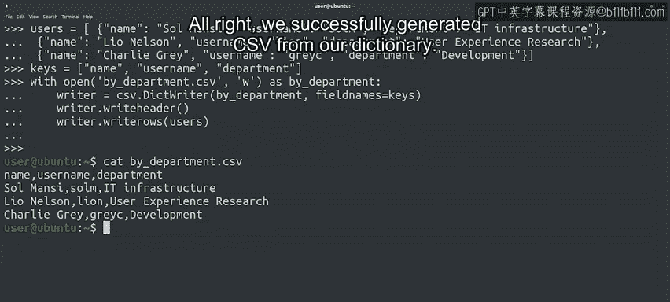

# 谷歌《用Python进行IT自动化办公1、2课（Python、控制操作系统）｜Google IT Automation with Python》中英字幕 - P99：25_使用字典读写 CSV 文件.zh_en - GPT中英字幕课程资源 - BV1gw411E7E1

In our earlier examples， we saw how we can read and write CSV files。

 and we use L as a data type on the Python side。This works when we know what the fields are going to be。

But it can be pretty cumbersome when we have a lot of columns and we need to remember which is which。

Imagine if your list of employees not only had name， phone number， and role， but also start date。

 username， office location， department， preferred pronouns， and so on。

It would soon get hard to keep track of which column corresponds to which position in the row。

For cases like this， it's common for CSVs to include the names of the columns as the first line in the file。

 like in this example。This CSV file lists a bunch of internally developed programs used at the company。

 including the latest version， the current development status， and the number of people using it。

Check out how the first line of the file includes the names of each of the fields we can profit from this additional information by using diict Reader。

 a slightly different reader that's also provided by the CSV module。

This reader turns each row of the data in a CSV file into a dictionary。

We can then access the data by using the column names instead of the position in the row。

 let's see how that looks。So here we're opening the file and creating a dit reader to process our CSV data。

Then when going through the rows， we can access information in each row using the keys。

 just like we would when accessing data in the dictionary。

See how we use row name and row users to get the name of the number of users。

Let's execute this and see what happens next。As you can see。

 we've successfully printed the contents of the two fields that we wanted。

Two important things to call out here。 One， the order of the field in the file doesn't matter。

 We can just use the name of the field instead。 And two， chty chicken is still alpha。

 So only has four users。 But you know a name like that。 it's going to be a hit。

So we can use Dic Writer in a similar way to generate a CSV file from the contents of a list of dictionaries。

This means that each element in the list will be a row in the file。

 and the values of each field will come out of each of the dictionaries。For this to work。

 we'll also need to pass a list of the keys that we want to be stored in the file when creating the writer。

 let's see this in action。First， we need a list of dictionaries with the data that we want to store。

For this example， we want to store data about the users in our company and the departments that they work in。

So here we have our list of dictionaries and each contained the keys， name， username， and department。

We now want to write this to a file， and the code will look like this。

So we first defined lists of keys that we want to write to the file。

 Then we open the file for writing。 Next， we created the diict writer passing the keys that we had identified before。

And then we call two different methods on the writer。

 the right header method will create the first line of the CSV based on the keys that we passed。

And the right row method will turn the list of dictionaries into lines in that file。

 Let's check if this worked correctly。All right， We successfully generated CS SV from our dictionary。

 Nice， right。😊。

Let's take a moment to acknowledge everything you've learned about managing files over the last few videos。

 you can read， write， and work with files and directories。

 and now you can also read and write CSV files。You started this course with fundamental knowledge of Python。

 and you've progressed so much in just a few videos。 Remember。

 we don't expect you to learn everything by heart。 You'll pick it all up with practice。

 which is why up next， we've got another cheat sheet for you。😊，In it。

 you'll find a rundown of everything we just covered。

 so you can refer to it whenever you need a little refresher on working with CSV files。

After you check that out， head on over to the quiz and put your new knowledge to the test。

