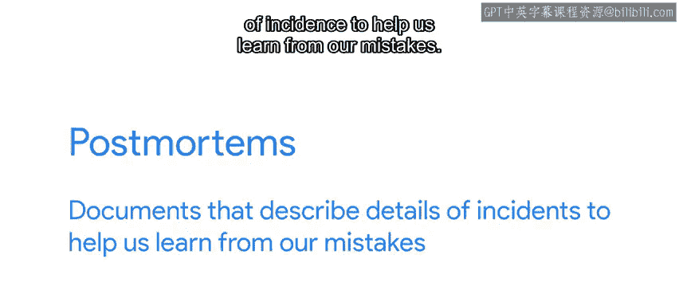
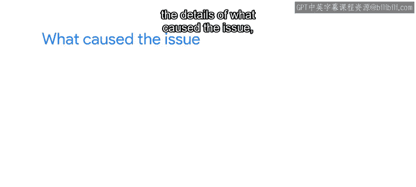
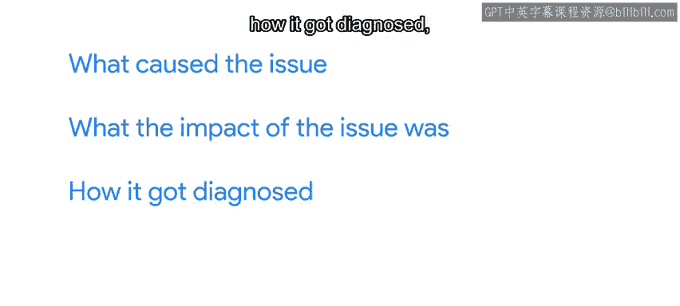
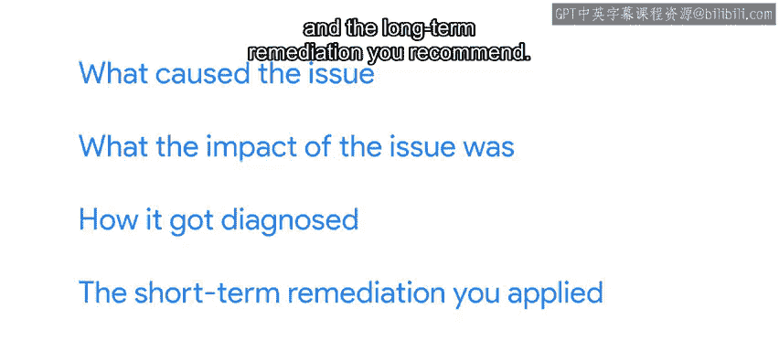
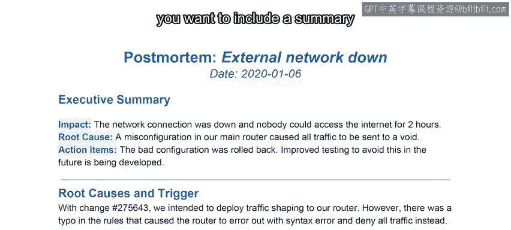

# 谷歌《用Python进行IT自动化办公3、4、5、6课（Git、debug、云端、实践）Google IT Automation with Python》中英字 - P99：41_编写有效的事后分析报告.zh_en - GPT中英字幕课程资源 - BV1LW4y1F7XW

。

In our last video， we talked about the importance of communication and documentation when troubleshooting incidents。

 and we called out that if the issue is big enough。

 we might want to document what happen in a postmortem。

 postmortems are documents that describe details of incidents to help us learn from our mistakes。

When writing a postmortem， the goal isn't to blame whoever caused the incident。

 but to learn from what happened， to prevent the same issue from happening again， to do this。

 we usually document what happened。 why it happened， how it was diagnosed， how it was fixed。

 and finally， figure out what we can do to avoid the same event happening in the future。

 And remember the main goal is to learn from our mistakes。

 writing a postmortem isn't about getting someone fired。

 but about making sure that next time we do better。

Writiding postmortems after dealing with incidents is important because it helps us avoid dealing with them again。

 or at least learn how to deal with the next incident better。

 While postmortems are super useful with large incidents。

 you don't need to wait until something huge happens to write your first postmortem。

 you can practice writing them for any kind of event where there's something to be learned。

 no matter how small， that way， when you need to write a postmtem after a big incident。

 you know how to concentrate on the things that matter the most。

 what you can learn from the problem and how you can prevent it in the future。

 So what should you write in a postmortem。The exact structure might vary depending on preference and the type of incident that you're dealing with。

In general， you'll want to include the details of what caused the issue。

 what the impact of the issue was， howvi got diagnosed。

 the short term remediation you applied and the long term remediation you recommended。

If the document is long and you're going to share it with a lot of people。

 you'll want to include a summary that highlights the root cause， the impact。

 and what needs to be done to prevent the issue from happening again。

It's useful to include what went well in postmortems too。When working on a problem。

 we might realize that it would have been much worse if we didn't have certain tools or systems available。

 For example， we might say that we were able to solve the problem quickly by doing a rollback to the previous version。

 or that we caught the issue before users even noticed it because we had good monitoring and alerting。

Noting the things that went well helps us show that our systems are effective and justifies keeping those systems running。

 writing a postmortem can sometimes help you understand the services that you're working with much better Earl this year。

 a service I worked on had a large outage， and I needed to provide information on what happened。

To do this， I needed to parse through hundreds of gigabytes of archived log data to show that certain data had never been received by the service。

Doing this， I realized that I needed to improve the data logged by our tools to give better information and have better reporting。

You can even practice writing postmortems outside of the IT context。

 like if you bake cookies and they don't turn out as great as you wanted them to document what you did and what went wrong。

What went right and how you can improve the results in the future。

 You can do this with any hobby that you have， maybe photography。

 3D printing or brewing your own beer。 You don't always need to write the whole thing down。

Sometimes a mental note is enough。Like if you bike to work and realize wearing your backpack hurts your shoulders。

 make a mental note to add a basket to your bike so you can put your backpack there next time。

 or if on your last trip， it was colder than expected and you forgot to bring a jacket。

 Make a mental note that next time you should check the weather before you leave and once again。

 remember that the most important part of a postmortem is what we can learn for the future。

So if instead of writing a whole document， you're creating a one paragraph summary of the incident。

Remember to focus that paragraph on what you can do better。

 not on whatever mistake caused the incident。Up next。

 we've got a quick quiz to check that everything still makes sense。

