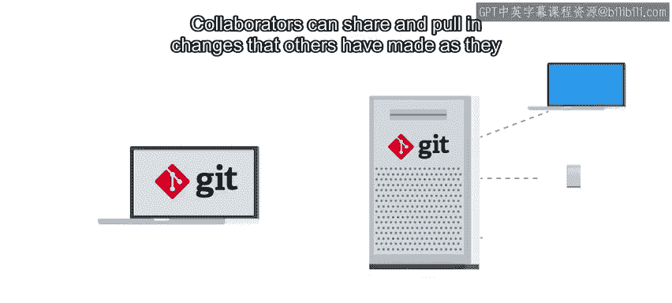
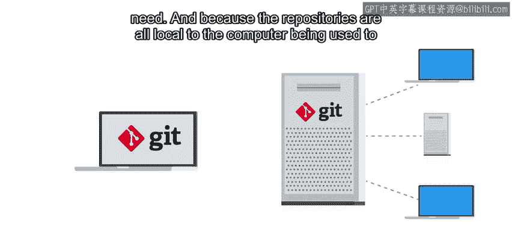
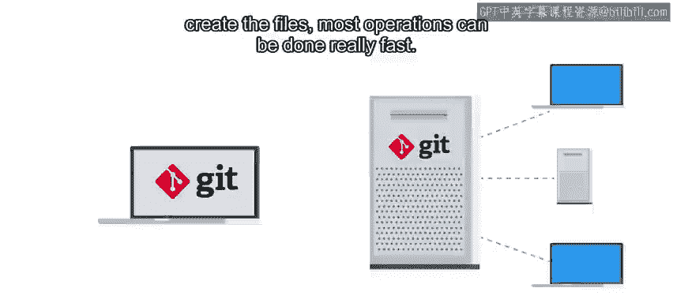

# 谷歌《用Python进行IT自动化办公3、4、5、6课（Git、debug、云端、实践）Google IT Automation with Python》中英字 - P9：8_什么是 Git.zh_en - GPT中英字幕课程资源 - BV1LW4y1F7XW

🎼。う。

Git is a VCS created in 2005 by Linus Tovalt， the developer who started the Linux kernel。

Gitt is a free open source system available for installation on Uni based platforms。

 Windows and Mac OS。Linnus originally created Git to help manage the task of developing the Linux kernel。

This was difficult because a lot of geographically distributed programmers were collaborating to write a whole bunch of code。

Lnus had some requirements for the way that the system worked and its performance that weren't being met by the VCS tools at a time。

 so he decided to write his own。Gitt is now one of the most popular Virgin control systems out there and is used in millions of projects。

Unlike some version control systems that are centralized around a single server。

 Git has a distributed architecture， this means that every person contributing to a repository has full copy of the repository on their own development machines。

Collaborators can share and pull in changes that others have made as they need。

And because the repositories are all local to the computer being used to create the files。

 most operations can be done really fast， if you want to collaborate with others。

 it usually makes sense to set up a repository on a server to act as a kind of hub for everyone to interact with。

But Git doesn't rely on any kind of centralized server to provide control or organizations to its workflow。

 Git can work as a standalone program as a server and as a client。

 This means that you can use Git on a single machine without even having a network connection。

Or you can use Git as a server on a machine where you want to host your repository。

And then you can use Git as a client to access the repository from another machine。

Or even the same one？Git clients can communicate with Git servers over the network using HTTP， SSH。

 or Gits own special Pro。If you're curious about diving deeper into GS architecture or communication protocols。

 we've put a link for more information in the next reading。

So you can use Git with or without a network connection。

You can use it for small projects with like one developer or huge projects with thousands of contributors。

 you can use it to track private work that you can keep to yourself。

 or you can share your work with others by hosting the code on public servers like GitHub。

 Gitlab or others。Are you starting to see how powerful Gi can be。When looking for information online。

 you might notice that the official Git website is called gitscm。

com and wonder what's the SCM at the end for。It's actually another acronym similar to VCS。

 it stands for source Control Management。While both terms mean the same。

 we generally prefer VCS because as we've called out already。

 these systems can actually be used to store much more than just source code。In this course。

 we chose Git for its popularity， multiplat support and robust set of features。

 as with most things in the IT world though， there are plenty of other tools that can be used to accomplish the same task。

 There are other VCS programs like subversion or Mercurial。

Feel free to experiment with alternatives if you think another VCS might better serve your needs。

 but before we jump into how to use it， let's go through another quick quiz to check that everything up until now is making sense。

