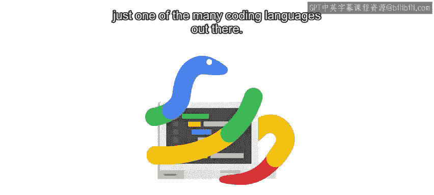
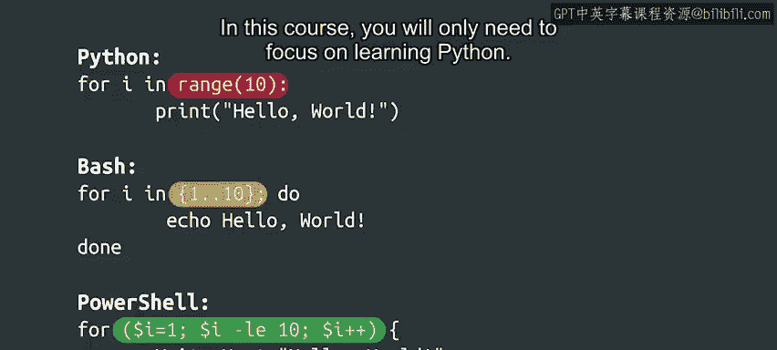

# 谷歌《用Python进行IT自动化办公1、2课（Python、控制操作系统）｜Google IT Automation with Python》中英字幕 - P9：8_其他语言.zh_en - GPT中英字幕课程资源 - BV1gw411E7E1

。

Although we picked Python for this course， it's important to note that it's just one of the many coding languages out there。

Think of a given programming language as just one of the many powerful tools in your I T toolbox。

 Each language has its unique set of pros and cons。 Some run faster than others。

 Some are better suited for enterprise applications。

 Other are particularly good at crunching numbers。 There are platform specific scripting languages like Powerhell。

 which is used on Windows and bash， which is used on Linux。

 Both are widely used by system administrators on those platforms。

 There are also general purpose scripting languages similar to Python like Pearl or Ruby。

 which are also widely used for scripting and automation。😊，Javascript。

 which was originally developed as a client side scripting language for the web。

 is increasingly used as server side for a broader set of tasks。 And the list doesn't stop there。

 There's a vast array of traditional languages to explore like C C plus plus Java or go。

 as you progress in your career in I T， you'll probably encounter a number of different languages and learn when to use each of them。

 But let's not get ahead of ourselves。 First， we have Python to get our heads around。

 A nice feature of learning the basics of programming in one language is that you can generally apply the same concepts you learn to other languages。

 This means that once you're familiar with Python， you'll find it easier to pick up new coding languages。

 as you'll spot and understand similarities and differences between them。 After all。

 every language needs to do some common things like create variables， control the flow of a program。

 read input and display output。 Even if they do these tasks using different approaches。

 As we called out earlier， learning a programming language is somewhat similar to learning a foreign language。

 You'll need to grasp the syntax and。😊，For that language，Luckily for us， once。

 you know the fundamentals of programming， learning another language is much easier than learning a second foreign language。

There are a lot more similarities between programming languages than differences to explore some of the similarities and differences between various scripting languages。

 let's take a look at a simple program that prints the words hello world 10 times in three different languages。

 Python， bash and power shellll。 As you can see， each language uses a different approach to printing hello world。

 But look closer and you'll see similarities， too。 Each language must somehow put text onto the screen。

 The command for Python is print for bash It echo。 and for powershell， its right host。😊。

Also notice that each language has to count to 10 in some way。

 while Python does this by specifying range 10， Bash uses a sequence notation to count from 1 to 10。

 Powerhell has the most complex syntax in this example。

 but it also boils down to starting at one and counting up to 10。

So as we've just seen there's a whole lot of programming languages out there。

 but don't let that scare you in this course you will only need to focus on learning Python once you can speak Python。

 you can go on to learn any other language you want Up next we've got another quiz to help you practice what you've just learned。

😡。