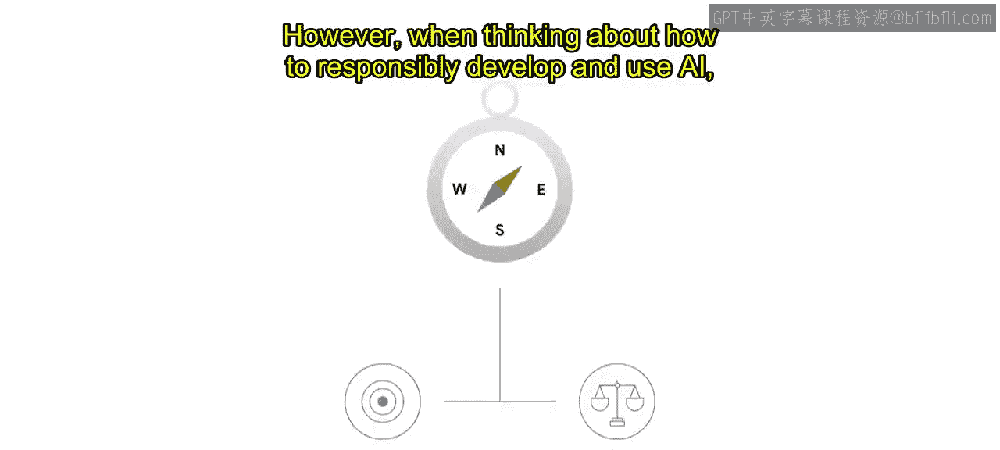
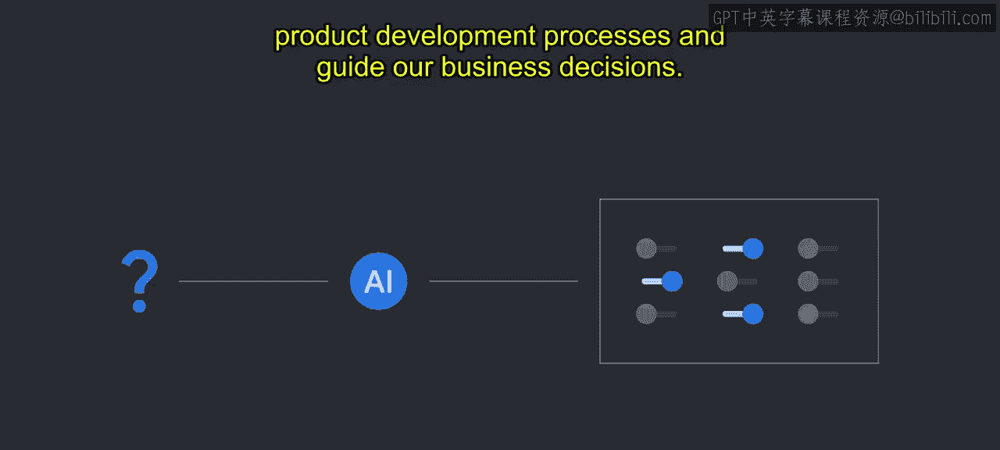
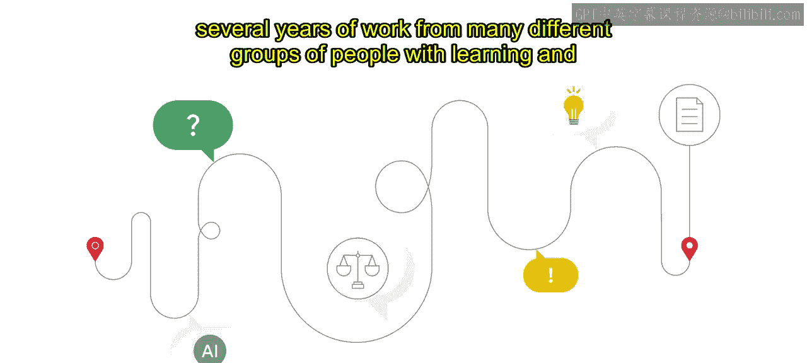
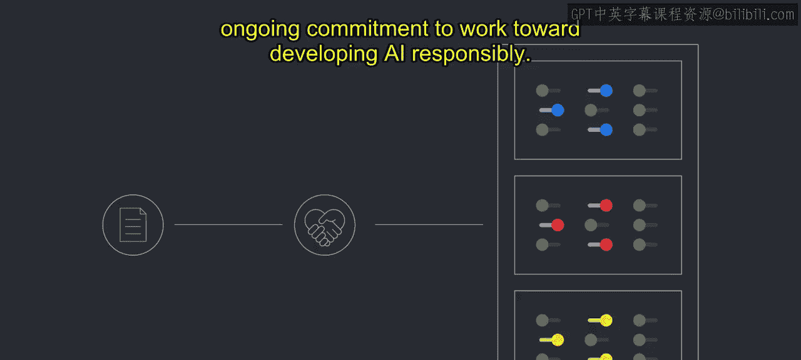
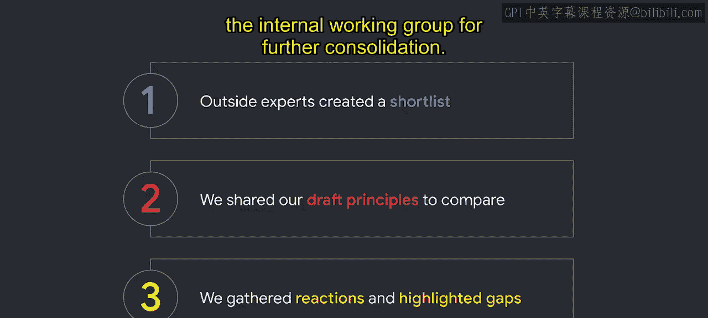

# 谷歌云《生成式AI学习路径（简介、LLM、负责的AI、应用）｜Introduction to Generative AI Learning Path》中英字幕 - P11：7_Google的AI原则是如何制定的.zh_en - GPT中英字幕课程资源 - BV1GM4m1m7xm

Google's mission and values have been our guiding principles for many years。However。

 when thinking about how to responsibly develop and use AI。

 we need to design a set of AI principles to actively govern our research and product development processes and guide our business decisions。

When we set out to write our AI principles， there were some pioneers in the field。

 but there wasn't a lot of industry guidance to help set the course。

Things have changed a lot since then， and the list of organizations that have developed guidelines for the responsible use of AI has grown considerably。

As illustrated by the Berkman Klein Centre report， principled artificial intelligence。

Many organizations have defined their own AI principles。And by Cap Geminize research。

 that number grew by 40% between 2019 and 2020。Cap Gemini also found that ethically sound AI requires a strong foundation of leadership。

 governance and internal practices around audits， training and operationalization of ethics。

As you work to create AI principles in your organization。

 we'd like to share the process we took to create ours。

We want to acknowledge we are not the only ones implementing AI principles。

And you should do your research and take the best learnings from various initiatives。

It's our hope that you can learn from our process， challenges and experiences and ultimately create and use your own AI principles as a foundation for your development process。

From our mission statement and values defined at the beginning to ongoing work by teams on topics such as ethics and compliance。

 trust and safety and privacy。Google has had many different initiatives over the years to help guide our work responsibly。

As AI emerged as a more prominent component of our business。

 there were many teams advocating for a responsible AI approach through a growing awareness of the importance of M L fairness specifically。

What we didn't have was a forn and comprehensive approach to the broader goals of responsible AI that all Googlers could unite behind。

Work on Google's AI principles started in the summer of 2017。 When our CEO。

 Sunnda Pii designated Google an AI first company。With this company wide vision as our foundation。

 we set out to design an AI ethical charter for Google's future technology。

This effort would evolve into our AI principles。It's important to note that this journey wasn't always smooth。

It's the result of several years of work from many different groups of people with learning and iterating along the way。

We understand this is a complex and evolving topic。

 and we'll share some of our lessons learned in a later module。

But what has shown itself to be true is that it takes ongoing commitment to work toward developing AI responsibly。

Today and in the future， we fully expect to continue iterating on our methods and interpretations as we learn and the field evolves。

We believe that organizations and communities flourish when。

 in addition to individuals' ethical values， there are also shared ethical commitments that each person plays a part in fulfilling。

Having a set of shared and codified AI principles keeps us motivated by a common purpose。

 in addition to the values we all individually hold。

Google recognized the need to not only focus on technical development and innovation。

But also ensure that development aligned with our mission and values。

A cross functional group of experts was assembled to determine what guidelines were needed to address the important challenges raised by AI。

When creating the team， we didn't just rely on functional expertise in artificial intelligence。

Instead， individuals were chosen who represented different skills。

 backgrounds and demographics across Google。From a skill perspective。

 we sought people for the core group with backgrounds in user research， law， public policy， privacy。

 online safety， sustainability and nonprofits。We also sought input from experts in AI。

 human rights and civil rights， and product experts who weren't strictly in the core working group。

We incorporated input across a broad range of diverse voices。

 including people from different countries， genders， races， ethnicities and age groups。

We also developed ways for those not directly in the working group to have a voice。For example。

 we asked every member to solicit discussion and feedback from other teams and external experts and to bring back ideas to the core group。

Having a small group charged with taking action based on input from as many stakeholders as possible was key to our success。

Incorporating a broad range of voices when creating your AI principles makes the principles more inclusive and also fosters trust in the process。

The team started by conducting research。We wanted to document what concerns people had regarding AI。

What did people consider irresponsible AI？The team scoured user and academic research from a wide range of sources。

And analyzed how AI was represented in the media。We even researched cultural and pop cultural AI references。

Like how AI was being portrayed on TV shows and in scifi books to gain a better understanding of how consumers might perceive AI。

All of this research would help us discover the standards that we wanted to guide our work。

After that， the team began an iterative process to draft a set of principles aimed at addressing the major concerns and themes identified in the research。

We started by aggregating and organizing all of the research into categories。

 which produced a long list of potential principles。

To refine this list， we first asked outside experts in AI policy。

 law and civil society without seeing our draft principles to come up with their own shortlist。

We then shared our draft principles created from research to compare。And finally。

 we gathered their reactions and highlighted gaps to bring back to the internal working group for further consolidation。

We engaged in a continuous feedback and refinement process to further consolidate the list of principles while maintaining a wide breadth of coverage and recognizingogni anything we may have overlooked。

What resulted was Google's AI principles， including seven objectives for AI applications。

 which guide our AI aspirations， as well as a list of four AI applications we will not pursue。

The goal of identifying the AI applications we will not pursue was to provide clear guard rails around highly sensitive AI application areas we will not design for across all parts of our business。

Acknowledging what we explicitly won't build at all is just as critical as outlining what we will。

This work culminated when Google published our AI principles in June of 2018。As a company。

 we remain dedicated to putting these principles into practice every day。

They are incorporated into daily conversations。 They form the foundation for opportunityport and harm reviews in the product development process。

And most importantly， they provide a shared ethical commitment for all Googlers when making decisions。

What we've described here is the journey Google took to codify our principles。

 while the field of responsible AI was in its early stages。

The body of research on ethical requirements， standards and practices in AI has grown a lot since then。

 especially thanks to the pioneering work of scholars of color and communities of advocates。

There's been a relative convergence in the AI community around what AI principles should encompass to be useful。

While your company's mission， values， geographic presence。

 and organizational goals will influence your approach。

Making some principles more relevant to your particular business context than others。

There are a clear set of themes that apply to all uses and industries to help you get started。

For example， if your company is involved specifically in creating chatbots for customer support。

While there may be core themes， some of your AI principles may look different or more specific to your context from those of a consulting company involved in a very wide range of use cases for different customers。

We hope that this insight into our approach is helpful to your organization。

 providing a scaffold to build upon。The challenges you face and your organization's values will define your process for identifying and creating your own AI principles that both convey the ethos of your organization and serve as a foundation for your AI governance。

