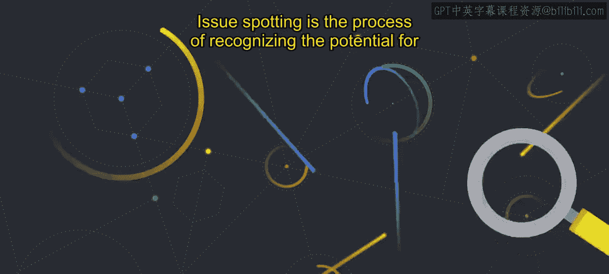
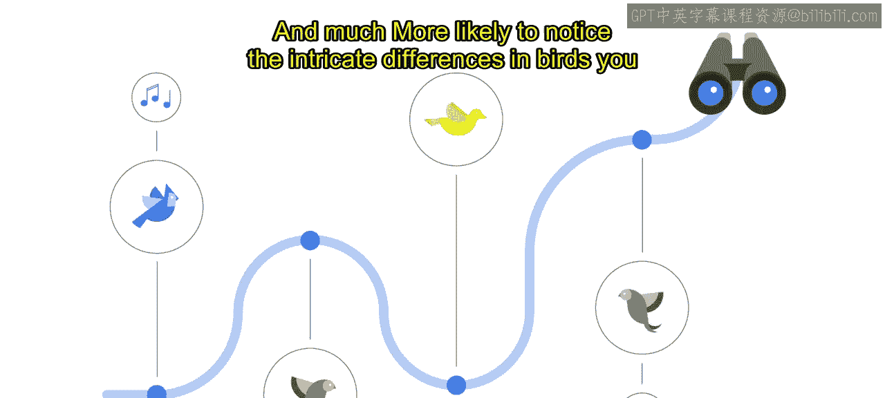
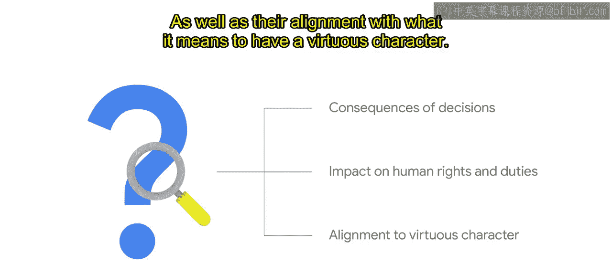

# 谷歌云《生成式AI学习路径（简介、LLM、负责的AI、应用）｜Introduction to Generative AI Learning Path》中英字幕 - P12：8_伦理问题发现.zh_en - GPT中英字幕课程资源 - BV1GM4m1m7xm

A core part of AI governance is a robust issue spotting practice。

Issue spotting is the process of recognizing the potential for ethical concerns in an AI project。

The AI principles your organization develops can be a guide for spotting these issues。

To address ethical concerns， we first need to identify them。

It may be tempting to try and make this process more efficient through checklists or outlining what is and isn't possible for each principle。

We know it's tempting because we tried it。We tried to create decision trees and checklists that would ensure our technology would be ethical。

That didn't work。The reality is that we need to address ethical issues。

 not just in familiar products or use cases， but also by recognizing new risks that we have never seen before emerging from new technologies。

Each use case， customer and social context is unique。

A tool or solution aligned with our AI principles in one context could be misaligned in another。

Technologies we've never imagined are being developed at rapid speed and scale that require an adaptive process。

 not rigid， prescriptive yes or no answers。It's not feasible to expect to create a simple checklist for each use case to meet your AI principles。

 We've learned that there's no replacement for careful review of the facts of each case。

A useful analogy is to think of ethical issues like birds。 They're all around us， often unseen。

They tend to be found in some areas more than others， and they range from big to small。

 exotic to ordinary。Noticing them gets easier with practice on your way to work。

 you probably passed a lot of birds， but you probably didn't really notice them。Now。

 imagine if you are a trained bird watcher， You'd be more sensitized to the species you encounter along your route and much more likely to notice the intricate differences in birds you pass every day。

Similarly， in issue spotting， the goal is to become more sensitized。

 to be able to quickly and accurately identify and classify ethical issues and risks。

As with bird watching， you see more as a team。 so having multiple reviewers helps。

No one individual can see everything that's there， and there exist special tools that enhance spotting abilities。

In the case of ethical issues spotting， moral philosophers have spent thousands of years developing lenses to help identify ethical issues。

While you may look at the various philosophical lenses and wonder which you should choose to align with。

 we've discovered that it isn't really about choosing one approach over another for all scenarios。

In practice， leveraging ethical lenses provides a structured way of considering issues from multiple angles and perspectives to make sure we are surveying and servicing what is important to consider。

Learning when and how to use such lenses allows you to switch between assessing the consequences of your decisions。

 their impact on human rights and duties， as well as their alignment with what it means to have a virtuous character。

If you want to learn more about ethical lenses。

See the materials from the Marulula Center for Applied Ethics。

