# 谷歌云《生成式AI学习路径（简介、LLM、负责的AI、应用）｜Introduction to Generative AI Learning Path》中英字幕 - P13：9_Google AI原则的伦理目标.zh_en - GPT中英字幕课程资源 - BV1GM4m1m7xm

At Google we have identified some core ethical aims。

 which can be seen as an explanation of the ethos behind each of the AI principles。

These ethical aims help us assess against the principles in a consistent way。

Ethical aims can help be a guide for what ethical issues may exist， but don't represent a checklist。

Let's walk through some of the core ethical aims， known as objectives for AI applications that make up our AI principles。

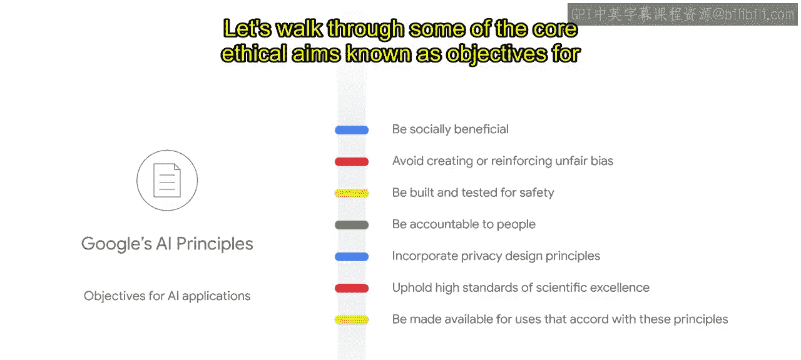

The first， be socially beneficial， seek to support healthy social systems and institutions。

 For example， this might mean preventing automated systems from unfairly denying essential services for people's well being。

 like employment， housing， insurance or education。

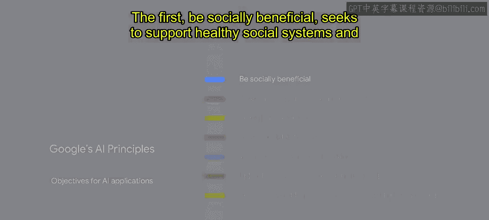

The principle also aims to reduce the risk of social harm in terms of quantity， severity。

 likelihood and extent。It aims to diminish risk to vulnerable groups。😡。

And it also aims to reduce the risk of unintended harms。

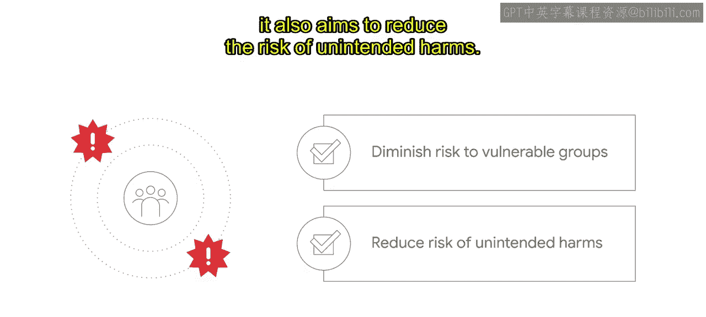

The second principle， avoid creating or reinforcing unfair bias。

 aims to promote AI that creates fair， just and equitable treatment of people and groups。

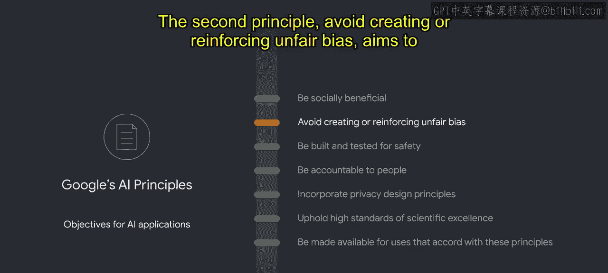

It should limit the influence of historical bias against marginalized groups in training data。

 both through data that's included and data that's absent or invisible due to historical exclusion。

Through this principle， we pay close attention to the impact that technology discrimination might have on the usefulness of the product for all users。

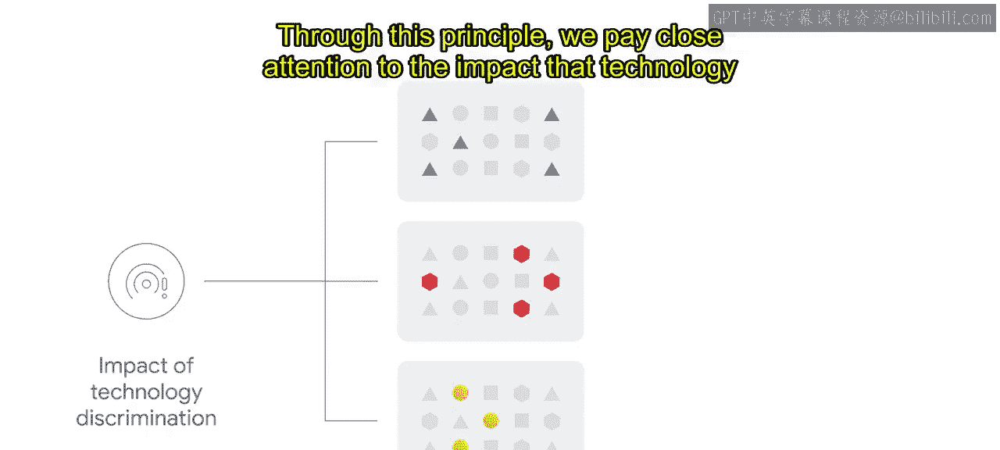

Take， for example， someone doing an image search for wedding。

An AI image classifier trained on bias data may only apply the label wedding to images of couples wearing traditional Western wedding attire。

However， an image where the couple is wearing traditional wedding attire from another culture may just be labelled as people instead of wedding。

What this demonstrates is how this image classifier may not recognize wedding images from different parts of the world or cultures。

These are not the kinds of labels and distinctions we want to be seeing。

 and this will be an example of a data set that doesn't reflect our global user base。Underrepresent。

 as depicted in this example， is harmful。Recognsizing this。

 Google is committed to building global products that are intended to work for everybody。

To bring greater representation across a full range of diversity。

 Google ran a competition that invited global citizens to add their images to an extended data because training data has to be able to represent societies as they are。

 not as a limited dataset might represent them。What's important to recognize is that unfairness can enter into the system at any point in the ML life cyclee from how you defined the problem originally。

 how you collect and prepare data。How the model is trained and evaluated and onto how the model is integrated and used。

At each stage in this flow， developers face different responsible AI questions and considerations。

Within that life cycle， the way we sample data， the way we label it。

 how the model was trained and whether or not the objective leaves out a particular set of users。

Can all work together to create bioys。Rarely can you identify a single cause of or a single solution to these problems？

The work of machine learning fairness is to disentangle these root causes and interactions。

And to find ways forward with the most fair solutions possible。

How we do that is by getting clarity on the questions that need answering at each stage of the life cycle。

 such as。What problems will the model solve？Who are the intended users。

What other groups may be impacted？What groups are invisible today？

How was the training data collected， sampled and labeled？Is the training date skewed？

How was the model tested invalidd？And is the model behaving as expected？

While not meant to be a comprehensive list， we've found questions like these asked at each stage to be helpful in guiding our investigations and recognizingogni possible unfair bias。

While these questions can be hard to answer and require a range of sociootechical inputs。

There are foundational tools to help in that process。

Some of them are open source via the TensorFlow ecosystem。

Some of them are managed products from Google Cloud。We won't focus on the tools here。

 but you can check out the resources for links to them。

These questions have a huge impact on how data sets and models get developed。

Some of these questions seem simple， but are in fact often underestimated。

 which can result in significant last minute changes to projects or even cancelling projects altogether。

At its core， doing AI responsibly is about asking hard questions。The third。

 be built and tested for safety， seeks to promote the safety。

 both bodily integrity and overall health of people and communities。

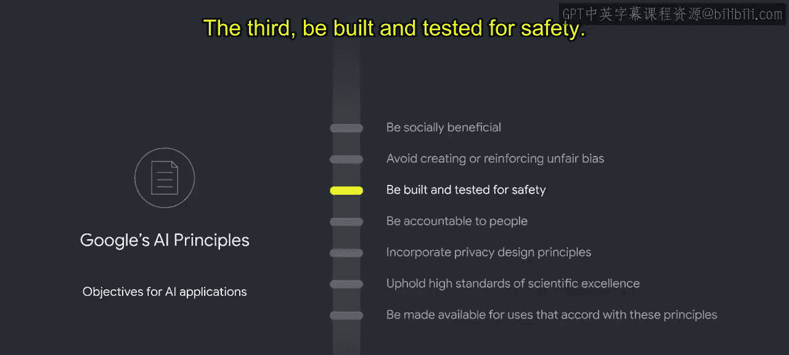

As well as the security of places， systems， properties。

 and infrastructures from attack or disruption。This principle also aims to ensure that there is effective oversight and testing of safety critical applications。

That there is control of AI systems behaviour and that there is a limit to the reliance on machine intelligence。

The fourth principle， be accountable to people， aims to respect people's rights and independence。

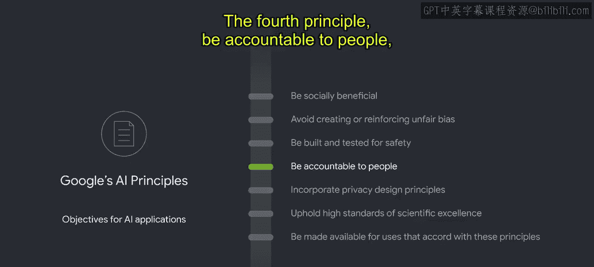

This means limiting power inequities and limiting situations where people lack the ability to opt out of an AI interaction。

The principal aims to promote informed user consent。

 and it seeks to ensure that there is a path to report and address misuse， unjust use or malfunction。

The goal is meaningful human control and oversight of AI systems to promote explainable and trustworthy AI decisions。

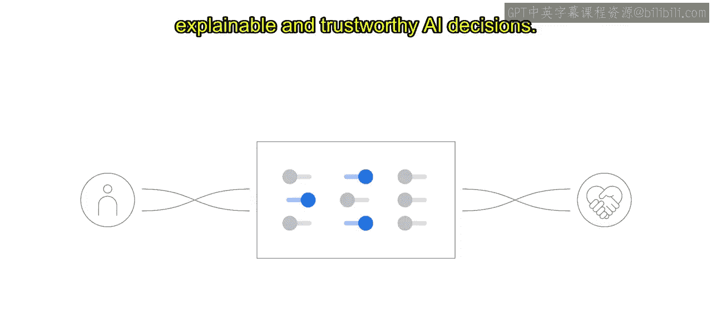

With the fifth of Google's AI principles， incorporate privacy design principles。

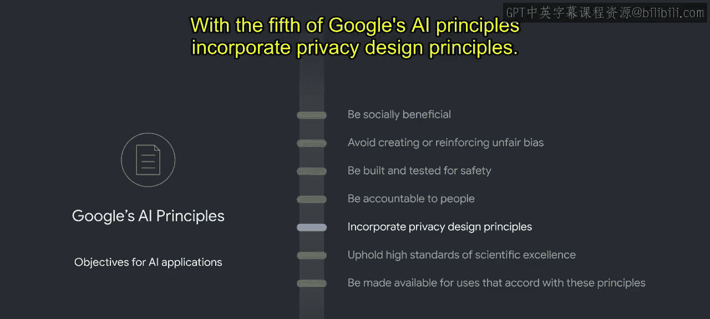

The aim is to protect the privacy and safety of both individuals and groups。To do so。

 we want to ensure that personally identifiable information and sensitive data are handled with special care through robust security。

It's also the goal of the principle to ensure that users have clear expectations of how data will be used and that they feel informed and have the ability to give consent to that use。

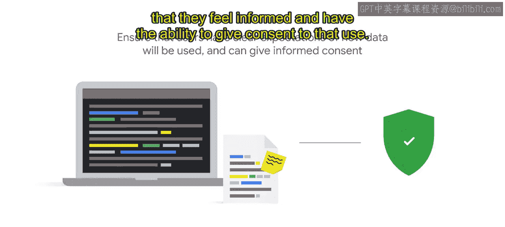

The sixth principle uphold high standards of scientific excellence。

 seek to advance a state of knowledge in AI。

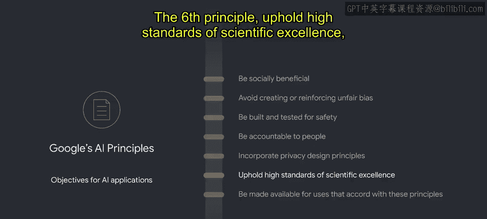

This means to follow scientifically rigorous approaches and ensure that feature claims are scientifically credible。

This print aims to do this through a commitment to open inquiry， intellectual rigour， integrity。

 and collaboration。Responsibly sharing AI knowledge by publishing educational materials。

 best practices and research enables more people to develop useful and beneficial AI applications while avoiding AI pseudoscience。

The last objective for AI applications in the AI principles。

 be made available for uses that accord with these principles。

 seeks accountability for Google's unique impact on society。

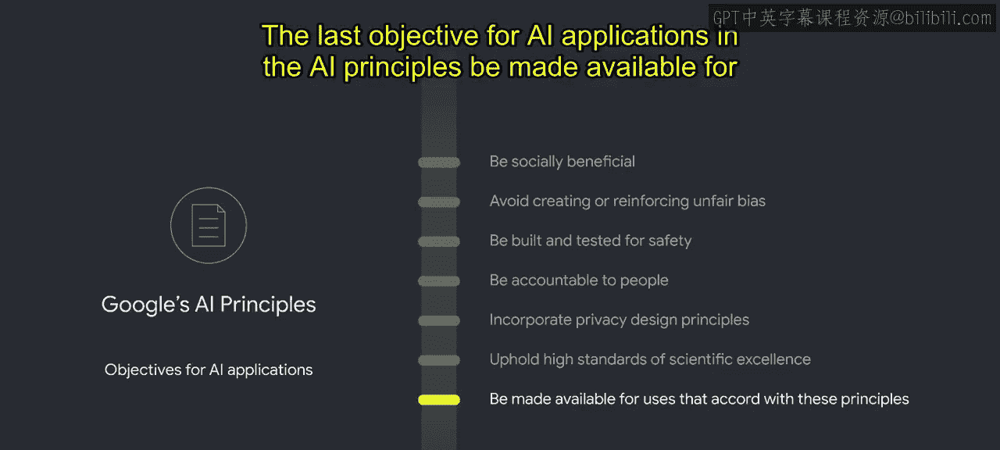

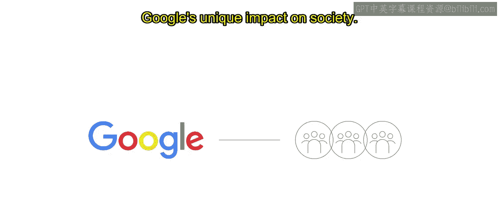

Many technologies have multiple uses。This principle aims to limit potentially harmful or abusive applications。

This includes how closely a technology solution is related to or adaptable to a harmful use。

The principle aims for the widest availability and impact of our beneficial AI technologies。

 while discouraging harmful or abusive AI applications。

It takes into account the fact that Google doesn't just build and control technology for its own use。

 but makes that technology available to others to use。

Google wants to ensure that it's not just the technology that we own and operate that aligns with our AI principles。

 but the technology that we make available to our customers and partners。

We use various factors to accurately define our scope of responsibility for a particular AI application。

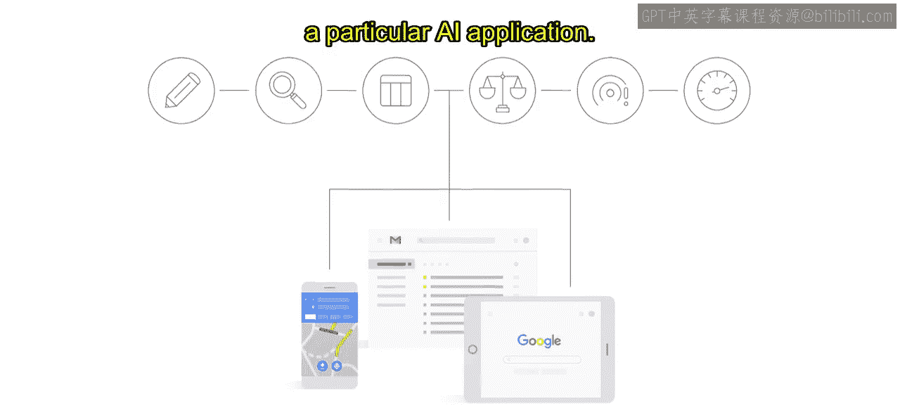

As well as these seven ethical aims which represent our commitment to how we will use AI responsibly。

 Google has also outlined the four areas of AI applications we will not pursue。

Those AI applications that are likely to cause overall harm。

 weapons or other technologist whose principal purpose is to cause injury to people。

Surveillance violating internationally accepted norms。

And those whose purpose contravenes international law and human rights。

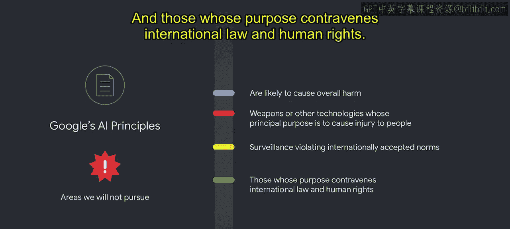

These seven aims and four areas together make up Google's AI principles and succinctly communicate our values in developing advanced technologies。

We believe these principles are the right foundation for our company and the future development of AI；

 however， establishing AI principles is just one step。

To use these principles to interpret issues and make decisions requires a process。

Responsible AI decisions require careful consideration of how the AI principles should apply。

 how to make trade offs when principles come into conflict。

And how to mitigate risks for a given circumstance。To operationalize the AI principles。

 we've established a formal review process with a governance structure to assess the multifaceted ethical issues that arise in new projects。

 products and deals。We also have several associated programs and initiatives。

 This is how the AI principles are put into practice。

