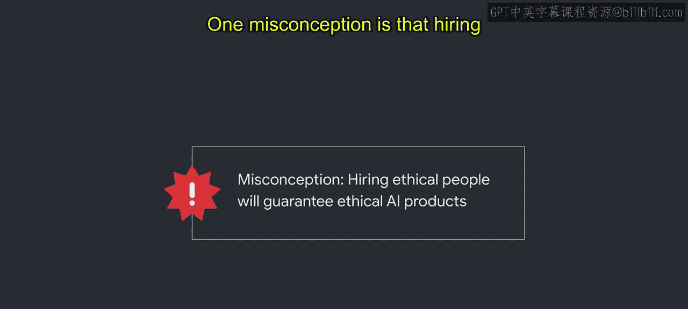
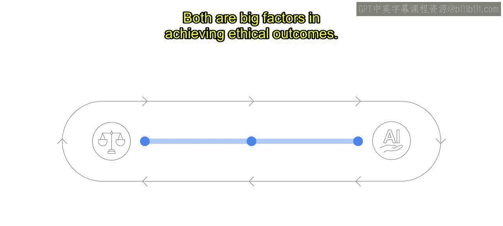
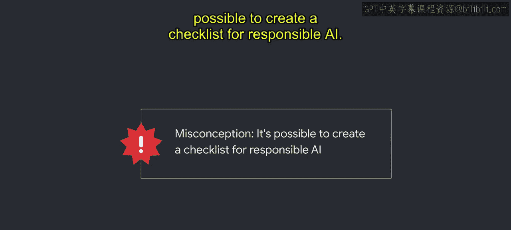
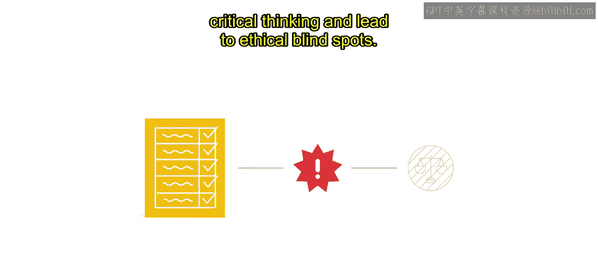
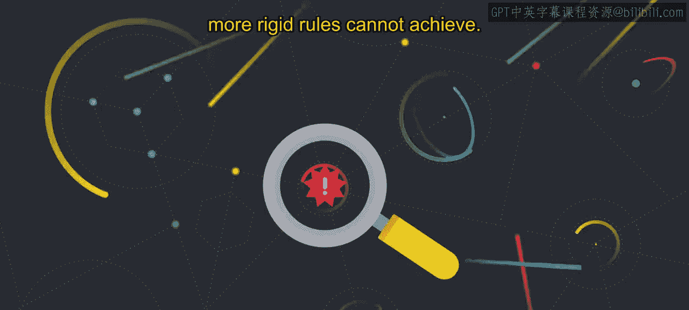
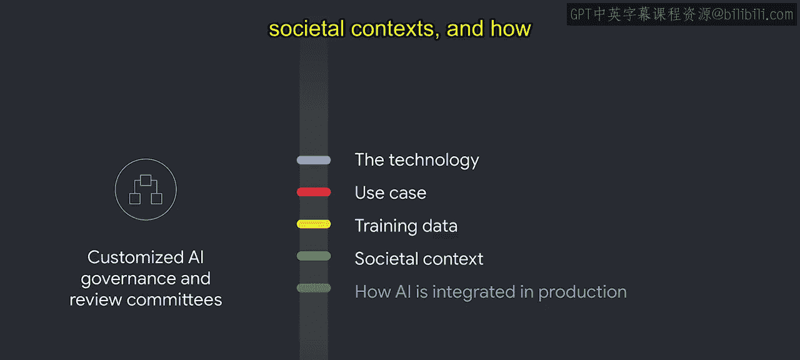

# 谷歌云《生成式AI学习路径（简介、LLM、负责的AI、应用）｜Introduction to Generative AI Learning Path》中英字幕 - P14：10_Google的AI治理.zh_en - GPT中英字幕课程资源 - BV1GM4m1m7xm

Once you have your AI principles defined， the next step in establishing AI governance is to set up a review process to put them into practice。

Having AI principles as guidance won't immediately answer all of your questions around AI's ethical concerns。

 and they don't relieve you from having hard conversations。

What the principles provide is a starting point for establishing the values you stand for。

And what you need to assess in technology development。

Applying those AI principles will take concerted and ongoing effort。

While responsible AI technical tools are helpful to examine how a particular ML model is performing。

 having robust AI governance processes is a critical first step in establishing what your goals are。

Technical tools are only useful if you have clear responsibility goals。

 a dedicated process promotes a culture of responsible AI。

 often not present in traditional product development life cycles。

Let's quickly address some common misconceptions about responsible AI governance。

One misconception is that hiring ethical people will guarantee ethical AI products。

The reality is that two people considered to have strong ethics could evaluate the same situation or AI solution and come to very different conclusions based on their experiences and backgrounds。

Research in the World Economic Forum report，Ethics by design suggests that even the most ethical people can be subject to ethical blind spots。

This is why it's important to build practices around ethical decision making and making space for ethical deliberation。

Both are big factors in achieving ethical outcomes。

Another common misconception is that it's possible to create a checklist for responsible AI。

Checklists or decision trees can feel comforting， but in our experience。

 checklists are ineffective at governance for such nascent technologies。For every product。

 both the technical details and context in which it's used are unique and require its own evaluation。

Following a checklist can place boundaries on critical thinking and lead to ethical blind spots。

Essential to AI governance is having programs and practices to support the review of your technologies。

These procedures allow your teams to exercise moral imagination。

 which is envisioning the full range of possibilities in a particular situation in order to solve an ethical challenge。

It also encourages people to build their issues spotting practice in a way that prescribed checklists and more rigid rules could not achieve。

So let's get into some detail on how we operationalize the review process。

Google created a formal review committee structure to assess new projects， products。

 and deals for alignment with our AI principles。The committee structure consists of the following AI governance teams。

A central responsible innovation team provides guidance to teams across different Google product areas that are implementing AI principal reviews。

 establishing a common interpretation of our AI principles。

 and ensures calibrated decision making across the company。

They handle the day to day operations and initial assessments。 This group includes user researchers。

 social scientists， ethicists。😊，Human rights specialist。

Policy and privacy advisers and legal experts， among others。

 which allows for diversity of perspectives and disciplines。

The second AI governance team in our committee structure is a group of senior experts from a range of disciplines across Google who provide technical。

 functional， and application expertise。These experts inform strategy and guidelines around emerging technologies and themes and consult on reviews when required。

The third AI governance team in our committee structure is a council of senior executives who handle the most complex and difficult issues。

 including decisions that affect multiple products and technologies。

They serve as the escalation body， make complex precedent setting decisions and provide accountability at the highest level of the company。

And finally， there are customized AI governance and review committees embedded within certain product areas that work closely with the responsible innovation team。

These take into account their unique circumstances regarding the technology， use case， training data。

 societal context， and how the AI is integrated in production。

A best practice for reviews across all teams is to seek participation from a diverse range of people。

 which ensures robust and trustworthy outcomes based on deliberation。

An environment of psychological safety needs to be fostered for this discussion and debate to succeed。

To give you a better idea of how Google Cloud approaches responsible AI。

 we will go through our custom AI governance process next。

