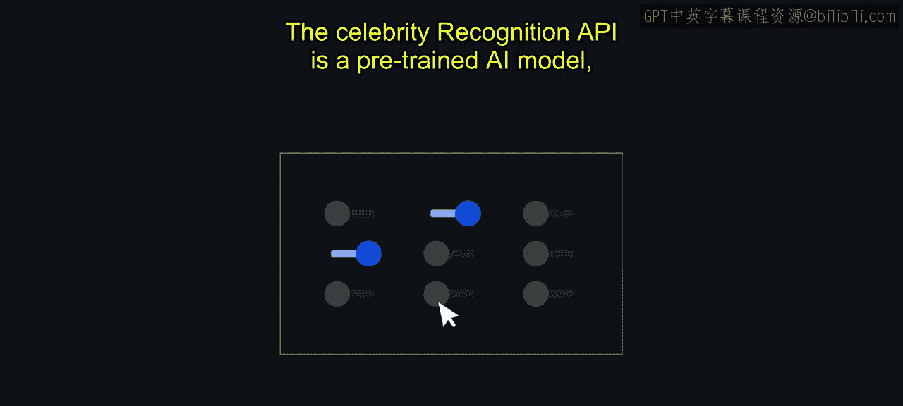
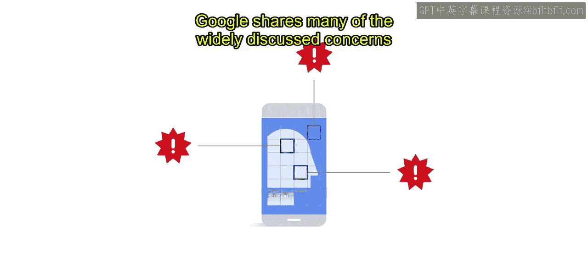
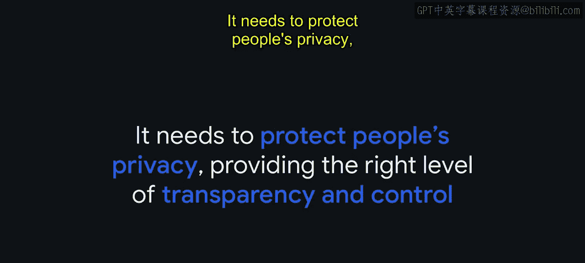
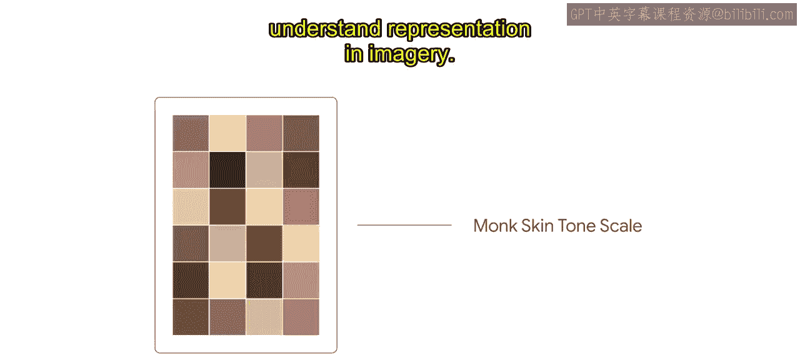

# 谷歌云《生成式AI学习路径（简介、LLM、负责的AI、应用）｜Introduction to Generative AI Learning Path》中英字幕 - P16：12_名人识别案例研究.zh_en - GPT中英字幕课程资源 - BV1GM4m1m7xm

The following case study outlines how our AI principles and review processes shaped Google Cloud's approach to facial recognition technology。

Let's start with the outcome of our review。In 2019， Google Cloud launched celebrity recognition。

 a tightly scoped API to media and entertainment customers looking to tag celebrities in their professional licensed media content。

Searching through video content has been a difficult and time intensive task without expensive tagging processes。

 This makes it difficult for creators to organize their content and offer personalized experiences。

The celebrity recognition API is a pre trained AI model。

 meaning it's not customizable that's able to recognize thousands of popular actors and athletes from around the world based on licensed images。

 This is Google Cloud's first enterprise product， with facial recognition。😊。

So how do we get here？Facial recognition was identified as a key concern for potential unfair bias。

 In early 2016， cloud leadership decided facial recognition would not be a part of the cloud Vi API offering。

 despite it being a top request from our customers。To explore this further。

 we took facial recognition through an early iteration of our AI principles review process。

These reviews gave us the open forum and time to think critically about the research。

 societal context and challenges of the technology。

We've seen how useful the spectrum of face related technologies can be for people and for society overall。

They can make products safer and more secure， like using face authentication to control access to sensitive information。

There are uses with tremendous social good， such as nonprofits using facial recognition to fight against the trafficking of miners。

But it's important that these technologies are developed thoughtfully and responsibly。

Google shares many of the widely discussed concerns over the misuse of facial recognition technology。

 namely， it needs to be fair， so it doesn't reinforce or amplify existing biases。

 especially where this might impact underrepresented groups。

It should not be used in surveillance that violates internationally accepted norms。

And it needs to protect people's privacy， providing the right level of transparency and control。

To reduce the potential for misuse and make the technology available for an enterprise use case aligned with our AI principles。

 Google decided to pursue a tightly scoped facial recognition application for celebrity recognition。

To prepare for launch readiness of the celebrity recognition API。

 along with our own internal review processes， we sought help from external experts and civil rights leaders。

We recognized that our lived experience wouldn't necessarily align with the lived experience of impacted people。

 and we needed help incorporating those experiences and concerns into our review。

Systematic under representation of black and minoritized actors in society was a key factor in our evaluation。

 given the product's intended use。To focus even further on potential impacts。

 we engaged with an external human rights consultancy called Business for Social Respon or BSR。

 to conduct an in depth human rights impact assessment。

Engaging with BSR played an essential role in shaping the API's capabilities and policies。

 integrating human rights considerations throughout the product development life cycle。

It also revealed where the solution needed additional oversight and validated our earlier decision not to offer general purpose facial recognition APIs。

Their full report is publicly available and can be found in the resources section of this course。

Based on BSR's recommendations， Google implemented a number of safeguards。

 including making the Clebrity recognition API available only to qualifying customers behind an allow list。

The database of celebrity individuals is carefully defined and restricted to a predefined list。

An opt out policy is implemented to enable celebrities to remove themselves from the list。

And in expanded terms of service apply to the API。These measures serve to avoid and mitigate potential harms and provide Google with a firm basis to reduce risks to human rights。

Another key step in Google's review of the celebrity recognition API was a series of fairness analyses。

Fundamentally， these fairness tests sought to evaluate the performance of the API in terms of recall and precision。

In other words， we evaluated the performance of the API both for individual skin tone and gender groups。

 but also for the combination of those groups， for example。

 for a woman with darker skin tones or men with lighter skin tones。

Over three separate fairness tests， we found errors between our training data sets and one of the benchmarks based on skin tone。

Those errors gave us pause， and we decided to take a deeper look at the root causes。

The first thing we checked was whether the skin tone labels in our data set were accurate。

It was discovered they weren't completely accurate for medium and darker skinned people。

We relaed the skin tones， according to the Fitzpatrick's skin type scale。

 as used in the seminal gender shades researched by Joy Bomwoodni and Timni Gabriel。😊。

This research evaluated bias present in automated facial analysis。

 algorithms and data sets with respect to skin， tone and gender。

Relabelling the skin tones reduce error rates， but we found further discrepancies。

 A small subset of actors represented a significant proportion of the total missedids in the evaluation data sets。

 especially for darker skin men。Knowing the majority of error rates were affecting a select few actors。

 we looked at the actors with the largest number of errors and found that they had nearly 100 per cent false rejection rate。

Due to the reduced scope of the celebrity recognition API。

 we were able to go one by one through the test set and gallery to determine what the problem was。😊。

We found that for three black actors， our celebrity gallery had images of them as adults。

 while the training set had images of them as much younger actors。

Our model could not recognize the adult actors as the younger characters they had played years prior。

In this instance， we were able to correct that problem by expanding the training data set to include images of celebrities at many different points in their careers and at different ages。

This removed the discrepancy between error rates。This experience drove home the importance of taking the time to look at the overall context of the solution。

 namely the issue of representation in media。Only with an appreciation of that context。

 tightly scoping the solution and after rigorously testing and improving the API for fairness。

 were we able to get comfortable launching the API。😊。

This is an example of why responsible development of AI leads to successful integration of AI。

In mid 2020， we welcomed the news that other technology companies were limiting or exiting their facial recognition business。

 given the wider concerns about the technology。Ultimately。

 our AI governance process allowed us to research and scope a product that aligned with our AI principles。

Today， Google has released the Monk skinkin tone MST scale。

A more refined skin tone scale that will help us better understand representation in imagery。

