# 谷歌云《生成式AI学习路径（简介、LLM、负责的AI、应用）｜Introduction to Generative AI Learning Path》中英字幕 - P19：15_从实施AI原则中学到的最佳实践.zh_en - GPT中英字幕课程资源 - BV1GM4m1m7xm

We'll now explore some of the lessons we've learned from operationalising our AI principles and how these led us to develop a set of best practices。

We encourage you to select， adapt， and devolve these best practices to fit the needs of your organization。

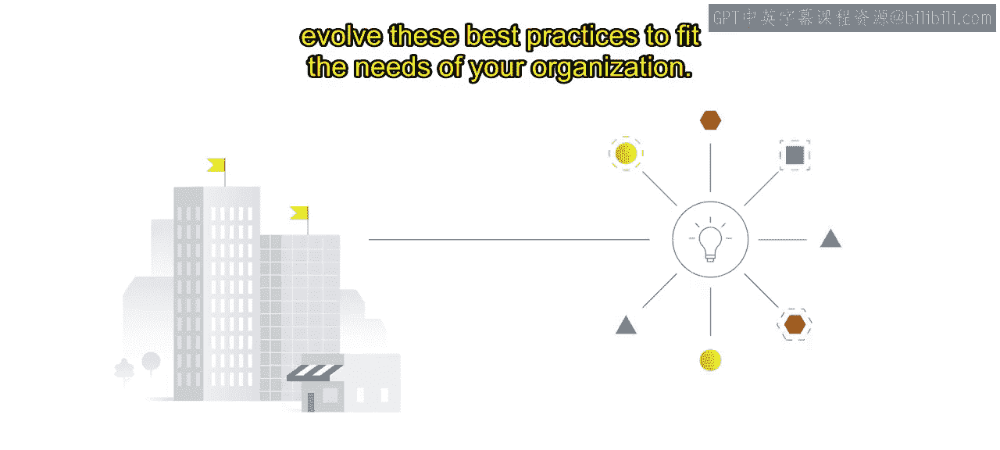

Research shows the benefit of assembling a review committee that is diverse in cultural identity。

 expertise and seniority， and at Google we have found this to be key。

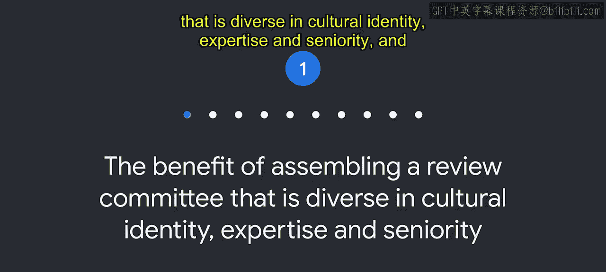

All AI principles require interpretation， making it important to have a review committee that more closely represents your current or potential user base。

It's critical to include diversity， equity and inclusion。

 or DEI considerations when building our multidisciplinary teams。

Bringing together a diverse group encourages more informed decisions which in turn results in more actionable and feasible solutions。

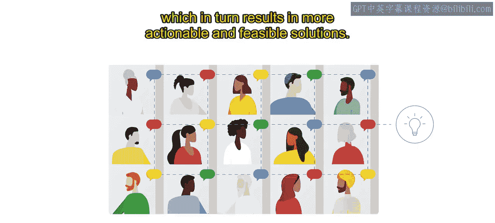

With regard to the adoption of our AI principles， we learn that it's important to get both top down and bottom up support and engagement。

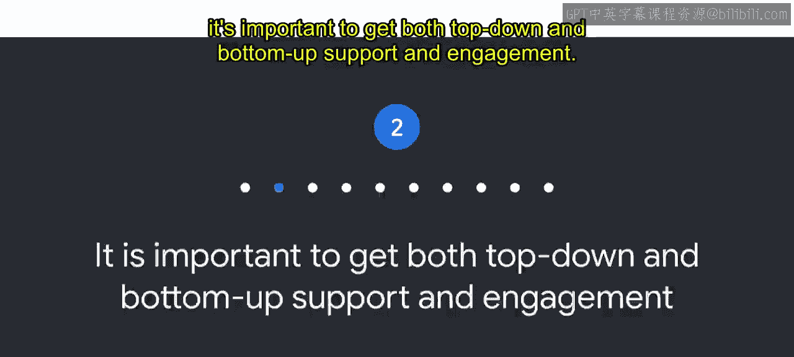

A top down mandate where senior leadership endorses the adoption of AI principles is necessary。

 but it's not enough。We've learned that a true cultural transformation requires organization wide adoption。

Our experience is that bottom up engagement from Team helps normalize it and is a critical step when embedding responsible AI into a company's culture。

It's also our experience that teams are likely to be very interested in the topic of responsible AI。

 often with their own opinions and beliefs on the topic。

Harnessing that drive and knowledge is beneficial to overall adoption。

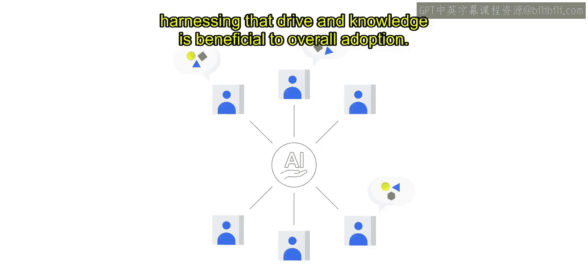

At Google， responsible AI adoption comes from educating our teams。Therefore。

 we suggest that you train your product and technical teams on tech ethics and encourage non technical stakeholders to develop an understanding of the technological。

 business and societal impacts of AI。

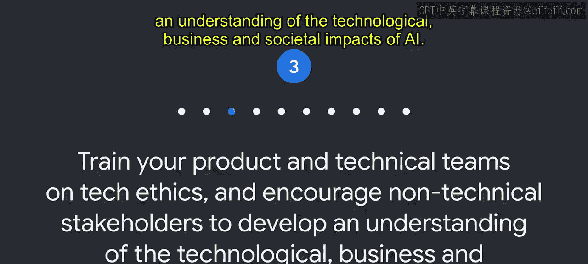

This helps to build a company culture that embraces responsible AI。

 where ethics are directly tied to technology development and product excellence。

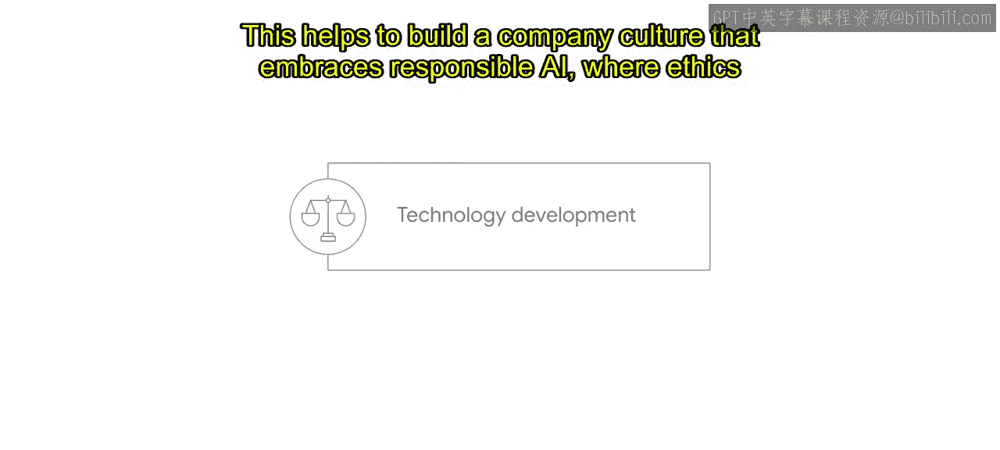

It's important to recognize that the goals and motivations of the business and the responsible AI team align because responsible AI equals successful AI。

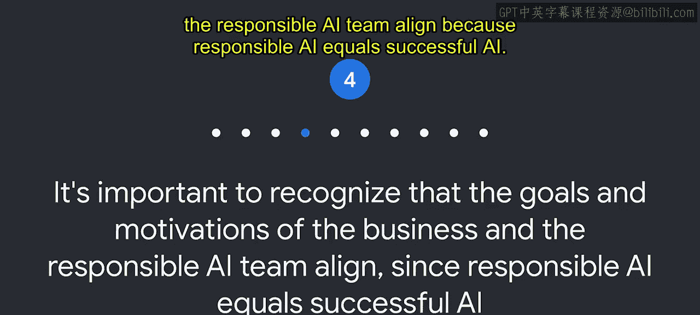

Building responsible AI products means confronting ethical issues and dilemmas and at times slowing down to find the right path forward。

Here， the motivations of the business and responsible AI could be perceived to be in conflict when in reality。

 releasing a product that works well for everyone is good for business and good for the world。

We strive for transparency in our responsible AI governance process。

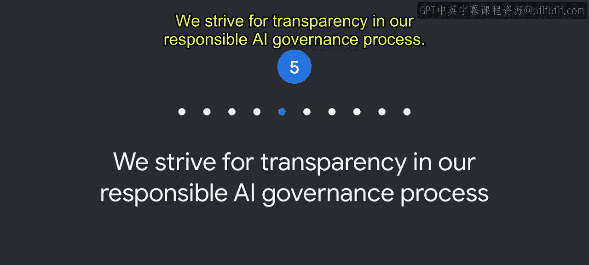

We believe that transparency around our process and the people involved build trust。

Confidentiality on the details of individual reviews is often required。

 but transparency in the governance process can help build trust and credibility。

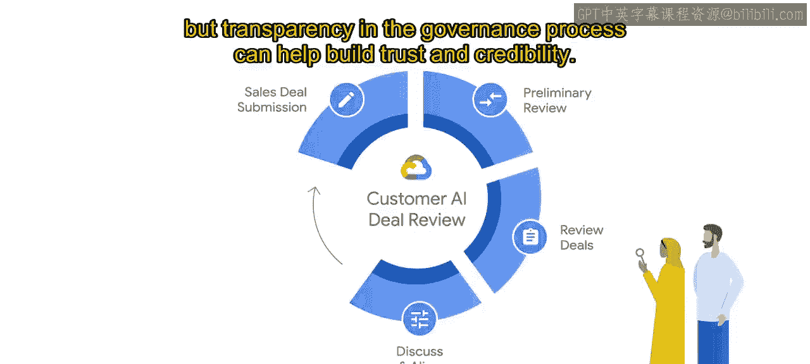

At Google， we've also learned that the work we do now can affect our future decisions。Therefore。

 we suggest developing a system to keep track of alignment plans， including issues。

 mitigations and precedents。

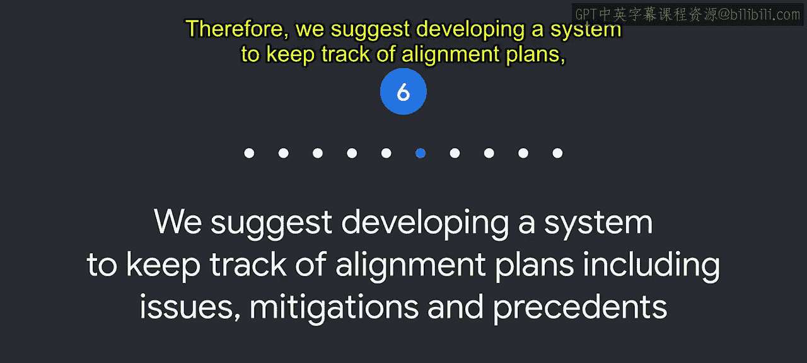

One specific goal of Google's review team is to identify patterns and maintain records。

 to track decisions and how they were made to inform future work and reviews。

This system also helps provide transparency to stakeholders that the review team followed a tried and trusted path to reach their decisions。

With this kind of documentation that provides consistent information throughout an organization。

 we find that a responsible AI initiative can scale to reach more people。

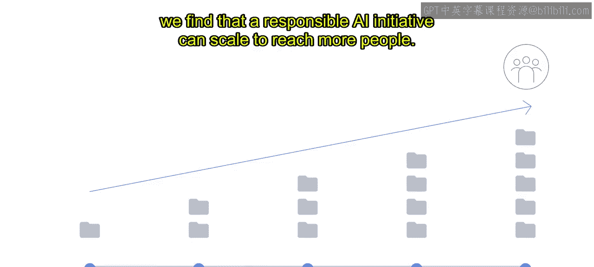

On our responsible AI journey， we've also recognized the importance of a humble approach。

AI is changing rapidly， and our world is not static。

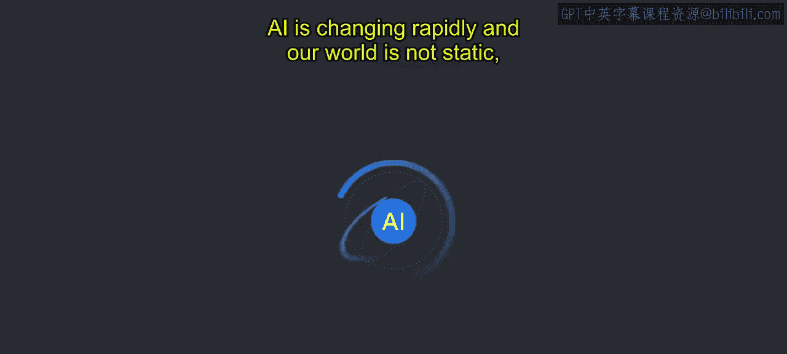

We try to consciously remember that we are always learning and we can always improve。

We believe we must maintain a delicate balance between ensuring consistency in our interpretations and remaining open and responsive to new research and inputs。

As we implement our responsible AI practices， we believe an openness to evolve will allow us to make the best。

 most informed decisions。We've learnt the benefit of investing in psychological safety。

When a team has psychological safety， they often feel safe to take risks and be vulnerable with each other。

In the review process， teams need to feel comfortable to explore what if questions and areas of misuse in order to work together to surface potential issues。

However， while exploring all potential issues is an important step in this process。

 in order to avoid analysis paralysis， you must ground your issue spotting in technical。

 business and societal realities before developing a comprehensive set of guardrails。

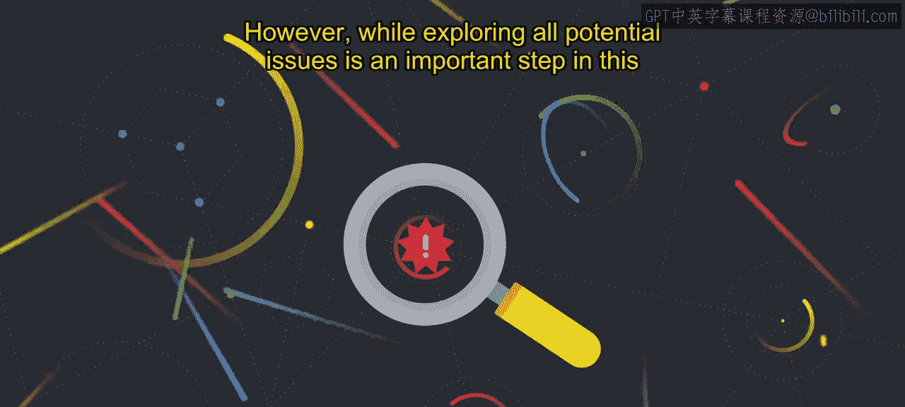

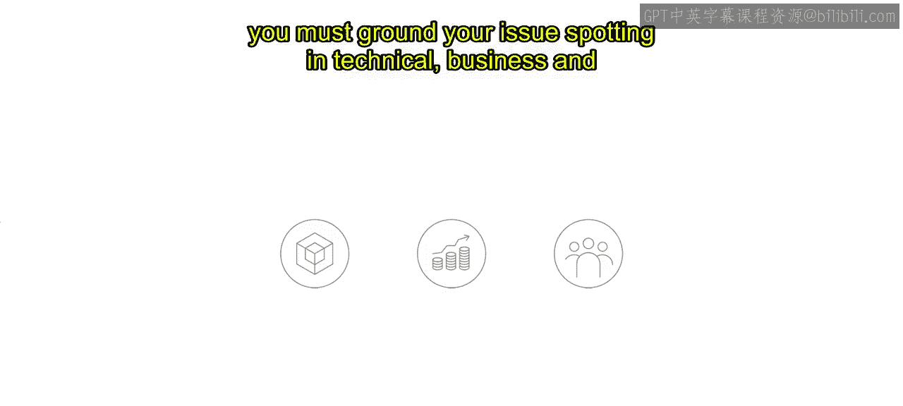

Another best practice is that efficiency is not the primary goal of an AI principles process。

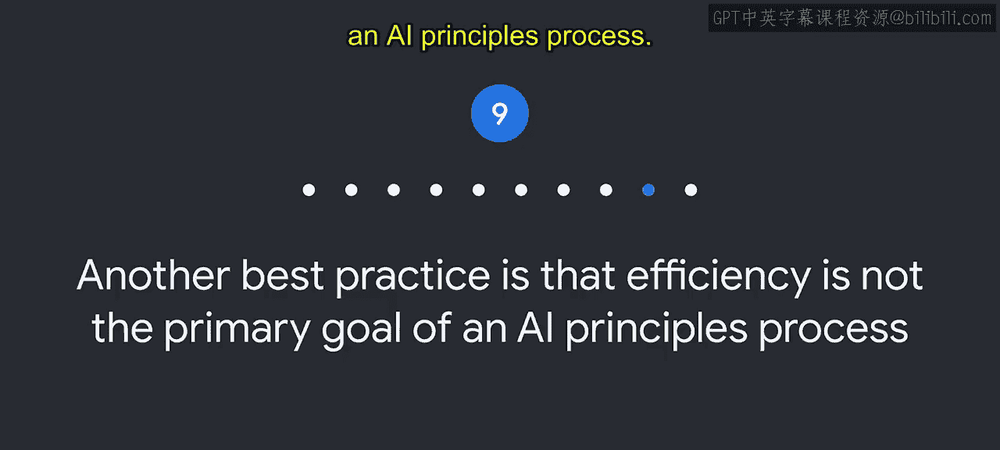

A balance is needed between the product development goals and the time needed for a comprehensive AI review。

If you focus too much on being efficient， you may miss potential issues that cause downstream harms for your customers。

Although our AI principles require interpretation and an element of trial and error。

 they still need to support the speed and scale of the business。

Deliberation and healthy disagreement allows people the space to explore risks and mitigations。

But a thoughtful and robust ethical process also means supporting product development goals。

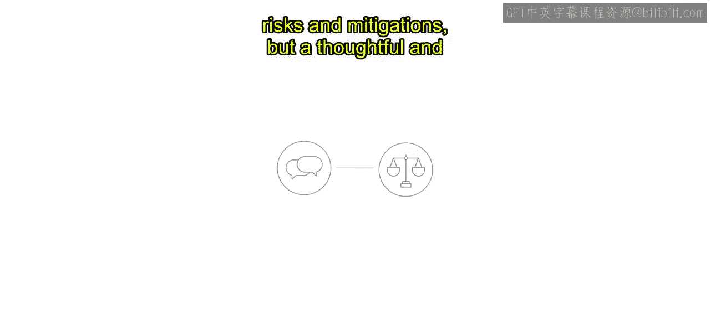

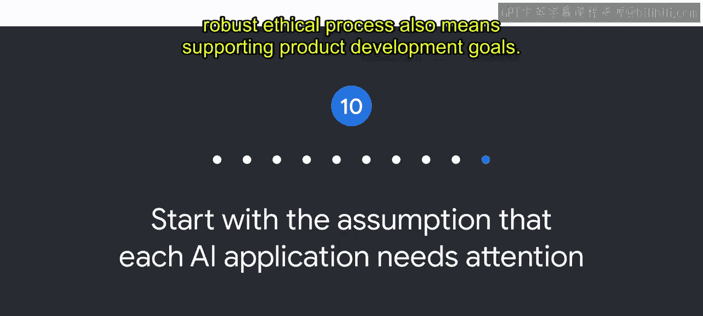

Start with the assumption that each AI application needs attention。

Ethical issues don't always arise from the most obvious controversial use cases and AI products。

Even seemingly beneficial or innocuous AIU use cases can have issues and risks associated with them。

This assumption pushes us to imagine what if and explore all the possible scenarios in order to develop a comprehensive set of mitigations。

Our AI principles reviews are a framework to guide those conversations。

These are some of the best practices Google has learned from operationalizing our AI principles。

 and we know these will evolve further with time。We hope that these best practices can be helpful as you create and implement your own responsible AI process。

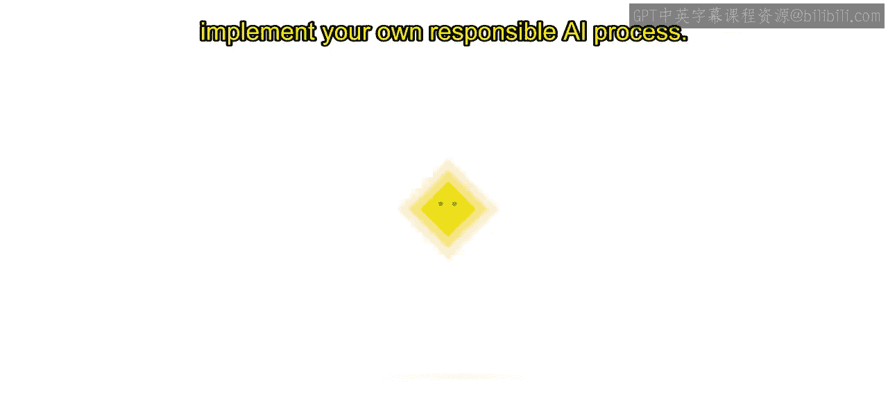