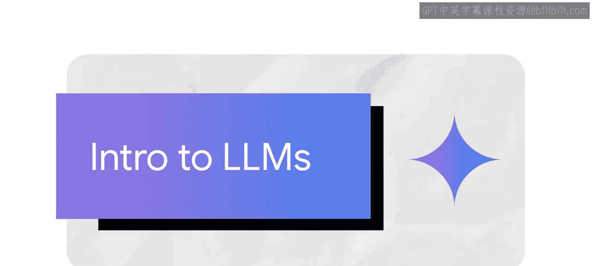
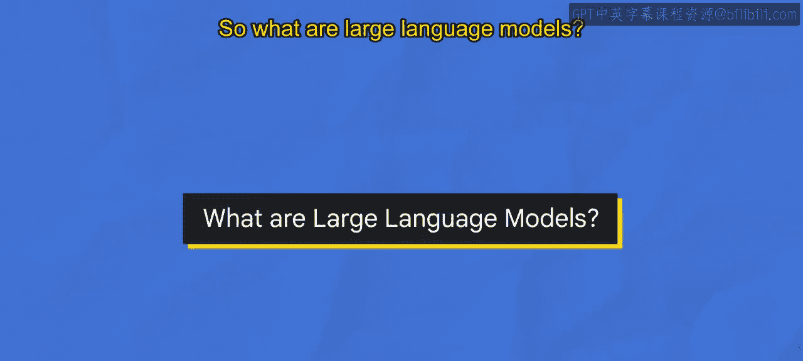
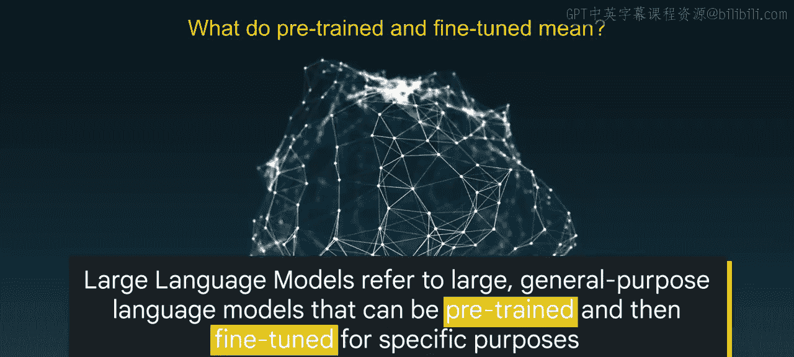
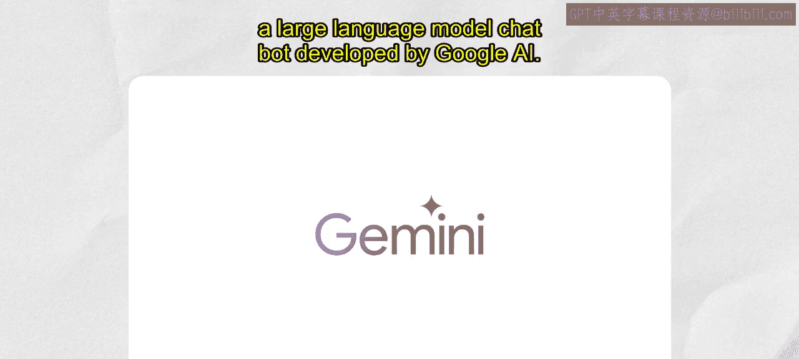
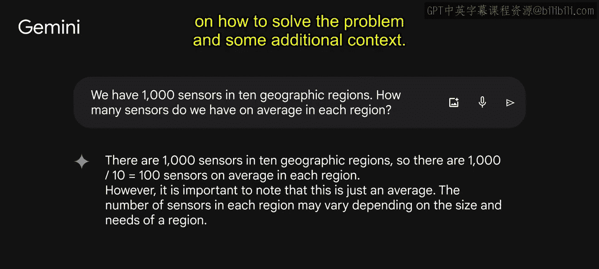
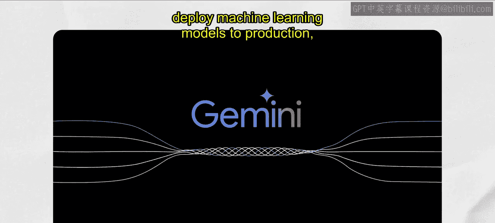
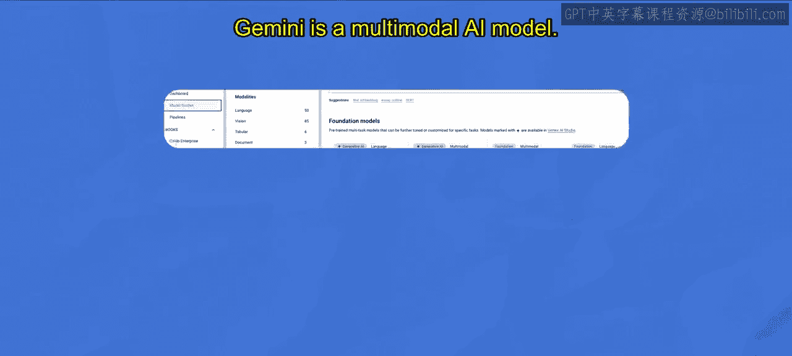
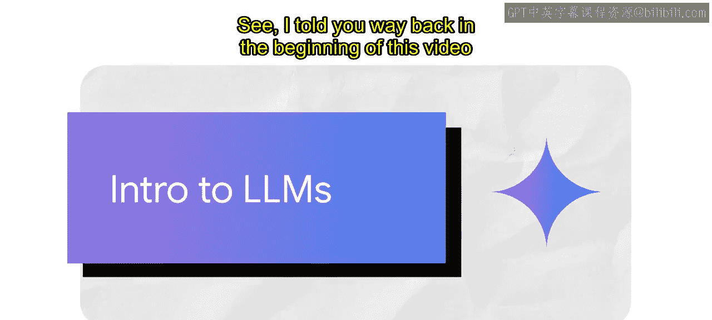

# 谷歌云《生成式AI学习路径（简介、LLM、负责的AI、应用）｜Introduction to Generative AI Learning Path》中英字幕 - P2：0_大语言模型简介.zh_en - GPT中英字幕课程资源 - BV1GM4m1m7xm

Yeah。

How's it going I'm Miga today I'm going to be talking about large language models don't know what those are me just kidding I actually know what I'm talking about I'm a customer engineer here at Google Cloud and today I'm going to teach you everything you need to know about LLMs that short for large language models。

In this course， you are going to learn to define large language models， describe LLM use cases。

 explain prompt tuning and describe Google's gener VI development tools。 Let's get into it。

Large language models are L L Ms are a substantive deep learning to find out more about deep learning。

 Check out our introduction to generative AI course video。

 L L Ms and geneative AI intersect and they are both a part of deep learning。

 Another area of AI you may be hearing a lot about is generative AI。😊。

This is a type of artificial intelligence that can produce new content， including text， images。

 audio and synthetic data All right back to LLMs。So what are large language models。

 La language models refer to large， general purpose language models that can be pretrained and then fine tuned for specific purposes。

 What do pretrained and fine tuneed great questions， Let's dive in。 Imagine training a dog。

 Often you train your dog basic commands such as sit， come down and stay。

 These commands are normally sufficient for everyday life and help your dog become a good can citizen。

 Good boy， But if you need special service dog， such as a police dog， a guide dog or a hunting dog。

 you add special trainings， right， The similar idea applies for large language models。

 These models are trained for general purposes to solve common language problems。

 such as text classification， question answering， document summarization and text generation across industries。

😊。

The models can then be tailored to solve specific problems in different fields， such as retail。

 finance and entertainment， using a relatively small size of field dataset sets。

 So now that you've got that down， let's further break down the concept into three major features of large language models。

 We'll start with the word large。😊，Large indicates two meetings。

First is the enormous size of the training dataset set。 Sometimes at the petabyte scale。 Second。

 it refers to the parametermeter count in machine learning， Paraas are often called hyperparameters。

 Paraameters are basically the memories and the knowledge the machine learned from the model training。

 parametersameters define the skill of a model in solving a problem， such as predicting text。

So that's why we use the word large。 What about general purpose。

 General purpose is when the models are sufficient to solve common problems。

 Two reasons LED to this idea。 First is the commonality of human language。

 regardless of the specific tasks。 And second is the resource restriction。

Only certain organizations have the capability to train such large language models with huge dataset sets and a tremendous number of parameters。

 How about letting them create fundamental language models for others to use。

 So this leaves us with our last  terms。 pretrain and fine tuned。

 which means to pretrain on large language models for a general purpose with a large dataset set and then fine and tune it for specific aims with a much smaller dataset set。

 So now that we've nailed down the definition of what large language models L L Ms are we can move on to describing LL M use cases。

 The benefits of using large language models are straightforward。😊，First。

 a single model can be used for different tasks。This is a dream come true。

 These large language models that are trained with petabytes of data and generate billions of parameters are smart enough to solve different tasks。

 including language translation， sentence completion， text classification。

 question answering and more。 Second， large language models require minimal field training data when you tailor them to solve your specific problem。

😊，Large language models obtain decent performance， even with little domain training data。

 In other words， they can be used for few shot or even zero shot scenarios。 In machine learning。

 Fu shot refers to training a model with minimal data。

 and zero shot implies that a model can recognize things that have not explicitly been taught in the training before。

😊，Third， the performance of large language models is continuously growing when you add more data and parameters。

 Let's take P as an example。😊，In April 2022， Google released PM short for a Pathways language model。

 a 540 billion parameter model that achieves a state of the art performance across multiple language tasks。

Pm is a dense decoder， only transformer model。It leverages a new pathway system which enabled Google to efficiently train a single model across multiple TPU V4 pods。

Pathway is a new AI architecture that will handle many tasks at once。

 learn new tasks quickly and reflect a better understanding of the world。

The system enables Pm to orchestra distributed computation for accelerators。

 and I'm getting ahead of myself。I previously mentioned that PM is a transformer model。

 let me explain what that means。A transformer model consists of an encoder， and a decoder。

The encoder encodes the input sequence and passes it to the decoder。

 which learns how to decode the representations for a relevant task。

 They've come a long way from traditional programming to neural networks， to generative models。

In traditional programming， we used to have to hard code the rules for distinguishing a cat。

Type animal legs  for ears 2， fur yes， likes yarn and catnip。In the wave of neural networks。

 we could give the network pictures of cats and dogs and ask， is this a cat。

 and they would predict a cat。What's really cool is that in the generative wave。

 we as users can generate our own content， whether it be text， images， audio， video or more。

 For example， models like Pm or Paways language model or lambmbda language model for dialogue applications in just very。

 very large data from multiple sources across the internet， and build foundation language models。

 we can use simply by asking a question whether typing it into a prompt or verbally talking into the prompt itself。

 So when you ask it what's a cat， It can give you everything it has learned about a cat。

 Let's compare LLM development using pretrained models for traditional ML development。😊，First。

 with LLM development， you don't need to be an expert。

 you don't need training examples and there is no need to train a model。

 all you need to do is think about prompt design， which is a process of creating a prompt that is clear。

 concise and informative。It is an important part of natural language processing or NLP for short。

 In traditional machine learning， you need expertise， training examples， compute time and hardware。

 That's a lot more requirements than LM development。

Let's take a look at an example of a text generation use case to really drive the point home。

Question answering or QA is a subfield of natural language processing that deals with the task automatically answering questions posed in natural language。

QA systems are typically trained on a large amount of text and code。

 and they are able to answer a wide range of questions， including factual。

 definition and opinion based questions。The key here is that you needed domain knowledge to develop these question answering models。

 Let's make this clear with a real world example。 domain knowledge is required to develop a question answering model for customary T support or health care or supply chain。

 but using generative QA， the model generates free text directly based on the context。

 there is no need for domain knowledge。Let me show you a few more examples of how cool this is。

 Let's look at three questions given to Gemini， a large language model chat bot developed by Google AI。

Question 1。This year's sales are $100，000。Expenses are $60，000。 How much is net profit。

Gmini first shares how net profit is calculated， then performs the calculation。

 Then Gemini provides the definition of net profit。 Here's another question。

 In on hand is 6000 units。 A new order requires 8000 units。

 How many units do I need to fill to complete the order。Again。

 Gemini answers the question by performing the calculation。And our last example。

 we have 1000 sensors in 10 geographic regions。 How many sensors do we have on average in each region。

 Gemini answers the question with an example on how to solve the problem and some additional context。

So how is that in each of our questions a desired response was obtained？This is due to prompt design。

 fancy。Prompt design and prompt engineering are two closely related concepts in natural language processing。

 Both involve the process of creating a prompt that is clear， concise and informative。

 but there are some key differences between the two。

 Pro design is the process of creating a prompt that is tailored to the specific task that the system is being asked to perform。

 For example， if the system is being asked to translate a text from English to French。

 the prompt should be written in English and should specify that the translation should be in French。

 Promp engineering is a process of creating a prompt that is designed to improve performance。

 This may involve using domain specific knowledge， providing examples of the desired output are using keyword that are known to be effective for the specific system。

 In general， prompt design is a more general concept while prompt engineering is a more specialized concept。

 Promp design is essential。 While prompt engineering is only necessary for systems that require a high degree of accuracy or performance。

 There are three kinds of large language models， generic。

gu models instruction tuned and dialogue tuned Each needs prompting in a different way。

Let's start with generic language models generic language models predict the next word based on the language in the training data。

 Here is a generic language model。 in this example， the cat sat on the next word should be done。

 and you can see that the is most likely the next word。

Think of this model type as an autocomplete in search。Next， we have instruction to and models。

 This type of model is trained to predict a response to the instructions given in the input。

For example， summarize the text of X。Generate a poem in the style of X。

Give me a list of keywords based on semantic similarity for X。In this example。

 classify text into neutralut， negative or positive。And finally， we have dialogue tuned models。

 This model is trained to have a dialogue by the next response。

 Diogue tuned models are a special case of instruction tuned where a request are typically framed as questions to a chat bot。

😊，Dialogue tuning is expected to be in the context of a longer back and forth conversation and typically works better with natural question like phrasings。

 chain of thought reasoning is observation that models are better at getting the right answer when they first output text that explains the reason for the answer。

 Let's look at the question。😊，Roger has five tennis balls。 He buys two more cans of tennis balls。

 Each can has three tennis balls。 How many tennis balls does he have now。

 This question is posed initially with no response。

 The model is less likely to get the correct answer directly。However。

 by the time the second question is asked， the output is more likely to end with the correct answer。

But there is a catch。 There' is always a catch。 A model that can do everything has practical limitations。

But task specific tuning can make LLMs more reliable Vertex AI provides task specific foundation models。

Let's get into how you can tune with some real world examples Let's say you have a use case where you need to gather how your customers are feeling about your product or service。

 you can use a sentiment analysis task model， same provision tasks if you need to perform occupancy analytics。

 there is a task specific model for your use case tuning a model enables you to customize the model response based on examples of the task that you want the model to perform。

It is essentially the process of adapting a model to a new domain or a set of custom use cases by training the model on new data。

For example， we may collect training data and tune the model specifically for the legal or medical donate。

You can also further tune the model by fine tuning。

 where you bring your own data set and retrain the model by tuning every weight in the LLM。

This requires a big training job and hosting your own fine tuned model。

 Here is an example of a medical foundation model trained on healthcare data。

 The tasks include question answering， image analysis， finding similar patients， etc ce。

 fine tuning is expensive and not realistic in many cases。

 So are there more efficient methods of tuning， Yes。Parameter efficient to。

