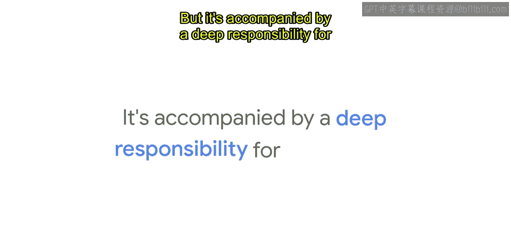
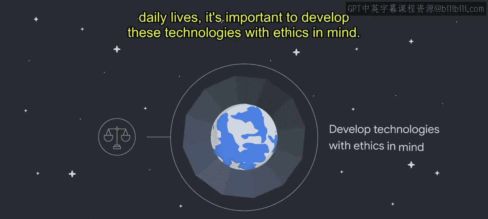
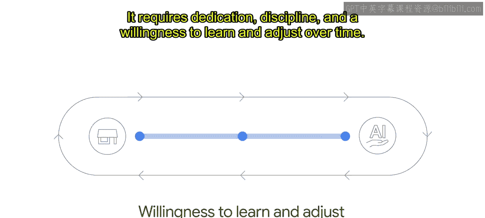
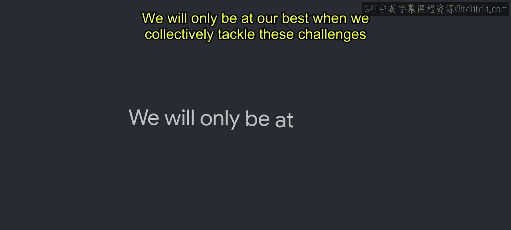
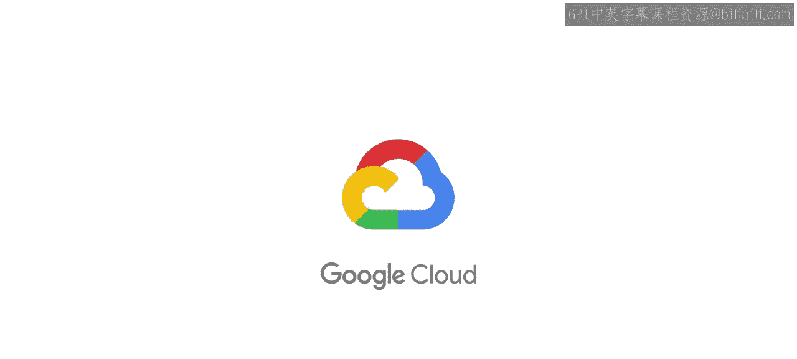

# 谷歌云《生成式AI学习路径（简介、LLM、负责的AI、应用）｜Introduction to Generative AI Learning Path》中英字幕 - P5：1_Google与负责任AI.zh_en - GPT中英字幕课程资源 - BV1GM4m1m7xm

Many of us rely on technological innovation to help live happy and healthy lives。

Whether it's navigating the best route home or finding the right information when we don't feel well。

The opportunity for innovation is incredible。But it's accompanied by a deep responsibility for technology providers to get it right。

There is a growing concern surrounding some of the undeintended or undesired impacts of AI innovation。

 These include concerns around M L fairness and the perpetuation of historical biases at scale。

 The future of work in AI driven unemployment and concerns around the accountability and responsibility for decisions made by AI。

We'll explore these in more detail later in the course。

Because there is potential to impact many areas of society， not to mention people's daily lives。

 it's important to develop these technologies with ethics in mind。

Responsible AI is not meant to focus just on the obviously controversial use cases without responsible AI practices。

 even seemingly innocuous AI use cases or those with good intent could still cause ethical issues or unintended outcomes or not be as beneficial as they could be。

Ethics and responsibility are important， not least because they represent the right thing to do。

 but also because they can guide AI design to be more beneficial for people's lives。

At Google we've learned that building responsibility into any AI deployment makes better models and builds trust with our customers and our customers' customers。

If at any point that trust is broken， we run the risk of AI deployments being stalled， unsuccessful。

 or at worst harmful to stakeholders those products affect。

This all fits into our belief at Google that responsible AI equals successful AI。

We make our product and business decisions around AI through a series of assessments and reviews。

These instill rig inconsistency in our approach across product areas and geographies。

These assessments and reviews begin with ensuring that any project aligns with our AI principles。

During this course， you'll see how we approach building our responsible AI process at Google and specifically within Google Cloud。

At times， you might think， well， it's easy for you with substantial resources in a small army of people。

There are only a few of us， and our resources are limited。

 You may also feel overwhelmed or intimidated by the need to grapple with thorny， new。

 philosophical and practical problems。 And this is where we assure you that no matter what size your organization is。

 This course is here to guide you。 Responsible AI is an iterative practice。 It requires dedication。

 discipline and a willingness to learn and adjust over time。

The truth is that it's not easy， but it's important to get right。 So starting the journey。

 even with small steps is key。Whether you're already on a responsible AI journey or just getting started。

 spending time on a regular basis simply reflecting on your company values and the impact you want to make with your products will go a long way in building AI responsibly。

Finally， before we get any further， we'd like to make one thing clear at Google。

 we know that we represent just one voice in the community of AI users and developers。😊。

We approach the development and deployment of this powerful technology with a recognition that we do not and cannot know and understand all that we need to。

 We will only be at our best when we collectively tackle these challenges together。

The true ingredient to ensuring that AI is developed and used responsibly is community。

We hope that this course will be the starting point for us to collaborate together on this important topic。

While AI principles help ground a group in shared commitments。

 not everyone will agree with every decision made and how products should be designed responsibly。

This is why it's important to develop robust processes that people can trust。

 so even if they don't agree with the enddecision， they trust the process that drove the decision。

In short and in our experience， a culture based on a collective value system that is accepting of healthy deliberation must exist to guide the development of responsible AI。

By completing this course， you yourself are contributing to the culture by advancing the practice of responsible AI development as AI continues to experience incredible adoption and innovation。

