# 谷歌云《生成式AI学习路径（简介、LLM、负责的AI、应用）｜Introduction to Generative AI Learning Path》中英字幕 - P6：2_Google的AI原则介绍.zh_en - GPT中英字幕课程资源 - BV1GM4m1m7xm

How AI is developed and used will have a significant effect on society for many years to come as a leader in AI。

 We at Google and Google Cloud recognize we have a responsibility to do this well and to get it right。

In June 2018， we announced seven principles to guide our work。

 These are concrete standards that actively govern our research and product development and affect our business decisions。

We're going to cover these principles and their development in some depth later in the course。

 So for now， here's an overview of each one。

One， AI should be socially beneficial。Any project should take into account a broad range of social and economic factors and will proceed only where we believe that the overall likely benefits substantially exceed the foreseeable risks and downsides。

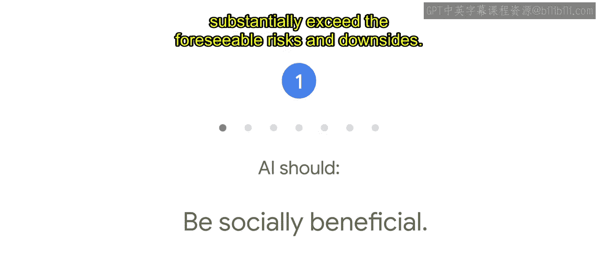

2。AI should avoid creating or reinforcing unfair bias。We seek to avoid unjust effects on people。

 particularly those related to sensitive characteristics， such as race， ethnicity， gender。

 nationality， income， sexual orientation， ability and political or religious belief。

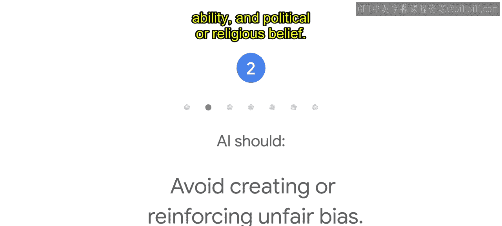

3， AI should be built and tested for safety。 We will continue to develop and apply strong safety and security practices to avoid unintended results that create risks of harm。

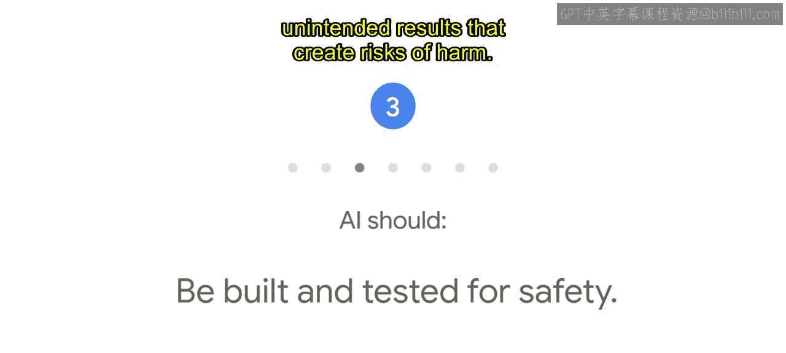

4our AI should be accountable to people。 We will design AI systems that provide appropriate opportunities for feedback。

 relevant explanations and appeal。

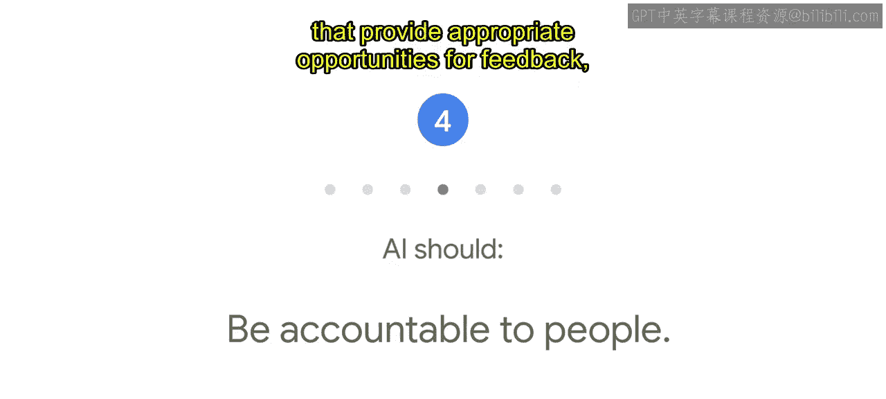

5 AI should incorporate privacy design principles。We will give opportunity for notice and consent。

 encourage architectures with privacy safeguards and provide appropriate transparency and control over the use of data。

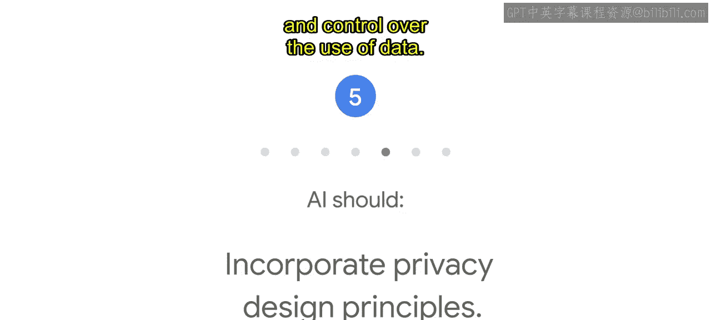

six。AI should uphold high standards of scientific excellence。

 We will work with a range of stakeholders to promote thoughtful leadership in this area。

 drawing on scientifically rigorous and multidisciplinary approaches。

 and we will responsibly share AI knowledge by publishing educational materials。

 best practices and research that enable more people to develop useful AI applications。

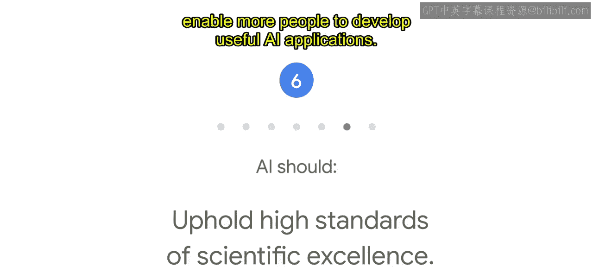

7。AI should be made available for uses at accord with these principles。

 Many technologies have multiple uses， so will work to limit potentially harmful or abusive applications。

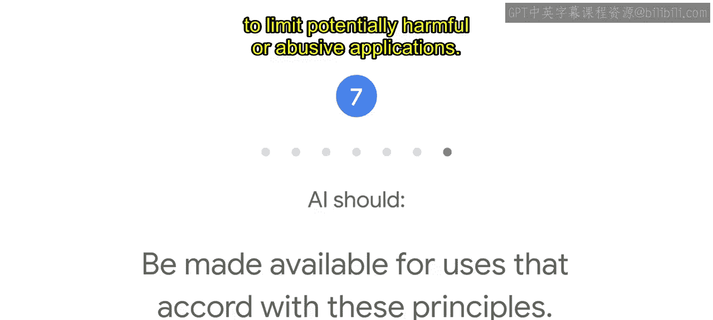

In addition to these seven principles， there are certain AI applications we will not pursue。

We will not design or deploy AI in these four application areas。

Technologies that cause or are likely to cause overall harm。

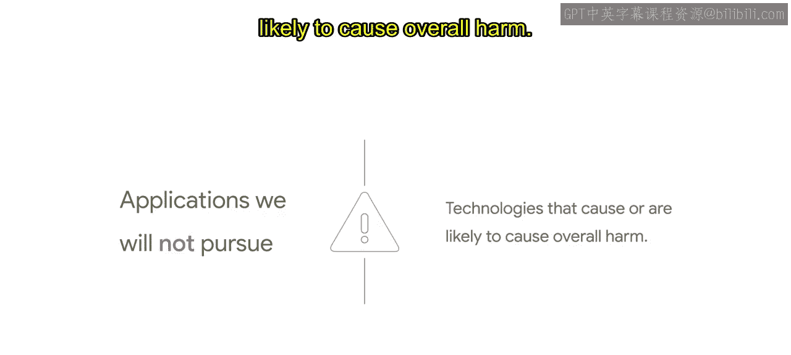

Weapons or other technologies whose principal purpose or implementation is to cause or directly facilitate injury to people。

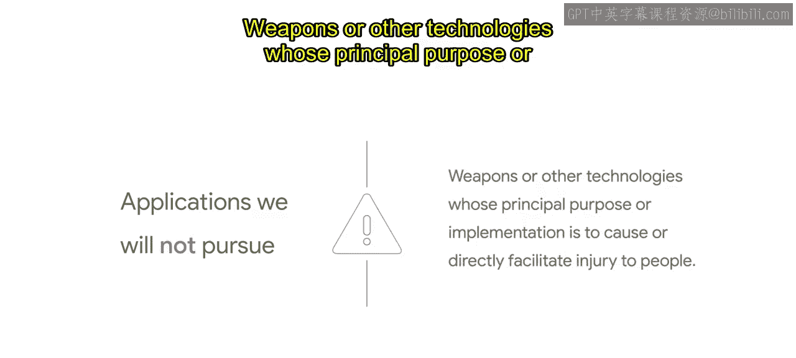

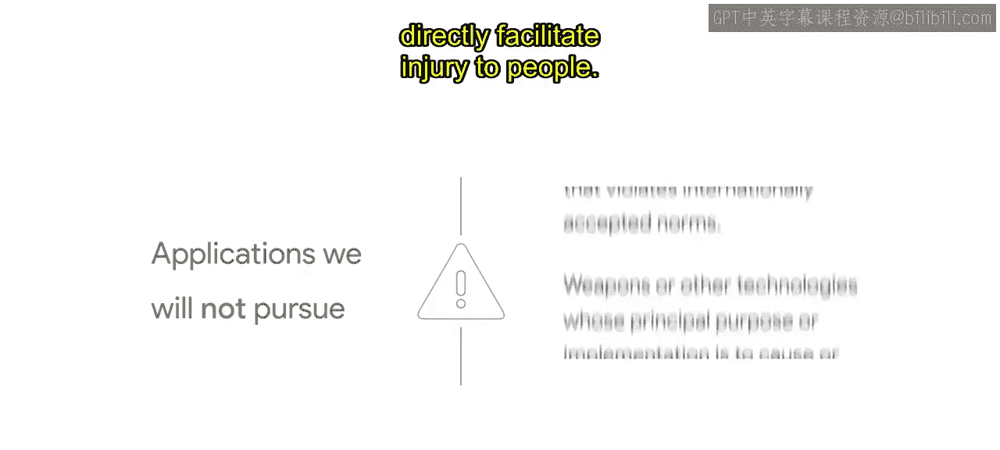

Technologies that gather or use information for surveillance that violates internationally accepted norms。

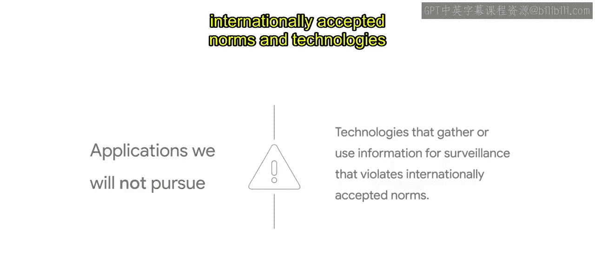

And technologies whose purpose contravenes widely accepted principles of international law and human rights。

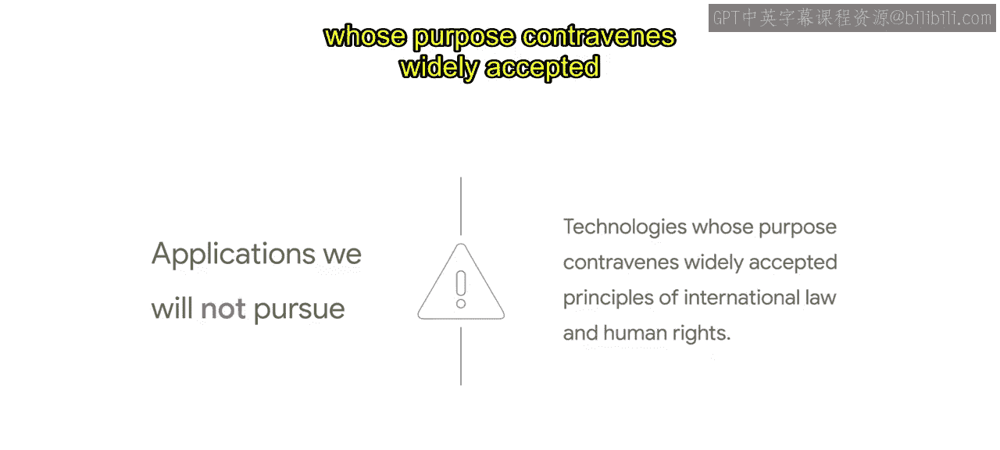

Establishing principles was a starting point rather than an end。

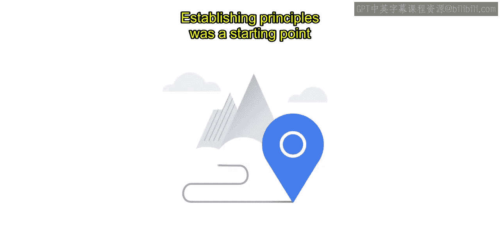

What remains true is that our AI principles rarely give us direct answers to our questions on how to build our products。

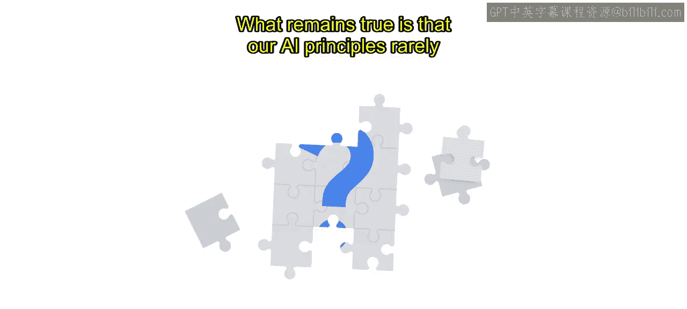

They don't and shouldn't allow us to sidestep hard conversations。

They are a foundation that establishes what we stand for， what we build and why we build it。

 and they are core to the success of our enterprise AI offerings。

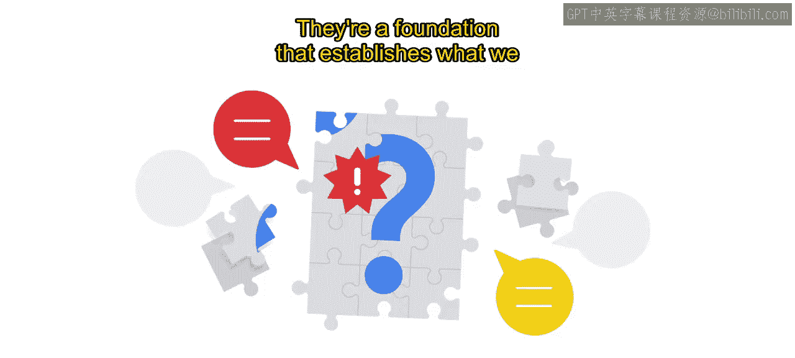

Later in the course， we'll give some suggestions to develop your own set of AI principles within your organization。

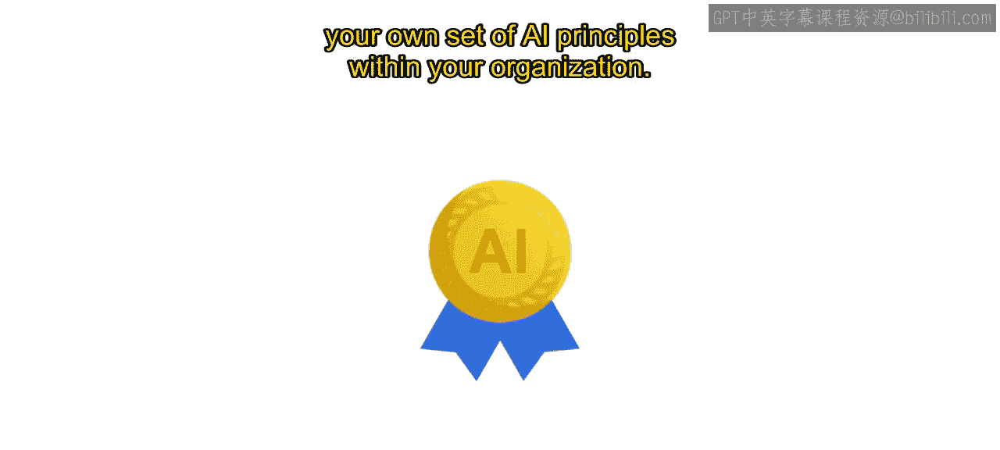

