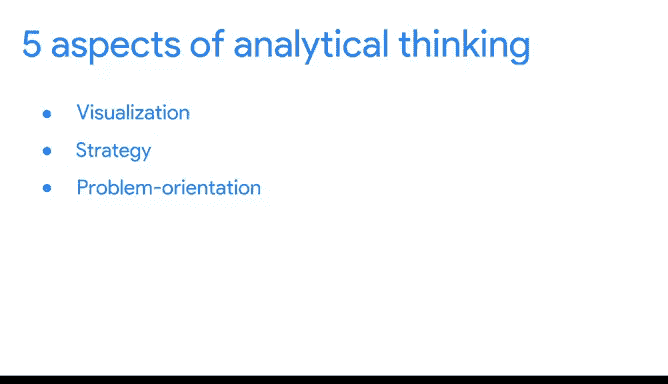

# 谷歌数据分析师1《基础： 数据，数据，无处不在》foundations-data - P11：11_01_02_探索核心分析技能.zh_en - GPT中英字幕课程资源 - BV1UN411S7yZ

Let's recap what we've learned about analytical thinking so far。

The five key aspects are visualization， strategy， problem orientation， correlation。

 and using big picture and detail oriented thinking。

And we've seen how you already use them in your everyday life。

We also talked about how different people naturally use certain types of thinking。

 but that you can absolutely grow and develop the skills that might not come as easily to you。

This means you can become a versatile thinker， which is a very important part of data analysis。

 You might naturally be an analytical thinker， but you can learn to think creatively and critically and be great at all three。

😊，The more ways you can think， the easier it is to think outside the box and come up with fresh ideas。

But why is it important to think in different ways， Well， because in data analysis。

 solutions are almost never right in front of you， You need to think critically to find out the right questions to ask。

 but you also need to think creatively to get new and unexpected answers。

Let's talk about some of the questions data analysts ask when they're on the hunt for a solution。

Here's one that will come up a lot。What is the root cause of a problem？

A root cause is the reason why a problem occurs。 If we can identify and get rid of a root cause。

 we can prevent that problem from happening again。A simple way to wrap your head around root causes is with a process called the five ys。

 in the five y's， you ask why five times to reveal the root cause。

The fifth and final answer should give you some useful and sometimes surprising insights。

Here's an example of the five Ys in action。Let's say you wanted to make a blueberry pie。

 but couldn't find any blueberries。You'd be trying to solve a problem by asking。

 why can't I make a blueberry pie？The answer would be there were no blueberries at the store。

There's why number one。So you then ask， why were there no blueberries at the store？

And discover that the blueberry bushes don't have enough fruit this season。 That's why number 2。

Next you'd ask。Why was there not enough fruit？This would lead to the fact that birds were eating all the berries。

 Why number3 asked and answered。Now we get to why number four。Ask why a fourth time。

 And the answer would be that although the birds normally prefer mulberries and don't eat blueberries。

 the mulberry bushes didn't produce fruit this season。 So the birds are eating blueberries instead。

 And finally， we get to why number 5， which should reveal the root cause。

 A late frost damaged the mulberry bushes。 So they didn't produce any fruit。😊。

So you can't make a blueberry pie because of a late frost months ago。

See how the five wires can reveal some very surprising root causes， this is a great trick to know。

 and it can be a very helpful process in data analysis。

Another question commonly asked by data analysts is where are the gaps in our process？For this。

 many people will use something called gapap analysis gapap analysis lets you examine and evaluate how a process works currently in order to get what you want to be in the future。

Businesses conduct GAAP analysis to do all kinds of things。

 such as improve a product or become more efficient。

 The general approach to GAAP analysis is understanding where you are now compared to where you want to be。

Then you can identify the gaps that exist between a current and future state and determine how to bridge them。

A third question that data analysts ask a lot is， what do we not consider before？

This is a great way to think about what information or procedure might be missing from a process so you can identify ways to make better decisions and strategies moving forward。

These are just a few examples of the kinds of questions data analysts use at their jobs every day as you begin your career。

 I'm sure you'll think of a whole lot more。The way data analysts think and ask questions plays a big part in how businesses make decisions。

 that's why analytical thinking and understanding how to ask the right questions can have such a huge impact on the overall success of a business。

Later， we'll talk more about how data driven decisions can lead to successful outcomes。

