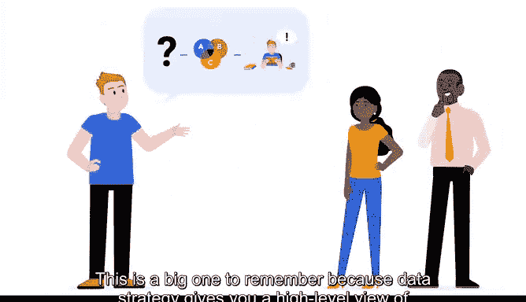

# 谷歌数据分析师1《基础： 数据，数据，无处不在》foundations-data - P12：12_01_04_数据驱动成功成果.zh_en - GPT中英字幕课程资源 - BV1UN411S7yZ

In an earlier video， you learned about five essential analytical skills。As a reminder。

 there are curiosity， understanding context， having a technical mindset， data design。

 and data strategy。In the next couple of videos， we'll explore how these abilities all become part of data driven decision making。

 but first， let's look at the concept of data driven decision making and why it's more likely to lead to successful outcomes。

You might remember that data driven decision making involves using facts to guide business strategy。

 data analysts can tap into the power of data to do all kinds of amazing things with data they can gain valuable insights。

 verify their theories or assumptions， better understand opportunities and challenges。

 support an objective。Help make a plan and much more。In business。

 data driven decision making can improve the results in a lot of different ways。 For example。

 say a dairy farmer wants to start making and selling ice cream。

They could guess what flavors customers were like， but there's a better way to get the information。

The farmer could survey people and ask them what flavors they prefer。

This gives the farmer the data they need to pick ice cream flavors people will enjoy。

Here's another example， let's say the president of an organization is curious about what Perk's employees value most。

She asked a human resourcess director who says people value casual dress code。It's a gut feeling。

 but the HR director backs it up with the fact that he sees a lot of people wearing jeans and T shirts。

But what if this company were to use a more structured employee feedback process such as a survey？

It might reveal that employees actually enjoy free public transportation cards the most。

The human resources director just didn't realize that because he drives to work。

 These are just some of the benefits of data driven decision making。

 It gives you greater confidence about your choice and your abilities to address business challenges。

 It helps you become more proactive when an opportunity presents itself。

 and it saves you time and effort when working towards a goal。😊。

Now let's learn more about how these five skills help you tap into all the potential of data driven decision making。

First， think about curiosity and context。The more you learn about the power of data。

 the more curious you're likely to become。 you'll start to see patterns in relationships in everyday life。

 whether you're reading the news， watching a movie or going to an appointment across town。

The analysts take their thinking a step further by using context to make predictions。

 Research answers， and eventually draw conclusions about what they've discovered。

 This natural process is a great first step in becoming more data driven。😊。

Having a technical mindset comes next。Everyone has instincts。

 or as in the case of our human resources director example， gut feelingss。

Data analysts are no different。 They have gut feelings， too。

But they've trained themselves to build on those feelings and use a more technical approach to explore them。

They do this by always seeking out the facts， putting them to work through analysis。

 and using the insights they gain to make informed decisions。Next， we come to data design。

 which has a strong connection to data driven decision making to put it simply。

 designing your data so that it' organized in a logical way makes it easy for data analysts to access。

 understand and make the most of available information。

And it's important to keep in mind that data design doesn't just apply to databases。

 This kind of thinking can work with all sorts of real life situations， too。The basic idea is this。

If you make decisions that are informed by data， you are more likely to make more informed and effective decisions。

The final ability is data strategy， which incorporates the people。

 processes and tools used to solve a problem。 This is a big one to remember because data strategy gives you a high level view of the path you'll need to take to achieve your goals Also data driven decision making isn't a one person job。

It's much more likely to be successful if everyone is on board and on the same page。

 So it's important to make sure specific procedures are in place and that your technology being used is aligned with your data driven strategy。

😊，Now you know how these five essential analytical skills work towards making better data driven decisions。

So far， many of the examples you've heard are hypothetical， that means they could be true in theory。

 but aren't specific real world cases。Next， we'll look at some real examples。

 I can't wait to share how data analysts put data to work for amazing results。

