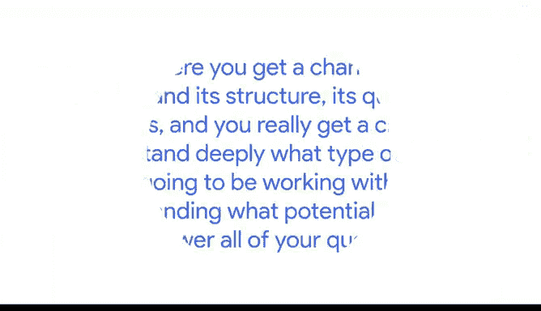
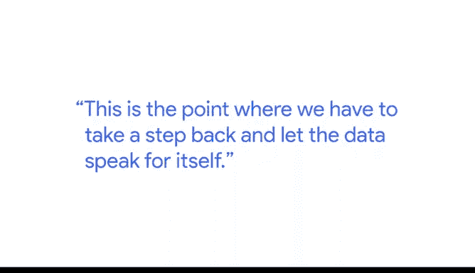

# 谷歌数据分析师1《基础： 数据，数据，无处不在》foundations-data - P18：18_02_03_Molly的数据分析流程实例.zh_en - GPT中英字幕课程资源 - BV1UN411S7yZ

Regardless of what type of data analysis you're conducting。The process is generally the same。

 The example that I'll walk through is that of our employee engagement survey。

 But you can imagine that this process applies to just about any data analysis that you're going to conduct as an analyst。

 The first thing you want to do is ask you want to ask all of the right questions at the beginning of the engagement that you better understand what your leaders and stakeholders need from this analysis。

So the types of questions that I generally ask are around， you know。

 what is the problem that we're trying to solve， What is the purpose of this analysis。

 What are we hoping to learn from it， So after you've asked all the right questions and you've wrapped your arms around the scope of the analysis you need to conduct。

 the next step is to prepare。We need to be thinking about what type of data we need to answer those key questions。

 This could be anything from quantitative data or qualitative data。

 It could be cross sectional or point in time versus longitudinal over a long period of time。

 We need to be thinking about the type of data we need in order to answer the questions that we've set out to answer based on what we learned when we asked the right questions。

We also need to be thinking about how we're going to collect that data。

 or if we need to collect that data， it may be the case that we need to collect this data brand new。

 And so we need to think about what type of data we're going to be collecting and how for our employee engagement survey。

 we do that via a survey of both quantitative and qualitative questions。

 But it may actually be the case that for many analyses。

 the data that you're looking for already exist。 Then it's a question of working with this data owners to make sure that you are able to leverage that data and use it responsibly。

After you've done all the hard work to collect your data， now you need to process that data。

It begins with cleaning。 This， to me， is the most fun part of the data analytics process。 You。

 we can think of it as the initial introduction or the handshake。 you know， Ho to your data。

 This is where you get a chance to understand its structure， its quirks， its nuances。

 and you really get its chance to understand deeply What type of data you're going to be working with and understanding what potential that data has to answer all of your questions。

😊。

This is such an important part， too， where we're running through all of our quality assurance checks。

 For example， do we have all of the data that we anticipated we would have。

Are we missing data at random or is it missing in a systematic way。

 such that maybe something went wrong with our data collection effort。 If needed。

 did we code all of our data the right way， Are there any outliers is that we need to treat differently。

 You， This is the part we spend a lot of time。 really digging deeply into the structure and nuance of the data to make sure that you are able to analyze it appropriately and responsibly。

 After cleaning our data and running all of our quality assurance checks。

 Now is the point where we analyze our data， making sure to do so in as objective and unbiased way as possible to do this。

 the first thing we do is run through a series of analyses that we've already planned to ahead of time based on the questions that we know we want to answer from the very。

 very beginning of the process。 One thing that's probably the hardest about this particular process。

 the hardest thing might analyze data is that we as analysts are， are trained to look for patterns。

And over time， as we become better and better at our jobs。

 what we'll often find is that we can start doing intuit what we might see in the data。

 or we might have a sneaking suspicion as to what the data are going to tell us。

 And this is the point where we have to take a step back and let the data speak for itself。😊。

As data analysts， we are storytellers， but we also have to keep in mind that it is not our story to tell that story belongs to the data。

 and it is our job as analysts to amplify and tell that story in as unbiased and objective a way as possible。

 The next step is to share all of the data and insights that you've generated from your analyses。

 Now， typically for our employee engagement survey。

 we start by sharing the high level findings with our executive team。

 We want them to have a landscape view of how the organization is feeling。

 and we want to make sure that there aren't any surprises as they dig deeper and deeper into the data to understand how teams are feeling and how individual employees are feeling。

 all of this work from asking the right questions to collecting your data to analyzing and sharing doesn't mean much of anything。

 if we aren't taking action on what we've just learned。😊，This， to me， is the most critical part。

 especially of our employee engagement survey。 I like to say that the survey is actually the easy part。

 and acting on the results is really where the real work begins。

This is where we use all of those data driven insights to decide what types of interventions we want to introduce not only at the organizational level。

 but also at the team level as well。So we might find， for example。

 that the organization is working on a series of interventions to help improve part of the employee experience。

 whereas individual teams have additional roles， responsibilities to play to either bolster some of those efforts or to introduce new ones to sort of better meet their team where where their strengths and opportunity areas are。

 The data analysis process is rigorous。But it is lengthy。

 and I can completely appreciate that we as data analysts get so excited about just diving right into the data and doing what we do best。

The challenge is that if we don't work through the process and in its entirety。

 if we try to skip steps。We're not going to be able to elicit the。

 the insights that we're looking for。 I absolutely love my job。 I。

 I have such a deep appreciation for， for data and what it can do and and what type of insight we can derive from it。

