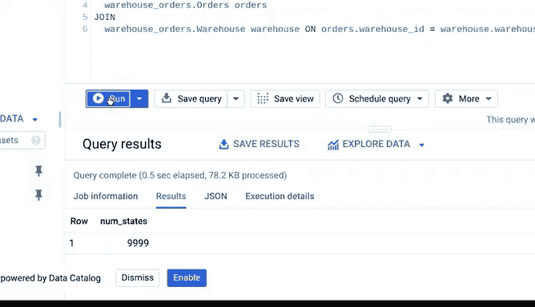
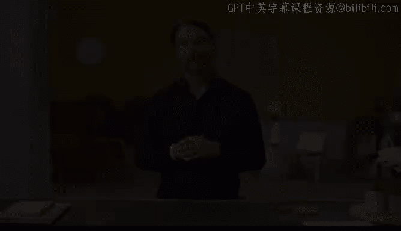
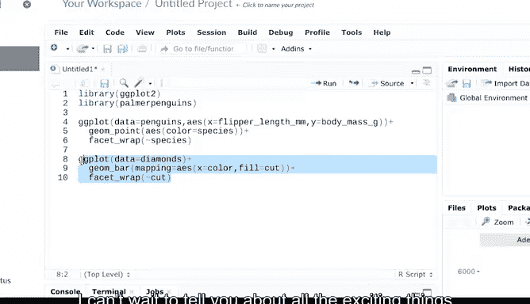
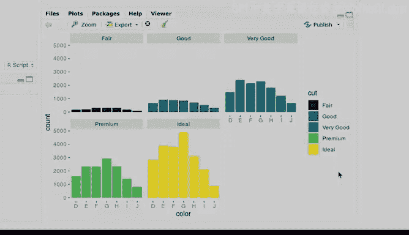
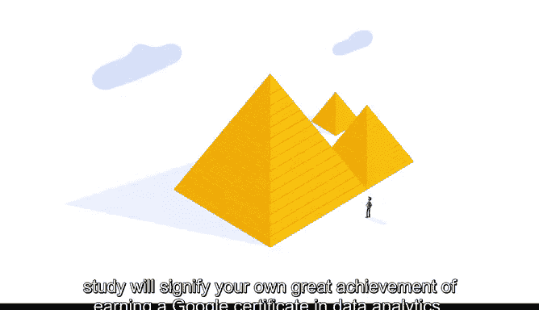

# 谷歌数据分析师1《基础： 数据，数据，无处不在》foundations-data - P1：01_01_01_欢迎加入谷歌数据分析证书课程.zh_en - GPT中英字幕课程资源 - BV1UN411S7yZ

🎼What do companies in E-commerce， entertainment， healthcare care， manufacturing， marketing， finance。

 tech and hundreds of other industries all have in common。 You guessed it。 They all use data。

Organizations of all kinds need data analysts to help them improve their processes。

 identify opportunities and trends， launch new products。

 provide great customer service and make thoughtful decisions。 Hi， I'm Tony。

 a program manager at Google。 and a data analyst myself。😊。

I'd like to welcome you to the Google Data Analytic Cerific。Now。

 there are lots of great reasons to earn this certificate。

 maybe you're thinking about starting a career in the exciting world of data analytics。

 or maybe you're just fascinated by the power of data as I am。No matter what brought you here。

 you're in the right place to kickstar a career and learn industry relevant skills in data analytics。

But first， what exactly is data？Well， I like to say that data is a collection of facts。

This collection can include numbers， pictures， videos， words， measurements， observations， and more。

Once you have data， analytics puts it to work through analysis。Data analysis is the collection。

 transformation and organization of data in order to draw conclusions， make predictions。

 and drive informed decision making， and it doesn't stop there。Data evolves over time。

 which means this analysis or analytics， as we call it。

 can give us new information throughout data's entire life cycle data is everywhere。

You use and create data every day。Have you ever read reviews of a product before deciding whether or not to buy it？

That's data analysis。Or maybe you wear a fitness tracker to count your steps so you can stay active throughout the day。

 That's data analysis。 but you don't just use data。

 You also create huge amounts of it every single day。Any time you use your phone。

 look up something online， stream music， shop with the credit card， post on social media。

 or use GPS to map a route your creating data。 Our digital world and the millions of smart devices inside of it have made the amount of data available。

 truly mind blowing。😊，Here at Google， we process more than 40，000 searches every second。That's 3。

5 billion searches a day and 1。2 trillion searches every year。Here's another way to think about it。

YouTube has almost 2 billion users。If YouTube users made up a country。

 it would be the largest in the world。 All of that data is transforming the world around us。

 The publication， the economists recently called data the world's most valuable resource。

So it's easy to see why data analysts are so valued by their organizations。

And what exactly does a data analyst do？Put simply a data analyst is someone who collects。

 transforms， and organizes data in order to help make informed decisions。 Besides the role itself。

 one of the most exciting parts of being a data analyst is the number of opportunities available。😊。

The demand for data analysts is greater than the number of qualified people to fill these job openings。

 and this certificate program is a great first step in your journey to finding a job you love。

 Data analysts come from many different backgrounds and have all kinds of life experiences。😊。

You don't need decades of work experience or an expensive education to get started。

 Many data analysts taught themselves the skills they needed to land their first job。

 just like you're doing right now。Okay。Now let's talk more about what you're going to learn。

The Google Data Analytic certificate is split into courses based on different processes for data analysis。

 Those are ask， prepare， process， analyze， share and act。 plan to watch these videos in order。

Each one covers a new topic and every topic builds on what you've learned before。

 making it easy to track your progress。And you're in the driver's seat。

Even though you might see things organized by weeks， everything can be completed at your own pace。

 so you decide how much you want to do each day。By the end of the program。

 you'll take everything you've learned and turn it into a project that you can use to show off your skills and while hiring managers at your job interviews。

 Now， along the way， you'll also hear from Googlers。😊。

That's what we call people who work here at Google。

 They'll give you an inside look at what it's like to work in our industry and share personal stories of how they got into the field。

They'll also give you some excellent tips on how to land your dream job。 Stay tuned。

 some of them are going to introduce themselves in just a sec。So I'm Angie。

 I'm a program manager of engineering at Google。 I truly believe that cleaning data is the heart and soul of data。

 It's how you get to know your data， Its quirks， it's flaws， it's mysteries。

 I love a good mystery and it felt like a superpower almost like I was a detective and I'd gone in there and I'd really solved something。

Hi， I'm Alex， I'm a research scientist at Google。I research the different impacts of artificial intelligence on society and our users。

So my name is Liah Jones， and I am a part of our cloud team。

 I get a chance to lead a team of amazing individuals that are focused on helping customers get to the cloud。

😊，Hi， I'm Evan。 I'm a learning portfolio manager here at Google。

 and I have one of the coolest jobs in the world where I get to look at all the different technologies that affect big data and then work them into training courses like this one for students to take。

😊，I'll be your instructor for the first course。 I'll take you through each module that will cover a specific topic in a few different ways。

 I'm really excited to be guiding you through this course。

 but I'm especially excited that you've chosen this adventure。😊。

Lifelong learning is something that I'm very passionate about。Growing up， when I looked around。

 I often didn't see many options available to me。It wasn't until I started getting serious about my education that I realized I had the control to make my own opportunities with education being the key that would open those doors。

The more I learned and the harder I worked， the more possibilities opened up。

Had I not gone after that knowledge and continued challenging myself， I may not be where I am today。

Learning allowed me to grow personally， be successful。

 visit places I would never have seen and meet people I would never have known。

And now I'm going to introduce some of those great people。Hello， I'm Ka， financial analyst。

 I'll be helping you learn how to ask the right questions about data。

 the project you work on and the problems you're trying to solve。 Hey， my name is Hallally。 Ana lead。

 I am so excited to show you how to prepare your data。 So it's ready for analysis。 Hello， I'm Sally。

 measurement and analytical lead。 Together will cover how to process and clean your data。

 Cleaning data doesn't require soap water。 I'm talking about making sure your data is complete。

 correctect and relevant to the problem you're trying to solve。😊，Hey， I'm Aana。

 Global Inights manager。 We'll be digging into analysis。 You'll learn how to collect。

 transform and organize data so that you can use it to discover useful information。

 drawaw conclusions and make great decisions。😊。

My name is Kevin， and with my experience as director of analyticss at Google。

 I'll guide you through what I think is the most exciting part of the data analysis process。 Plan。

 create and present effective and compelling data visualizations。😊。

Hello， my name is Carrie， I can't wait to tell you about all the exciting things you can do with the programming language R。

Are you ready？

Hi， I'm Rishi， Global Analytic skillskill Curric Manager。

I'm going to help you bring together everything you learn during this program by creating a case study that will dazzle any hiring manager。

 just like the captionstone of a great building shows everyone that it's complete。

 your case study will signify your own great achievement of earning a Google certificate in data analyticss。

😊。

🎼Okay， are you getting excited about the potential of becoming a data analyst so much as possible with data。

 You're about to enter a whole new world， ready。😊，Let's go。

