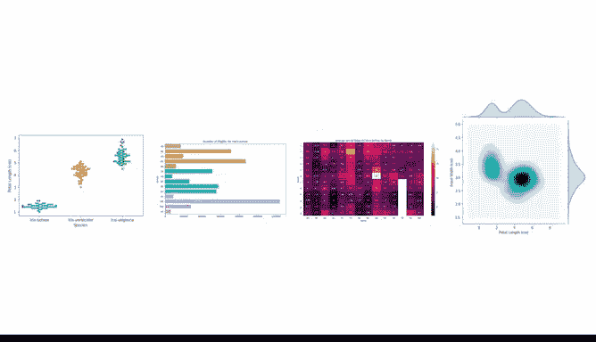

# 谷歌数据分析师1《基础： 数据，数据，无处不在》foundations-data - P20：20_03_01_核心数据工具详解.zh_en - GPT中英字幕课程资源 - BV1UN411S7yZ

Welcome back in the next few videos， you'll continue to explore the data analytics tools we discussed earlier。

And you'll get the chance to see them in action a little bit。

This will give you a clearer picture of how to use these tools the rest of the program will build on from what you learn here。

We'll start with a closer look at spreadsheets。Will break spreadsheets down to their basics to better understand a few of their features and functions。

 You'll also learn how you might want to use them in your work as a data analyst。 For example。

 how do you search your data to make it easier to use。We'll find out。Next， we'll see SequL in action。

Data analysts use SQL in their work all the time。 Like when they need a large amount of data in seconds to help answer a quick business question。

 Chances are， you're not familiar with SQL。 That's okay。

You'll learn how using SequL is just like ordering food at a super speedy restaurant。

Your SQL query might not be as delicious， but you won't have to wait long to get your order。

Speaking of food， what better topic than dessert， you can think of data visualization as the dessert to the meal of data analytics。

 It's served at the end of your analysis after you've done what you need to get the right data for a question or task。

😊，We've already seen that visualizations come in a lot of forms like graphs or charts。

And just like dessert， they're a treat to look at。

You'll learn more about these visual representations and see other examples of how they might look。

Then you'll get to talk about visualizations with other future data analysts just like yourself。

We'll wrap things up with an assessment。But you'll have time to review what you've learned before then。

Okay， let's keep going。By the way， is anyone else hungry now？

