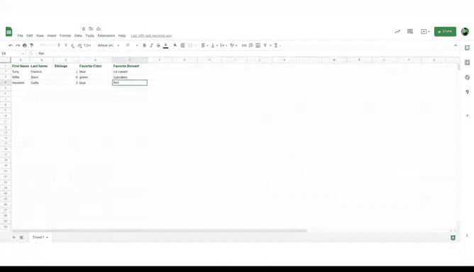
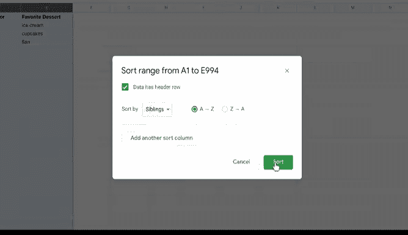
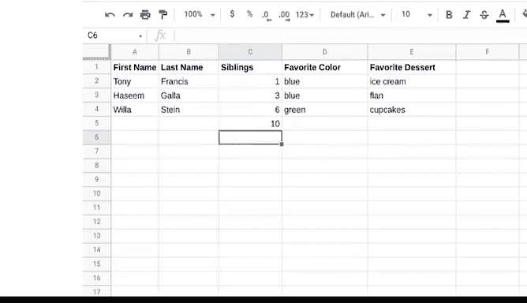

# 谷歌数据分析师1《基础： 数据，数据，无处不在》foundations-data - P21：21_03_03_让电子表格成为得力助手.zh_en - GPT中英字幕课程资源 - BV1UN411S7yZ

Spreadsheets are a big part of data analytics。 The sooner you make friends with spreadsheets。

 the better。 Trust me， they'll save you a lot of time as a data analyst and make your whole job easier。

😊，This spreadsheet is one example of how an organized spreadsheet might look。

In this video will demonstrate some of the basic spreadsheet concepts for all of you who are new to this world。

This might be a review for some of you more experienced folks out there。

 but it never hurts to practice what you know。Plus， you might still learn a trick or two。

I showed you this image earlier。 Let's explore it further because it's a great example of the three main features of a spreadsheet。

 cells， rows and columns。😊，They'll be part of almost everything you do in a spreadsheet for making a simple grocery list to analyzing a complex data set。

I use spreadsheets to manage everything from my own personal finances to the annual homecoming party my friends and I have every year I'm the planner。

 so I use a spreadsheet to keep things in order， making sure we have everything we need。

Speaking of keeping things in order， columns are organized vertically in a spreadsheet。

And are ordered by letter， and the rows are organized horizontally and are ordered by number。

So when you talk about a specific cell， you name it by combining the column letter and the row number where the cell is located。

 for example， in this spreadsheet， the word row is in cell D3。

Let's get started in an actual spreadsheet。You can complete all of the steps in just about any spreadsheet program。

Let's get to know your spreadsheet a little better now。All right。

 we'll start with some basic operations。 Keep in mind， as an analyst。

 you won't always create your own data set， but for now， let's do just that。I'll click and sell A2。

And type my first name like this。Then I'll click and B2 and type my last name。

Don't worry if your name doesn't fit in the cell， you can always make columns wider if you need to。

All you have to do is click and drag the right edge of the column until your name fits。

Or you can use the text wrapping feature， which will set cells to automatically change their height to allow the text in the cell to fit to use this feature。

 select the cells， columns or rows with text。 then use the format menu to look at the text wrapping options。

😊，It is automatically set to allow the text to overflow out of the cell。

 but you can wrap the text instead， so all of the text is visible。

 The clip option will cut off the text in the cell， so only the text that fits is visible。

There it is， we've added data。Now let's label it。This is important for organization。

Adding labels to the top of the columns will make it easier to reference and find data later on when you're doing analysis。

These column labels are usually called attributes， and attribute is a characteristic or quality of data used to label a column in a table。

 more commonly， attributes are referred to as column names， column labels， headers。

 or the header row。All right。Let's add some headters to our table。

I'll click and sell A1 and type the words first name。In cell B1， I'll type last name。

We'll make these attributes bold so they stand out more。 Spreadsheets can get really big。

 So you want to make sure your data is clearly labeled and easy to find。

 I can use my cursor to select the cells with the attributes。

 Then I'll click the bold icon to make them bold。 Looking good so far。 Ready to add some more data。

 Let's start with some new attributes。 First， I'll add a column for the number of siblings by typing siblings in cell C1。

😊，Then I'll add two more attributes in the next two columns。

 Let's go with favorite color and favorite dessert。I'll make them bold too。

And to fit the labels in the cells， I'll adjust the size of the columns just like before。Now。

 keep in mind， there are more ways to adjust the size of the columns and rows。

 If you have questions about using spreadsheets， a quick search online will usually help you find what you need。

 We've also included a reading with more tips and information about spreadsheets。Okay。

 let's get back to it。Now I can add my own data to the data。

I'll type in how many siblings I have and my favorite color and dessert in the appropriate cells。

Next， I'll add data for two more people。We now have three rows of data。In a data set。

 a row is also called an observation。An observation includes all of the attributes for something contained in a row of a data table。

In this case， row 3 is an observation of Willist Ste because we see all of her attributes in this row。

😊，So now we know spreadsheets let you do lots of things with data。

 you can store and organize data like we've done in this spreadsheet。

But you can go even further and recognize existing data too here， I'll show you how。

Let's say we want to organize our data by how many siblings each person has。

 there's a simple way to do that， first we'll need to select all of our columns with data so that all of it is reorganized together。

Then we can go to our data menu。Here we have some options。 Let's select sort range。

 This will let us choose how to organize the column。Next， we'll choose A to Z。

 which will organize our numbers in order from smallest to largest。Now。

 we want to watch out Far hiter row。Which is the word siblings， the attribute for this column。

We'll check this box。This makes sure the word siblings stays in place。

All right， now we're ready to sort。Vila， we just reorganized our data by sorting it from the smallest number to the largest。

 And as we go further， you'll discover lots of other ways to work with data in a spreadsheet。

 including functions and formulas。 Let's finish with a quick example of a formula。😊。

You can think of formulas as one way of manipulating data in a spreadsheet。

Formulas are like a calculator， but more powerful。 A formula is a set of instructions that performs a specific action using the data in a spreadsheet。

😊，To do this， the formula uses cell references for the values it's calculating。Let me show you。

Here we go， we'll click in the next cell in the siblings column。Then we'll type in equal sign。

All formulas begin with this symbol Next， we'll type in the cells we want to add together。

 in this case， we'll type in C2 plus C3 plus C4。Now we can press enter。And there it is。

The formula has given us the total number of siblings represented in this data set。

 We've just analyzed some data。

Well want to store the data for later use in Google sheetets。

 a spreadsheet is automatically saved in your Google Drive for Excel and other spreadsheets。

 you'll save them as a file。 And now you know some basics for using spreadsheets。

 Once you're used to these concepts， you'll be able to learn even more about spreadsheet tools。

 feel free to rewatch this video and practice on your own。

 You can even make your own version of this spreadsheet with your own data。😊，Bye for now。

