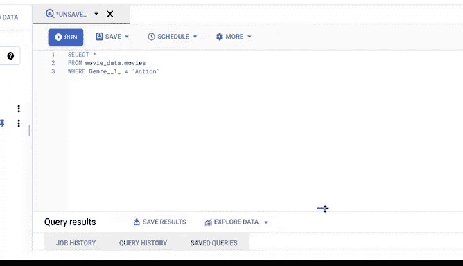

# 谷歌数据分析师1《基础： 数据，数据，无处不在》foundations-data - P22：22_03_01_SQL实战应用.zh_en - GPT中英字幕课程资源 - BV1UN411S7yZ

As you might remember， earlier， we touched on the query language SQL。In this video。

 you'll see SQL in action and learn what you can do with it， with some examples of specific queries。

I guess you can call this the SequL SequQL。We'll try to make this one even better than the original。

Remember， SQL can do lots of the same things with data that spreadsheets can do。

You can use it to store， organize， and analyze your data among other things， but like any good SQL。

 it's on a larger scale， bigger， more action packedact。 Think of it as supers spreadsheets。

For example， you might want to consider a spreadsheet when you have a smaller data set。

 such as one with just 100 rows。But if your data set seems to go on forever。

And your spreadsheet is struggling to keep up。 SQL would be the way to go。When you use SQL。

 you'll need a place where the SQL language is understood。

If you've ever gone somewhere and not known the language， it can be challenging to communicate。

You might think you're asking for one thing and get something completely different。Well。

 SQL knows the filling， SQL needs a database that will understand its language。So let's talk。

There are a number of databases out there that use SQL。

You may use several of them during your time as a data analyst， but here's the thing。

 no matter which database you use， SQL basically works for the same in each。 For example。

 in SQL queries are universal。 We've talked about queries before。

 but it never hurts to have a refresher。A query is a request for data or information from a database。

Here's the structure of a basic query。You can see that with this query。

 we can select specific data from a table by adding where we can filter the data based on certain conditions。

All right， let's get started。 We'll open our database and see how SQL can communicate with it to do some simple data task。

First， let's select our data， we'll use an asterisk to select all of the data from the table。

 and with that simple query， the database calls up the table we need。Magic。

Let's add where to our query to show how that changes what data we get。

You can see the data now only shows movies that are in the action genre。And that's it。

A basic query and sequel。 Prety cool， Hu So， you'll learn about building more complex queries For now。

 though， we can celebrate learning about the structure of a basic sequel query。😊。

Select from and where。As you continue the program， you'll have the opportunity to you SQL yourself。

 so I hope this video was a useful sneak peek at what's coming later。

