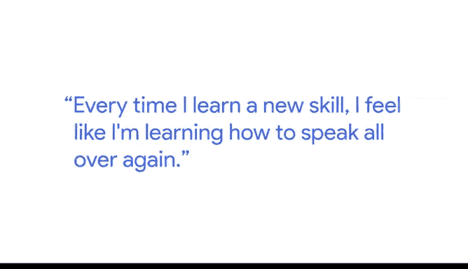

# 谷歌数据分析师1《基础： 数据，数据，无处不在》foundations-data - P23：23_03_03_Angie谈学习新技能的日常挑战.zh_en - GPT中英字幕课程资源 - BV1UN411S7yZ

I'm Angie， I'm a program manager of engineering at Google。

 I'm currently working on the data analyticslytic certificate and previously I was a researcher in People analytics。

 I was also what I call an analytical mercenary working for a lot of different companies to help them make sense of their data。

Every time I learn a new skill， I feel like I'm learning how to speak all over again。

I remember the first time I learned Sequel， I was so frustrated because everyone around me just it felt like they were fluent。

 They knew exactly what they were doing。And I remember struggling with the most basic things。

 just like getting the data out of the table or I remember somebody asked me just to find an average of something。

 and I kept on getting an error and it really does feel like you're learning a new language and you're at toddler level and everyone around you like maybe fluent So my parents immigrated to this country when they were in their 30s。

 So after they had learned another language and they had to start over and learn you know English。

 and I remember as a child watching them struggle every day to pick up a new language to do really basic things like ask for help at the grocery store I remember calling the cable company when I was6 asking them questions about the bill because my parents couldn't。

 and I remember how hard they worked to learn this new language and to become fluent you know and every time I'm learning a new data language like SQL or R I think about how hard that must have been and。

I think if they can do that， I can learn SQL， if they can ask for help for the most basic of things。

 I can ask the data analyst next to me， you know how to write a SQL statement。

 how to get data out of a table， and that's really helped me is just having that mindset and knowing that I can ask for help。

