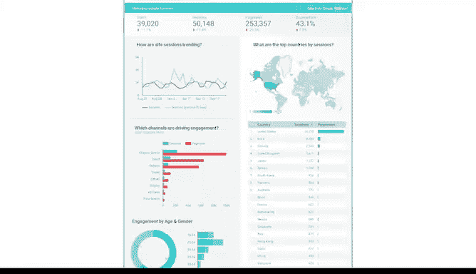
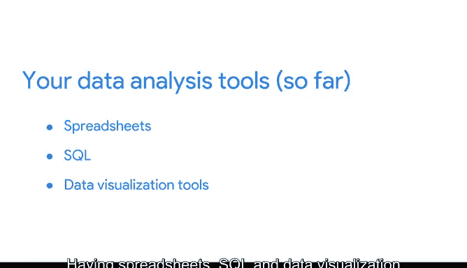

# 谷歌数据分析师1《基础： 数据，数据，无处不在》foundations-data - P24：24_03_05_成为数据可视化专家.zh_en - GPT中英字幕课程资源 - BV1UN411S7yZ

Wow， your data analysis toolbox is getting full。Learning about both spreadsheets and SQL will get you far in the world of data analysis。

There's more to learn， of course， and lots more tools you'll be able to use。

 but your future is looking bright， and it's about to look even brighter。😊。

Because we're here to talk more about data visualization。

I'll tell you a little more about the role of data visualization tools in data analytics and give you a chance to see those tools in action later in this video。

You might remember that data visualization is the graphical representation of information。

For tons of data analysts， it's the most exciting part of their job because they get to see their hard work pay off with something interesting。

😊，Not to mention that data visualization is beautiful and useful。

 I was floored when I got to Google and started to get a quarterly data report in my email。

 It had a big slide deck where people contributed their visualizations。😊。

It was definitely a source of light as I started to build my own visualizations。

If you're not impressed by my story， let me tell you about Florence Nightingale。

Does that name ring a bell？Ses responsible for much of the philosophy of modern nursing。

And believe it or not， she was also a data analyst。During the Crimean War in the 1850s。

 thousands of soldiers were dying every day。Nightingale wanted to find a way to reduce the number of deaths。

 After examining the data， she found that the majority of soldiers were dying from preventable conditions。

To convince hospital administrators that they needed to focus on these conditions。

 she created a chart showing the number of deaths over several months。

 The much larger blue sections individualization represent the preventable deaths。

Her work directly LED to major changes in patient care， and she did all of this over a50 years ago。

 without a computer。One of the main reasons Nightingale created this visualization was to make the data easier to digest for her audience。

She felt she'd be more successful， convincing the stakeholders using visuals instead of just words and numbers。

 She was right。😊，Tables filled with data while necessary for analysis just aren't able to show trends and patterns as quickly and clearly as visualizations can。

Imagine you receive an assignment that needs to be completed the same day。

 you gather the data you need in a table。Could you explain your findings using the table？Yes。

 you probably could。But a better idea would be to use a visualization like this bar graph。

Something like this makes it much easier for you to explain quickly。

 and you've got the benefit of a cool graphic to back up your analysis。As a data analyst。

 you'll want to create visualizations that make the data easy to understand and interesting to look at。

So， show it off。Stakeholders may not have much time to devote to the data。

Your job will be to make their time worthwhile。Let's go back to that data table we created earlier in the course。

If you created your own for practice， you can open it up now or try this out later。

 Here's the data we added before。 Let's create a visualization of the data by inserting a chart。

 a bar graph。😊，Boom， you can see that the spreadsheet visualized the data from our table in a way that made the most sense。

 It created a bar graph or column chart to compare the ages of each person by name。

But you might have figured that out already。That's the beauty of visualization。

 It shows data analysis quickly and clearly。😊，We can use chart editor to adjust the chart。

 Different spreadsheet programs might have different ways to do this。

 but they all have visualization functions and ways to edit those visualizations。 All right， for now。

 let's just look at the suggested charts。We can make the bars go horizontally using a bar chart。

That looks great， so let's close the chart editor。There are lots of options to look at。

 but we'll keep it basic for now。Feel free to try other visualizations if you practice later。

Now we can adjust our chart to make our whole spreadsheet look clean and professional。Excellent。

 I hope you learn to love data visualization as much as I do。

Maybe you'll become a data visualization pioneer just like Florence Nightingale。

As a budding data analyst， you've started to fill your utility built with valuable tools that you'll use throughout the rest of the program。

Having spreadsheets， SQL， and data visualization know how will help make you an ACceE data detective。

You'll be able to use these tools throughout the data analytics process as you move forward。

Coming up next， you'll complete a few activities to wrap up this part of the program。

You'll also complete an assessment to check your understanding of all that you learn。

This is a great opportunity to think about some of the areas that you'll continue to explore in this course and in your career。

😊，As always， feel free to review the videos and readings to help remind you of certain topics and ideas。

 even if you already feel prepared。You're just a few steps away from the next course。

 That's great progress。 Keep it up。