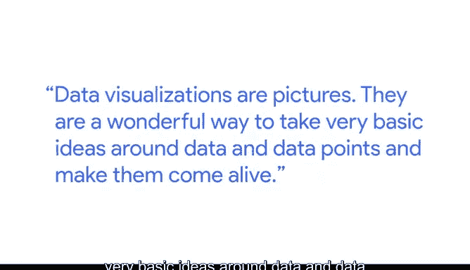

# 谷歌数据分析师1《基础： 数据，数据，无处不在》foundations-data - P25：25_03_07_Lilah谈可视化的力量.zh_en - GPT中英字幕课程资源 - BV1UN411S7yZ

My name is Liah Jones and I am a part of our cloud team I get a chance to lead a team of amazing individuals that are focused on helping customers get to the cloud data visualizations That's a long word and that can also make your eyes glaze over。

 but I wonder if when you were little and you were with your parents。

 maybe they had a bedtime routine or maybe you have children you're doing a bedtime routine with them you very rarely are gonna to come to those children with a bunch of facts and figures before they go to bed but I bet you probably are telling them a story you're showing them pictures I know I always loved comic books。

Pictures tell a story。 Data visualizations are pictures。

 They are a wonderful way to take very basic ideas around data and data points and make them come alive。

😊。

You can do all different types of。Combinations of visualizations， but the ones that are interactive。

 wow， those are huge。 Can you imagine being executive in organization and trying to figure out， wow。

 should we open up another site in Bangkok， Does that make sense and us being able to walk in and saying。

 here's why it make sense in having great data visualizations to support all of our points of view。

 Make it an O braininer。Interestingly enough， I do recall the first time I came across a super amazing visualization。

 It was in my personal life。 I switched my budgeting software from one provider to another。

 And the provider that I switched to was really focused on。😊。

Every dollar has a job and making sure you're budgeting every single dollar。

 They gave visualizations that change depending on what input you would add to it。

 And it really just changed my entire perspective of the entire thing。

 So having the data is like having the answer sheet for a test。

 It really just lets you know that you're going to make good decisions because it's backed up by data。

